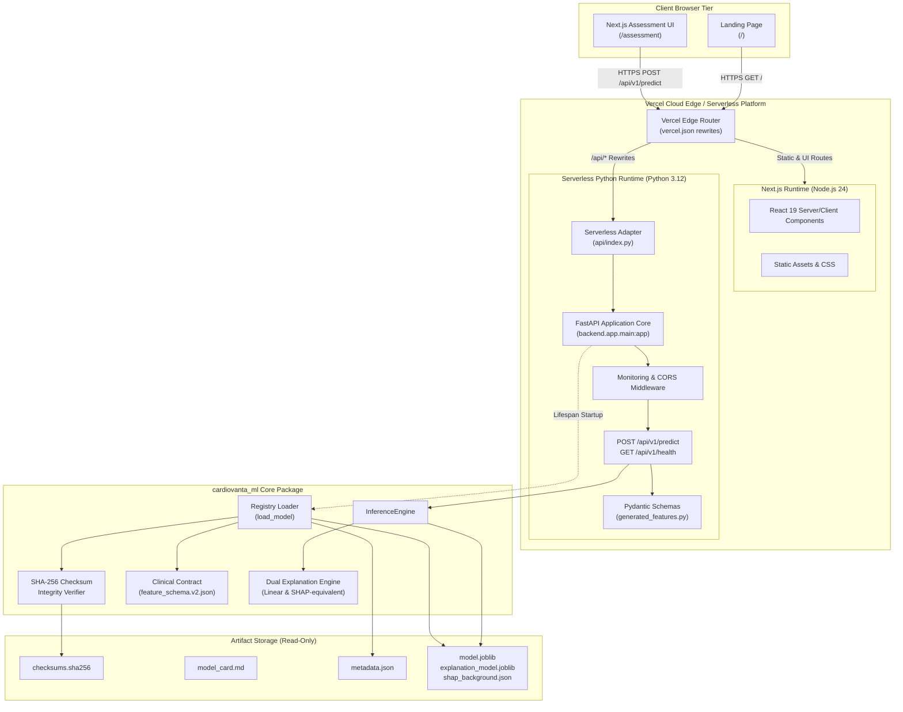
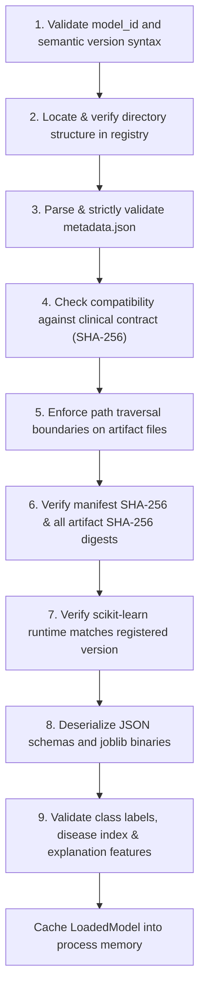
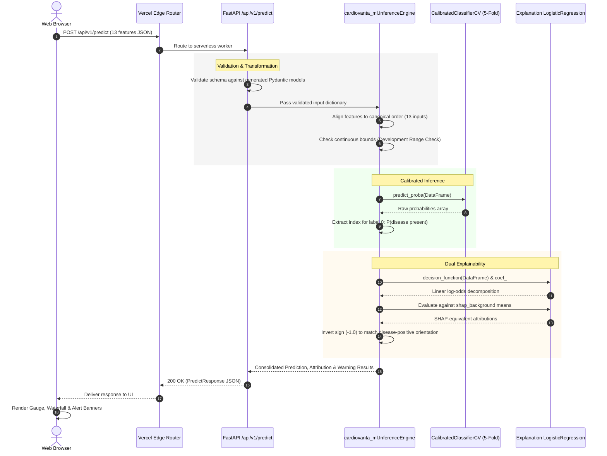
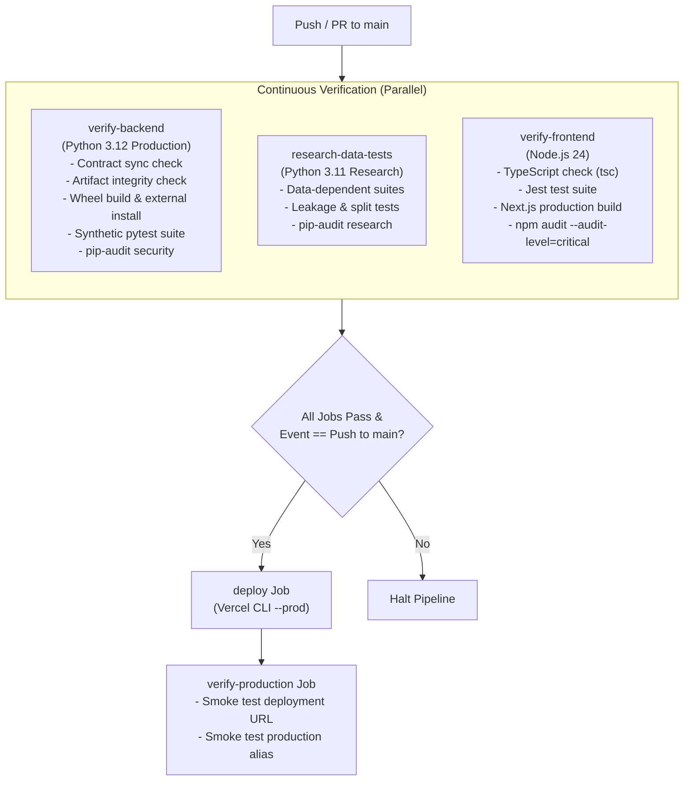
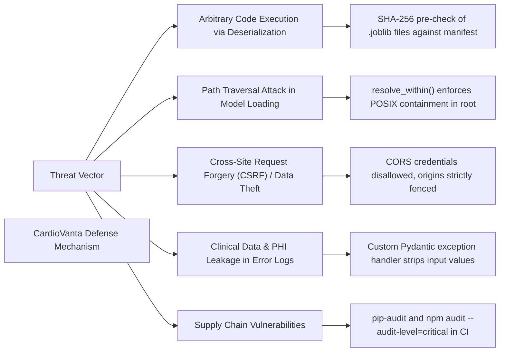

# High-Level Design (HLD) — CardioVanta

**Document Reference:** `HLD.md`\
**System Name:** CardioVanta Research Platform\
**System Architecture:** Serverless Monorepo (Next.js 16 + FastAPI / Python 3.12 Engine)\
**Target Cloud Platform:** Vercel Serverless Platform\
**ML Engine Package:** `cardiovanta_ml` (v0.2.0)\
**Registered Model Identifier:** `cardiovanta-lr13@1.0.0`\

---

## Table of Contents

1. [Architectural Overview & Vision](#1-architectural-overview--vision)
2. [End-to-End System Architecture](#2-end-to-end-system-architecture)
3. [Technology Stack Matrix](#3-technology-stack-matrix)
4. [Major Subsystems & Core Responsibilities](#4-major-subsystems--core-responsibilities)
5. [Frontend Architecture](#5-frontend-architecture)
6. [Backend Architecture & API Integration](#6-backend-architecture--api-integration)
7. [ML Serving & Model Registry Architecture](#7-ml-serving--model-registry-architecture)
8. [High-Level Data Flow](#8-high-level-data-flow)
9. [Deployment & Infrastructure Architecture](#9-deployment--infrastructure-architecture)
10. [Environment Configuration & Variables](#10-environment-configuration--variables)
11. [Security Architecture & Threat Mitigation](#11-security-architecture--threat-mitigation)
12. [System-Level Architectural Decision Records (ADRs)](#12-system-level-architectural-decision-records-adrs)

---

## 1. Architectural Overview & Vision

CardioVanta is architected as a high-performance, contract-governed, serverless monorepo that couples a modern React/Next.js assessment interface with a Python-based machine learning serving backend. The primary design goal is absolute reproducibility, fail-closed security, and full explainability for cardiovascular disease risk estimation.

The platform embraces a strict separation of concerns across three distinct layers:
1. **Client Presentation Layer:** Next.js 16 (App Router) delivering static asset optimization, accessible form controls, client-side input validation, and interactive risk visualization.
2. **Serverless API Adapter & Routing Layer:** Vercel Python runtime entry point (`api/index.py`) acting as an ASGI adapter to a FastAPI application with structured routing, logging, and middleware.
3. **Core Machine Learning Engine (`cardiovanta_ml`):** An independent, pure-Python research package containing canonical clinical contracts, cryptographic artifact loaders, calibration pipelines, and linear/SHAP-equivalent attribution modules.

---

## 2. End-to-End System Architecture

The following diagram illustrates the topological structure of CardioVanta, demonstrating component relationships from client browsers to the versioned model registry.



---

## 3. Technology Stack Matrix

| Architectural Layer | Technology / Library | Version | Rationale & Responsibility |
|:---|:---|:---:|:---|
| **Frontend Framework** | Next.js (App Router) | 16.3.8 | Modern React server components, asset optimization, responsive rendering, and zero-config Vercel hosting. |
| **UI Library** | React | 19.2.8 | Declarative component architecture powering interactive assessment forms and dynamic SVGs. |
| **Language (Frontend)** | TypeScript | 5.x | Compile-time type safety enforcing clinical contract consistency across user inputs. |
| **Animation / Layout** | Framer Motion | 13.4.5 | Smooth visual transitions for risk waterfalls and telemetry feedback. |
| **Serverless Gateway** | Vercel Serverless | Edge | Serverless function provisioning, path rewriting, and CDN caching. |
| **Backend Framework** | FastAPI | 0.141.1 | High-performance asynchronous REST API with automatic OpenAPI generation and native Pydantic support. |
| **Schema Validation** | Pydantic / Pydantic Settings | 2.10.4 | Strict data contract validation, fail-closed type parsing, and environment variable configuration. |
| **Production Runtime** | Python | 3.12 | Standardized execution runtime for production serverless functions (configured via `.python-version`). |
| **Core ML Package** | `cardiovanta_ml` | 0.2.0 | Pure Python ML engine isolated from web framework dependencies. |
| **Machine Learning** | scikit-learn | 1.9.1 | Production estimator pipelines (`Pipeline`, `ColumnTransformer`, `LogisticRegression`, `CalibratedClassifierCV`). |
| **Scientific Computing** | NumPy / pandas / SciPy | 2.4.6 / 3.0.6 / 1.17.1 | Matrix operations, vectorized attribution calculation, and data frame manipulation. |
| **Artifact Serialization**| joblib | 1.6.0 | Serialized estimator persistence and loading. |
| **CI / CD Pipeline** | GitHub Actions | Ubuntu Latest | Parallelized backend, frontend, security audits, artifact verification, and automated Vercel deployment. |

---

## 4. Major Subsystems & Core Responsibilities

### 4.1 Client Presentation Subsystem (`src/`)
* Renders the interactive cardiovascular assessment interface (`/assessment`) and informational landing page (`/`).
* Provides accessible form inputs with domain constraints matching canonical medical ranges.
* Enforces client-side validation preventing incomplete submissions from hitting the backend API.
* Visualizes calibrated risk percentages, threshold disclaimer notices, and directional feature contribution bars.

### 4.2 API Routing & Translation Subsystem (`backend/`, `api/`)
* **Lifespan Management:** Initializes application state during serverless cold starts; loads, validates, and caches the model package once per worker process.
* **Request Sanitization:** Intercepts invalid input payloads via `RequestValidationError` handlers, stripping clinical field values before emitting log entries.
* **Monitoring & Telemetry:** Injects unique request IDs (`X-Request-ID`) and records execution latency via `MonitoringMiddleware`.

### 4.3 Core ML Inference & Registry Subsystem (`cardiovanta_ml/`)
* **Contract Single Source of Truth:** Centralizes clinical definitions within `cardiovanta_ml/contracts/feature_schema.v2.json`.
* **Cryptographic Verification:** Verifies artifact digests against `checksums.sha256` before invoking joblib deserialization.
* **Deterministic Inference:** Executes calibrated probability estimation using the 5-member sigmoid ensemble.
* **Dual-Model Attribution:** Evaluates uncalibrated linear log-odds decompositions and SHAP-equivalent contributions against the frozen Cleveland background.

---

## 5. Frontend Architecture

### 5.1 Next.js App Router Structure
The frontend is constructed using Next.js 16 App Router principles:
* `src/app/layout.tsx`: Root HTML layout injecting security headers, global styling (`globals.css`), and accessibility metadata.
* `src/app/page.tsx`: Landing view detailing model methodology, dataset provenance, and platform limitations.
* `src/app/assessment/page.tsx`: Core assessment flow managing patient parameter state and asynchronous API communication.
* `src/app/assessment/CoronaryArteryVisual.tsx`: Anatomical SVG visualization illustrating coronary vessels.

### 5.2 Client-Side API Communication (`src/lib/api.ts`)
The client uses a strongly typed API abstraction that interfaces with Next.js environment configurations:

```typescript
// Resolution logic for API base URL
const getApiBaseUrl = () => {
  const envUrl = process.env.NEXT_PUBLIC_API_BASE_URL;
  if (envUrl && envUrl.trim() !== "") {
    return envUrl.trim();
  }
  if (process.env.NODE_ENV === "development") {
    return "http://127.0.0.1:8000";
  }
  return ""; // Uses relative /api routes on Vercel deployment
};
```

When deployed on Vercel, `NEXT_PUBLIC_API_BASE_URL` is typically empty, allowing browser requests to target `/api/v1/predict` directly on the same origin, eliminating cross-origin preflight latency.

---

## 6. Backend Architecture & API Integration

### 6.1 FastAPI Lifespan & Application State
FastAPI's asynchronous lifespan context manager guarantees that the ML model is verified and cached into memory before any HTTP traffic is served:

```python
@asynccontextmanager
async def lifespan(app: FastAPI):
    # Single load path: verifies checksums BEFORE deserialization
    model_package = load_model(
        settings.MODEL_ID,
        settings.MODEL_VERSION,
        registry_root=settings.MODEL_REGISTRY_ROOT,
    )
    app.state.inference_engine = InferenceEngine(model_package)
    yield
    app.state.inference_engine = None
```

### 6.2 Endpoint Routing Architecture
* `POST /api/v1/predict`: Primary inference gateway. Ingests 13 clinical features, invokes `InferenceEngine.predict()`, `explain()`, and `explain_shap_equivalent()`, and returns a structured `PredictResponse`.
* `GET /api/v1/health`: Liveness probe for monitoring platforms, returning service status without leaking internal metadata.

### 6.3 Serverless Request Rewriting (`vercel.json`)
Routing across languages within the Vercel infrastructure is governed by declarative rewrites:

```json
{
  "rewrites": [
    {
      "source": "/api/(.*)",
      "destination": "/api/index.py"
    }
  ],
  "functions": {
    "api/**/*.py": {
      "includeFiles": "{artifacts/**,src/**,backend/**,configs/**,cardiovanta_ml/**}"
    }
  }
}
```
This configuration directs all `/api/*` traffic directly to the Python serverless entry point (`api/index.py`) and bundles the requisite model artifacts and packages into the function container.

---

## 7. ML Serving & Model Registry Architecture

### 7.1 Separation of ML Package from Application Layer
A fundamental architectural improvement in CardioVanta is the complete isolation of `cardiovanta_ml` from web-serving frameworks. The package has zero dependencies on FastAPI, Uvicorn, or web protocols, enabling it to be packaged as a standalone Python wheel and verified independently.

### 7.2 Explicit Versioned Model Registry
Model loading follows an immutable, versioned directory hierarchy:

```text
artifacts/
├── model/                               # Default active model bundle
│   ├── model.joblib                     # Calibrated ensemble estimator
│   ├── explanation_model.joblib         # Uncalibrated Logistic Regression
│   ├── feature_schema.json              # Model input schema
│   ├── metadata.json                    # Package metadata & provenance
│   ├── reference_predictions.csv        # Baseline numerical validation
│   └── shap_background.json             # Frozen development baseline means
└── models/                              # Versioned registry root
    └── cardiovanta-lr13/
        └── 1.0.0/
            ├── checksums.sha256         # Authoritative file checksums
            ├── metadata.json            # Registry manifest & outcome mapping
            └── model_card.md            # Model provenance documentation
```

### 7.3 Multi-Stage Verification Pipeline (Fail-Closed)
Prior to deserializing any binary machine learning object, `load_model()` enforces a strict 9-step verification sequence:



---

## 8. High-Level Data Flow

The following data flow describes the lifecycle of an inference request through the system:



---

## 9. Deployment & Infrastructure Architecture

### 9.1 CI/CD Workflow (`.github/workflows/verify.yml`)
CardioVanta uses GitHub Actions for continuous integration, auditing, and continuous delivery to Vercel:



### 9.2 Immutable Artifact Principle
The deployment pipeline strictly enforces the **Immutable Artifact Principle**:
* Model artifacts (`artifacts/model/*`) are generated offline during controlled research phases and committed under Git LFS / repository tracking.
* The CI/CD pipeline **never** retrains, refits, or updates models dynamically during verification or deployment.
* Any unauthorized modification of a model artifact causes immediate failure in `scripts/verify_artifact_integrity.py`.

### 9.3 Post-Deployment Smoke Verification & Failure Handling (`audit_tests.py`)
Following successful deployment to Vercel, the `verify-production` job executes automated HTTP smoke tests (`audit_tests.py`) against two distinct targets:
1. **Immutable Deployment URL:** Tests the exact SHA-tagged deployment URL provisioned by Vercel to verify application code and artifact binding.
2. **Production Alias URL:** Tests `https://cardio-vanta-prod.vercel.app` to confirm edge DNS routing and cache invalidation.

**Failure Handling Policy:**
* The deployment pipeline does not execute automatic rollbacks.
* If a deployment fails during the `deploy` job, the existing live production environment is untouched.
* If the deployment succeeds but the subsequent `verify-production` smoke test fails on the unique deployment URL, manual operator rollback via `vercel rollback` is required.
* If the unique deployment URL passes but the alias test fails or remains stale, manual intervention in the Vercel dashboard is required to inspect routing domains.

**Security Audit Policy:**
* In `verify-frontend`, `npm audit --audit-level=critical` is explicitly configured as the project's security policy. This gracefully accommodates unfixable high-severity transitive dependencies (e.g., `braces`) without breaking CI, whilst strictly blocking critical vulnerabilities. Backend dependencies are audited via `pip-audit`.

---

## 10. Environment Configuration & Variables

| Variable Name | Required Scope | Default / Production Value | Purpose & Architectural Role |
|:---|:---:|:---|:---|
| `ENVIRONMENT` | Backend Runtime | `production` | Governs application operational mode; disables interactive `/docs` in production. |
| `CORS_ORIGINS` | Backend Runtime | `https://cardio-vanta-prod.vercel.app` | Comma-delimited list of origins permitted to issue browser cross-origin requests. |
| `NEXT_PUBLIC_API_BASE_URL` | Frontend Build | `""` (Empty in production) | Base URL for API requests. Defaults to relative origin on Vercel; points to `http://127.0.0.1:8000` in local dev. |
| `MODEL_ID` | Backend Runtime | `cardiovanta-lr13` | Identifies the registered model to load. Mandatory; no fallback. |
| `MODEL_VERSION` | Backend Runtime | `1.0.0` | Identifies the exact model version to load. Mandatory; no fallback. |
| `MODEL_REGISTRY_ROOT` | Backend (Optional) | `artifacts` | Directory path containing model registry entries. Defaults to `<repo_root>/artifacts`. |
| `VERCEL_TOKEN` | GitHub Environment | `[Secret]` | Production token for deploying serverless functions via Vercel CLI. |
| `VERCEL_ORG_ID` | GitHub Variables | `[Configured Variable]` | Vercel Organization identifier for production account. |
| `VERCEL_PROJECT_ID` | GitHub Variables | `[Configured Variable]` | Vercel Project identifier for CardioVanta repository. |

---

## 11. Security Architecture & Threat Mitigation

### 11.1 Security Architecture Matrix



### 11.2 Detailed Security Measures
1. **Deserialization Defense:** In standard Python systems, `joblib.load()` represents a critical vulnerability if malicious pickle bytes are injected. CardioVanta mitigates this by calculating streaming SHA-256 digests and matching them against the registered manifest *before* opening the file with joblib.
2. **Directory Traversal Mitigation:** `cardiovanta_ml.registry.integrity.resolve_within()` rejects paths containing drive letters, backslashes, absolute roots, or `..` path segments, preventing directory escape attacks.
3. **HTTP Header Hardening:** `next.config.ts` injects robust security headers (`X-Content-Type-Options: nosniff`, `X-Frame-Options: DENY`, `Referrer-Policy: strict-origin-when-cross-origin`, `X-XSS-Protection: 1; mode=block`).
4. **Input Sanitization in Logs & Privacy Boundaries:** Application logs record request identifiers, endpoint paths, HTTP status codes, latency, prediction probabilities, and feature range warning flags. Pydantic validation exception handlers explicitly strip raw clinical input fields to prevent leaking submitted data during client error scenarios, and internal server exceptions log only exception class names. However, because telemetry, serverless logs, and network transports have not undergone formal, independent healthcare privacy audits (e.g., HIPAA, GDPR, HITECH), the application does not claim certified zero-retention or regulatory privacy compliance; users are strictly instructed not to submit real patient health information (PHI).

---

## 12. System-Level Architectural Decision Records (ADRs)

### ADR-01: Single Source of Truth for Clinical Contracts
* **Context:** Pre-R1 implementations maintained duplicate feature schemas in `feature_schema.json`, Pydantic models in `backend/app/schemas/predict.py`, and TypeScript interfaces in `src/types/index.ts`. Updates risked silent schema drift.
* **Decision:** Adopt `cardiovanta_ml/contracts/feature_schema.v2.json` as the immutable single source of truth. Implement a code generator (`contracts/codegen/generate.py`) that emits Python Pydantic schemas and TypeScript interfaces. CI enforces zero-diff alignment with `--check`.
* **Consequences:** Eliminates schema divergence between frontend and backend.

### ADR-02: Isolated ML Core Package (`cardiovanta_ml`)
* **Context:** Pre-R2 inference code directly imported FastAPI structures and was tightly coupled to web application directories, making standalone benchmarking and offline testing difficult.
* **Decision:** Extract all ML logic into `cardiovanta_ml`, a pure Python package with zero web dependencies. Web servers interact with the model purely through the `InferenceEngine` interface.
* **Consequences:** Allows offline research, wheel packaging, independent test suite execution, and clean architectural boundaries.

### ADR-03: Explicit Versioned Registry with Checksum Verification
* **Context:** Loading models from implicit paths (e.g., `artifacts/model/model.joblib`) created ambiguity regarding which version was served and left the system vulnerable to unverified file modifications.
* **Decision:** Implement `cardiovanta_ml.registry.loader.load_model()` requiring explicit `model_id` and `model_version`. Load models only after checking manifest SHA-256 digests and runtime `scikit-learn` versions.
* **Consequences:** Fail-closed security; full auditability of deployed estimators.

### ADR-04: Interim Legacy Target Mapping for Model 1.0.0
* **Context:** Phase 17 scientific audit revealed that `heart.csv` (Kaggle distribution) had inverted target values relative to canonical UCI documentation ($1 = \text{healthy}, 0 = \text{disease}$). Because model `1.0.0` was trained on raw `heart.csv`, model label 0 corresponds to disease presence.
* **Decision:** Implement an explicit, verified `outcome_semantics` mapping in the registry. Model `1.0.0` is registered with `disease_present_label = 0` and `mapping_status = "interim_legacy"`. Inference dynamically queries `model.classes_` and the declared disease label to compute $P(\text{disease present})$.
* **Consequences:** Restores absolute clinical accuracy without requiring retraining or invalidating frozen research artifacts.
