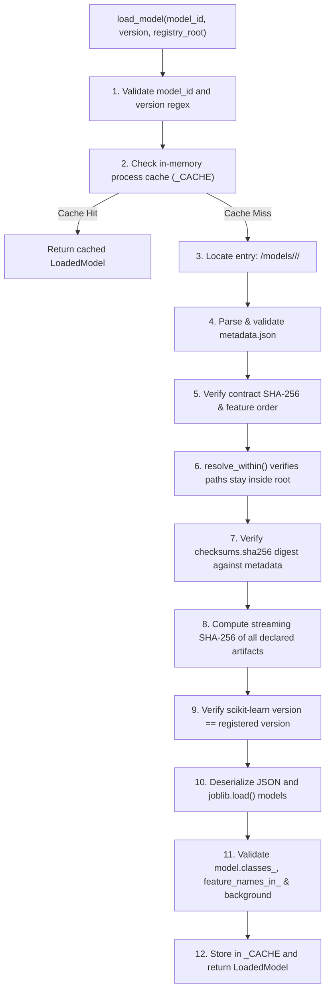
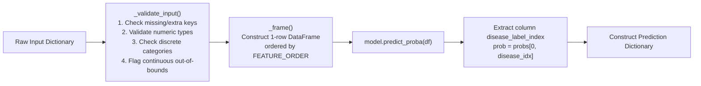
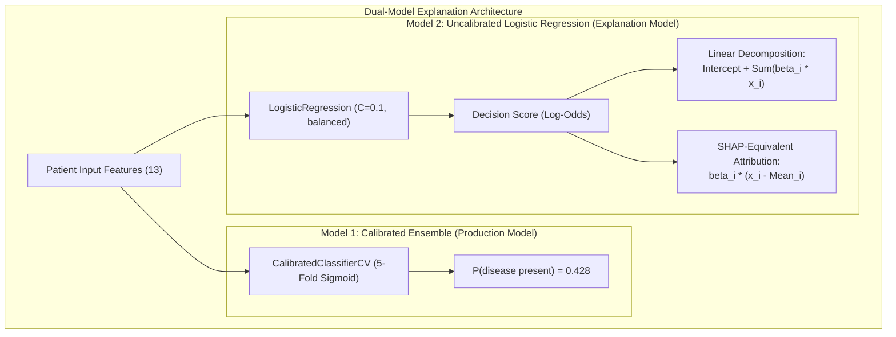
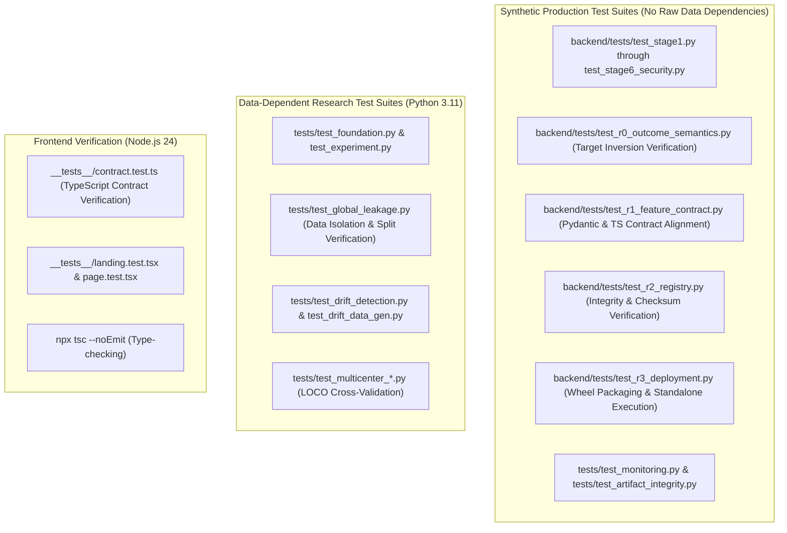

# Low-Level Design (LLD) — CardioVanta

**Document Reference:** `LLD.md`\
**System Name:** CardioVanta Research Platform\
**Target Release:** Production Release 1.0.0 (R0.3–R3 Architecture Alignment)\
**Core ML Package:** `cardiovanta_ml` (v0.2.0)\
**Registered Model Identifier:** `cardiovanta-lr13@1.0.0`\
**Canonical Contract:** `cardiovanta_ml/contracts/feature_schema.v2.json` (Contract v2.0.0)\

---

## Table of Contents

1. [Introduction & Scope](#1-introduction--scope)
2. [REST API Detailed Specification](#2-rest-api-detailed-specification)
3. [Data Contracts & Schemas](#3-data-contracts--schemas)
4. [Production Feature Contract & Input Validation](#4-production-feature-contract--input-validation)
5. [Clinical Outcome Semantics & Target Inversion Handling](#5-clinical-outcome-semantics--target-inversion-handling)
6. [`cardiovanta_ml` Package Architecture](#6-cardiovanta_ml-package-architecture)
7. [Model Registry & Cryptographic Verification Engine](#7-model-registry--cryptographic-verification-engine)
8. [Prediction Pipeline & Probability Calculation](#8-prediction-pipeline--probability-calculation)
9. [Calibration Methodology & Empirical Evaluation](#9-calibration-methodology--empirical-evaluation)
10. [Explainability Implementation & Dual-Model Architecture](#10-explainability-implementation--dual-model-architecture)
11. [Error Handling, Edge Cases & Input Sanitization](#11-error-handling-edge-cases--input-sanitization)
12. [Testing Architecture & Verification Strategy](#12-testing-architecture--verification-strategy)

---

## 1. Introduction & Scope

This Low-Level Design (LLD) document specifies the concrete implementation details, internal class architectures, mathematical operations, data schemas, and execution pipelines of the CardioVanta platform.

It covers the technical implementation across:
* The FastAPI backend HTTP interface (`backend/app`).
* The single-source-of-truth contract subsystem (`cardiovanta_ml/contracts`).
* The cryptographic model registry (`cardiovanta_ml/registry`).
* The deterministic inference and dual explainability engine (`cardiovanta_ml/inference`).
* The testing, validation, and continuous verification infrastructure.

---

## 2. REST API Detailed Specification

The backend exposes a stateless RESTful interface implemented in FastAPI.

### 2.1 Primary Inference Endpoint: `POST /api/v1/predict`

* **Path:** `/api/v1/predict`
* **Method:** `POST`
* **Content-Type:** `application/json`
* **Query Parameters:**
  * `threshold` (Optional, `float`): Mathematical cutoff threshold for binary classification. Must satisfy $0.0 \le \text{threshold} \le 1.0$. If omitted, the response defaults to continuous probability estimation without applying a binary cutoff.
* **Success Status Code:** `200 OK`
* **Response Contract:** Returns a JSON object structured into exactly five top-level objects:
  1. `prediction`: Calibrated probability, outcome semantics, and threshold evaluation.
  2. `development_range_warning`: Guardrail flags for continuous features outside development bounds.
  3. `explanation`: Linear log-odds decomposition of the uncalibrated Logistic Regression model.
  4. `shap_equivalent_explanation`: Closed-form linear SHAP attributions against the frozen development background.
  5. `metadata`: Model version, model family, calibration technique, and outcome mapping provenance.
  *(Note: Early project documentation in `docs/api.md` summarized the response into four objects prior to Phase 13 SHAP integration; the production schema in `backend/app/schemas/predict.py` authoritatively implements all five objects).*
* **Error Status Codes:**
  * `422 Unprocessable Entity`: Request body violates schema, missing required features, contains unexpected fields, or contains invalid categorical codes.
  * `500 Internal Server Error`: Unhandled server-side execution exception (stack traces stripped).
  * `503 Service Unavailable`: Model package failed to load or runtime is uninitialized.

#### Request Headers
```http
POST /api/v1/predict HTTP/1.1
Host: cardio-vanta-prod.vercel.app
Content-Type: application/json
Accept: application/json
```

#### Example Request Body
```json
{
  "age": 55.0,
  "sex": 1,
  "cp": 0,
  "trestbps": 140.0,
  "chol": 240.0,
  "fbs": 0,
  "restecg": 0,
  "thalach": 150.0,
  "exang": 0,
  "oldpeak": 1.5,
  "slope": 1,
  "ca": 0,
  "thal": 2
}
```

#### Example Response Body (`200 OK`)
```json
{
  "prediction": {
    "probability": 0.428512,
    "outcome": "significant_obstructive_cad_present",
    "probability_definition": "Calibrated model-estimated probability that significant obstructive coronary artery disease is present (angiographic >50% diameter narrowing; UCI 'num' > 0). Research estimate only; not a diagnosis and not clinically validated.",
    "threshold_applied": null,
    "class": null,
    "threshold_status": "no_validated_production_threshold_configured"
  },
  "development_range_warning": {
    "outside_development_range": false,
    "features": [],
    "note": null
  },
  "explanation": {
    "intercept": 0.28145,
    "contributions": {
      "age": 0.0152,
      "sex": 0.2104,
      "cp": -0.3412,
      "trestbps": 0.0411,
      "chol": 0.0189,
      "fbs": -0.0051,
      "restecg": -0.0120,
      "thalach": -0.1840,
      "exang": -0.0520,
      "oldpeak": 0.1645,
      "slope": 0.0890,
      "ca": -0.1250,
      "thal": 0.1980
    },
    "decision_function_log_odds": 0.49915,
    "note": "These feature contributions explain the underlying uncalibrated Logistic Regression explanation model's log-odds of significant obstructive CAD being present (positive = toward disease presence)..."
  },
  "shap_equivalent_explanation": {
    "expected_value": -0.1542,
    "contributions": {
      "age": 0.0120,
      "sex": 0.1850,
      "cp": -0.3120,
      "trestbps": 0.0380,
      "chol": 0.0150,
      "fbs": -0.0040,
      "restecg": -0.0100,
      "thalach": -0.1650,
      "exang": -0.0480,
      "oldpeak": 0.1520,
      "slope": 0.0810,
      "ca": -0.1150,
      "thal": 0.1820
    },
    "decision_function_log_odds": 0.49915,
    "note": "SHAP-equivalent linear attribution of the uncalibrated explanation model's log-odds of significant obstructive CAD being present, relative to the frozen development background..."
  },
  "metadata": {
    "package_version": "1.0.0",
    "model_type": "Logistic Regression",
    "calibration_method": "sigmoid",
    "outcome_mapping": "interim_legacy_inverted_target_mapping"
  }
}
```

### 2.2 Health Check Endpoint: `GET /api/v1/health`

* **Path:** `/api/v1/health`
* **Method:** `GET`
* **Response Status:** `200 OK` (when model package is active), `503 Service Unavailable` (if uninitialized).
* **Payload:**
```json
{
  "status": "ok",
  "service": "CardioVanta"
}
```

---

## 3. Data Contracts & Schemas

### 3.1 Pydantic Request Models (`backend/app/schemas/predict.py`)

All input models derive from code-generated bases created by `contracts/codegen/generate.py`:

```python
class PredictRequest(ClinicalFeaturesBase):
    """
    Enforces exact fields in order and forbids extra fields.
    Inherits age, sex, cp, trestbps, chol, fbs, restecg, thalach,
    exang, oldpeak, slope, ca, thal from ClinicalFeaturesBase.
    """
    model_config = ConfigDict(
        extra='forbid',
        json_schema_serialization_defaults_required=True
    )
```

### 3.2 Response Sub-Schemas

```python
class PredictionResult(BaseModel):
    probability: float
    outcome: OutcomeId
    probability_definition: str
    threshold_applied: Optional[float]
    class_: Optional[int] = Field(default=None, alias='class')
    threshold_status: str
    model_config = ConfigDict(populate_by_name=True)

class DevelopmentRangeWarning(BaseModel):
    outside_development_range: bool
    features: List[str]
    note: Optional[str]

class ExplanationResult(BaseModel):
    intercept: float
    contributions: FeatureContributions
    decision_function_log_odds: float
    note: str

class ShapEquivalentExplanationResult(BaseModel):
    expected_value: float
    contributions: FeatureContributions
    decision_function_log_odds: float
    note: str

class MetadataResult(BaseModel):
    package_version: str
    model_type: str
    calibration_method: str
    outcome_mapping: str

class PredictResponse(BaseModel):
    prediction: PredictionResult
    development_range_warning: DevelopmentRangeWarning
    explanation: ExplanationResult
    shap_equivalent_explanation: ShapEquivalentExplanationResult
    metadata: MetadataResult
```

---

## 4. Production Feature Contract & Input Validation

The canonical contract (`cardiovanta_ml/contracts/feature_schema.v2.json`) defines exactly 13 production features.

### 4.1 Feature Specifications Table

| Index | Feature ID | Data Type | Permissible Domain / Allowed Values | Training Dev Range [Min, Max] | Unit | Canonical UCI Attribute & Clinical Meaning | Verification Status |
|:---:|:---|:---:|:---|:---:|:---:|:---|:---:|
| 1 | `age` | Continuous | Finite Float | $[29.0, 77.0]$ | years | Age in years | Verified Codebook |
| 2 | `sex` | Binary | `{0, 1}` | — | — | 0 = Female, 1 = Male | Verified Codebook |
| 3 | `cp` | Categorical | `{0, 1, 2, 3}` | — | — | Chest Pain Type (Kaggle encoding: 0=Asymptomatic, 1=Atypical Angina, 2=Non-anginal, 3=Typical Angina) | Verified (1-to-1 Patient Matched) |
| 4 | `trestbps`| Continuous | Finite Float | $[94.0, 200.0]$ | mm Hg | Resting blood pressure on admission | Verified Codebook |
| 5 | `chol` | Continuous | Finite Float | $[126.0, 564.0]$ | mg/dl | Serum cholesterol | Verified Codebook |
| 6 | `fbs` | Binary | `{0, 1}` | — | — | Fasting blood sugar > 120 mg/dl (0 = False, 1 = True) | Verified Codebook |
| 7 | `restecg` | Categorical | `{0, 1, 2}` | — | — | Resting ECG (0 = Normal, 1 = ST-T Abnormality, 2 = LVH) | Verified Codebook |
| 8 | `thalach` | Continuous | Finite Float | $[71.0, 202.0]$ | bpm | Maximum heart rate achieved during exercise | Verified Codebook |
| 9 | `exang` | Binary | `{0, 1}` | — | — | Exercise-induced angina (0 = No, 1 = Yes) | Verified Codebook |
| 10| `oldpeak` | Continuous | Finite Float | $[0.0, 6.2]$ | mm | ST depression induced by exercise relative to rest | Verified Codebook (Unit UI Convention) |
| 11| `slope` | Categorical | `{0, 1, 2}` | — | — | Peak exercise ST slope (Training encoding: 0=Upsloping, 1=Flat, 2=Downsloping) | Unverified Mapping to UCI Codes 1-3 |
| 12| `ca` | Categorical | `{0, 1, 2, 3, 4}` | — | — | Major vessels (0-3) colored by fluoroscopy (Code 4 undefined in UCI codebook) | Codebook (0-3); Code 4 Undefined |
| 13| `thal` | Categorical | `{0, 1, 2, 3}` | — | — | Thallium scintigraphy (1=Normal, 2=Fixed, 3=Reversible; Code 0 undefined in UCI) | Unverified Mapping; Code 0 Undefined |

### 4.2 Canonical Sequence & Array Representation
Features must be fed to the model in the exact order:
```python
FEATURE_ORDER = [
    "age", "sex", "cp", "trestbps", "chol", "fbs",
    "restecg", "thalach", "exang", "oldpeak", "slope", "ca", "thal"
]
```

### 4.3 Patient Matching Verification Findings
A key discovery of the Phase 17 scientific audit resolved the chest pain (`cp`) encoding divergence between Kaggle distributions and the UCI repository:
* **Canonical UCI Attribute 9 (`cp`):** 1 = Typical Angina, 2 = Atypical Angina, 3 = Non-anginal Pain, 4 = Asymptomatic.
* **Kaggle `heart.csv` Encoding:** 0 = Asymptomatic, 1 = Atypical Angina, 2 = Non-anginal Pain, 3 = Typical Angina.
* **Validation:** Verified via 1-to-1 patient cross-matching on continuous attributes (`age`, `trestbps`, `chol`, `thalach`).

---

## 5. Clinical Outcome Semantics & Target Inversion Handling

### 5.1 Outcome Definition
* **Contract Outcome ID:** `significant_obstructive_cad_present`
* **Clinical Semantics:** Angiographic coronary artery disease with $>50\%$ diameter stenosis in at least one major coronary artery (corresponding to UCI raw attribute 58 `num > 0`).
* **Positive Class ($y = 1$):** Disease present.
* **Negative Class ($y = 0$):** Disease absent ($<50\%$ stenosis, UCI `num == 0`).

### 5.2 Historical Target Inversion in Model `1.0.0`
The frozen production package `cardiovanta-lr13@1.0.0` was trained on the raw `target` column of `data/raw/heart.csv`. As verified during the Phase 17 multicenter validation study, this column was inverted:
$$\text{target} = 1 \implies \text{UCI } num = 0 \quad (\text{Healthy})$$
$$\text{target} = 0 \implies \text{UCI } num > 0 \quad (\text{Disease Present})$$

### 5.3 Mathematical Resolution in Serving Engine
Rather than altering immutable model binary weights, the serving layer resolves the disease orientation dynamically:
1. The registry metadata declares `disease_present_label: 0` for `cardiovanta-lr13@1.0.0`.
2. The index of label `0` is resolved from `model.classes_`:
   ```python
   def disease_label_index(classes: Sequence, disease_label: int) -> int:
       labels = [int(c) for c in classes]
       return labels.index(disease_label)
   ```
3. For a binary sigmoid-calibrated classifier, the probability of disease is extracted directly from the column for label 0:
   $$P(\text{disease present}) = \text{predict\_proba}[:, \text{index}(0)] = 1.0 - P(\text{label 1})$$
4. Decision function log-odds sign multiplier:
   $$\text{sign} = \text{disease\_log\_odds\_sign}(\text{classes\_}, 0) = -1.0$$
   Multiplying decision function and additive contributions by $-1.0$ converts the score to the disease-positive orientation without breaking additivity:
   $$\text{Score}_{\text{disease}} = (-1.0) \cdot \text{Intercept} + \sum_{i=1}^{13} (-1.0) \cdot \text{Contribution}_i$$

---

## 6. `cardiovanta_ml` Package Architecture

The `cardiovanta_ml` package is structured into decoupled modules with lazy loading:

```text
cardiovanta_ml/
├── contracts/
│   ├── canonical.py               # Contract verification & SHA-256 calculation
│   ├── feature_schema.v2.json     # Authoritative clinical contract
│   ├── generated_features.py      # Generated Pydantic/dataclass definitions
│   └── __init__.py
├── inference/
│   ├── explain.py                 # Linear & SHAP-equivalent attribution
│   ├── outcome.py                 # Outcome semantics & label index mapping
│   ├── predict.py                 # InferenceEngine class implementation
│   └── __init__.py
├── registry/
│   ├── exceptions.py              # Fail-closed registry exception hierarchy
│   ├── integrity.py               # Path traversal protection & SHA-256 verification
│   ├── legacy.py                  # Fallback validator for unversioned bundles
│   ├── loader.py                  # load_model() loading algorithm
│   ├── metadata.py                # Registry metadata schema & parser
│   └── __init__.py
├── config.py                      # Registry root resolution & constants
├── pyproject.toml                 # Package build definition (v0.2.0)
└── __init__.py                    # Lazy attribute exposure
```

### 6.1 `LoadedModel` Container
```python
@dataclass(frozen=True)
class LoadedModel:
    metadata: RegistryMetadata
    model: Any                      # Deserialized CalibratedClassifierCV
    explanation_model: Any          # Deserialized LogisticRegression
    input_schema: Dict[str, Any]    # feature_schema.json
    package_metadata: Dict[str, Any]# metadata.json
    shap_background: Dict[str, Any] # shap_background.json
    entry_dir: Path
    artifact_dir: Path
```

---

## 7. Model Registry & Cryptographic Verification Engine

### 7.1 Loading Algorithm & Flowchart



### 7.2 Directory Traversal Defense (`integrity.py`)
```python
def resolve_within(base: Path, relative: object) -> Path:
    if not isinstance(relative, str) or not relative:
        raise ArtifactPathError("Path must be a non-empty relative string")
    posix = PurePosixPath(relative)
    if posix.is_absolute() or "\\" in relative:
        raise ArtifactPathError(f"Absolute or non-POSIX path not allowed: {relative!r}")
    if any(part in ("..", ".") for part in posix.parts):
        raise ArtifactPathError(f"Path traversal not allowed: {relative!r}")
    base_resolved = base.resolve()
    target = (base_resolved / Path(*posix.parts)).resolve()
    if target != base_resolved and base_resolved not in target.parents:
        raise ArtifactPathError(f"Path {relative!r} resolves outside {base_resolved}")
    return target
```

---

## 8. Prediction Pipeline & Probability Calculation

### 8.1 Inference Execution Flow



### 8.2 Model Pipelines: Calibrated Ensemble vs. Explanation Estimator
The production deployment utilizes two distinct but related model objects:

1. **Calibrated Ensemble Model (`model.joblib`):**
   * Wraps `CalibratedClassifierCV(estimator=base_pipeline, method="sigmoid", cv=splits)` where `splits` consists of 5 `StratifiedGroupKFold` splits on duplicate-row groups of the 242 development samples.
   * Duplicate-aware grouping prevents identical patient feature vectors from appearing simultaneously in training and calibration subsets.
   * The fitted object contains an ensemble of 5 calibrated member models; calling `predict_proba()` computes the calibrated probability from each fold estimator and averages the outputs.
   * **Base Pipeline:**
     * *Preprocessor:* `ColumnTransformer` with three parallel transformers:
       * `num`: `StandardScaler()` applied to the 5 continuous features (`age`, `trestbps`, `chol`, `thalach`, `oldpeak`).
       * `bin`: `passthrough` applied to the 3 binary features (`sex`, `fbs`, `exang`).
       * `cat`: `OneHotEncoder(handle_unknown='ignore')` applied to the 5 categorical features (`cp`, `restecg`, `slope`, `ca`, `thal`).
     * *Classifier:* `LogisticRegression(C=0.1, class_weight='balanced', solver='lbfgs', random_state=42)`.

2. **Uncalibrated Explanation Model (`explanation_model.joblib`):**
   * A single, standalone `Pipeline` with the exact same preprocessing and logistic regression hyperparameters (`C=0.1, class_weight='balanced'`), fitted on the full 242-sample development set without calibration.
   * Retained specifically for explanation generation because linear log-odds additivity is preserved only prior to nonlinear sigmoid averaging.

---

## 9. Calibration Methodology & Empirical Evaluation

To ensure that the raw scores output by Logistic Regression represent reliable event probabilities, model training incorporated probability calibration.

### 9.1 Cross-Validation Protocol
Calibration was evaluated using 5-fold cross-validation on the 242 development samples (`heart.csv` development partition). Duplicate feature rows were grouped via `StratifiedGroupKFold` to prevent calibration leakage.

### 9.2 Empirical Method Comparison

| Calibration Method | Mean Brier Score | Mean Log Loss | Overfitting Risk Assessment | Final Selection Status |
|:---|:---:|:---:|:---|:---:|
| **Uncalibrated Baseline** | 0.1235 | 0.3959 | Baseline baseline calibration error | Rejected |
| **Isotonic Regression** | **0.1200** | 0.6516 | High risk of step-function overfitting on $N=242$ | Rejected (Unstable Log Loss) |
| **Sigmoid (Platt Scaling)** | 0.1210 | **0.3860** | Smooth parametric fit; optimal generalization | **Selected Production Method** |
| **Temperature Scaling** | 0.1218 | 0.3871 | Constrained single-parameter scaling | Secondary Candidate |

**Decision Rationale:** Although Isotonic regression yielded a marginally lower Brier score (0.1200 vs 0.1210), its Log Loss increased sharply to 0.6516. Sigmoid calibration was selected as the optimal production calibrator because it minimized Log Loss (0.3860) while significantly improving Brier accuracy without overfitting small sample counts.

---

## 10. Explainability Implementation & Dual-Model Architecture

CardioVanta implements a **Dual-Model Explanation Architecture** to deliver transparent feature-level attributions.



### 10.1 Linear Log-Odds Decomposition (`explain.py`)
Calculates the exact additive contribution of each transformed feature back to the clinical feature space:
```python
def linear_contributions(explanation_model, df_input, feature_order, disease_label):
    preprocessor = explanation_model.named_steps["preprocessor"]
    x_transformed = preprocessor.transform(df_input)[0]
    coef = explanation_model.named_steps["model"].coef_[0]
    intercept = float(explanation_model.named_steps["model"].intercept_[0])

    raw = _aggregate(preprocessor.get_feature_names_out(), x_transformed * coef, feature_order)
    actual_decision_function = float(explanation_model.decision_function(df_input)[0])

    # Exact mathematical verification
    np.testing.assert_almost_equal(intercept + sum(raw.values()), actual_decision_function, decimal=5)

    sign = disease_log_odds_sign(explanation_model.classes_, disease_label)
    return {
        "intercept": sign * intercept,
        "contributions": {f: sign * v for f, v in raw.items()},
        "decision_function_log_odds": sign * actual_decision_function
    }
```

### 10.2 Closed-Form SHAP-Equivalent Attribution
Evaluates local feature shifts against the frozen development background expectations $\mathbb{E}[x]$:
$$\phi_i = \beta_i \left( x_i - \mathbb{E}[x_i] \right)$$
$$\text{Decision Function} = \mathbb{E}[\text{Score}] + \sum_{i=1}^{13} \phi_i$$

### 10.3 Critical Distinction: Log-Odds vs. Probability
Attribution values represent shifts on the **uncalibrated log-odds scale**, NOT direct percentage-point changes in the calibrated probability. The sigmoid mapping is nonlinear:
$$P = \frac{1}{1 + e^{-z}}$$
Therefore, a feature contribution of $+0.50$ on the log-odds scale does not correspond to a $+50\%$ or $+5.0\%$ change in the reported risk probability.

### 10.4 Global Permutation Importance Baseline
Computed via Out-of-Fold Permutation Importance (ROC-AUC drop):
1. `thal` (mean drop: 0.0468)
2. `cp` (mean drop: 0.0319)
3. `ca` (mean drop: 0.0211)
4. `oldpeak` (mean drop: 0.0169)
5. `sex` (mean drop: 0.0135)

---

## 11. Error Handling, Edge Cases & Input Sanitization

### 11.1 Input Sanitization, Exception Masking & Privacy Boundaries
To mitigate accidental exposure of clinical observations in logs, the application incorporates defensive sanitization across two critical layers:

1. **Validation Error Sanitization (`backend/app/main.py`):**
   When client requests fail Pydantic validation (HTTP 422), the exception handler iterates through all error dictionaries and deletes the raw `"input"` key before logging or emitting the JSON response:
   ```python
   @app.exception_handler(RequestValidationError)
   async def validation_exception_handler(request: Request, exc: RequestValidationError):
       sanitized_errors = []
       for err in exc.errors():
           err_copy = err.copy()
           err_copy.pop("input", None)  # Strip raw clinical inputs
           sanitized_errors.append(err_copy)
       return JSONResponse(status_code=422, content={"detail": sanitized_errors})
   ```

2. **Internal Exception Masking (`backend/app/api/endpoints/predict.py`):**
   Internal inference errors can embed feature values within raw exception messages. To prevent leakage, the endpoint catches all exceptions, logs strictly the exception class name (`type(e).__name__`) without stringifying the message, and returns a sanitized HTTP 500:
   ```python
   except Exception as e:
       logger.error(f"Inference failed with exception type: {type(e).__name__}")
       raise HTTPException(status_code=500, detail="Internal inference failure")
   ```

3. **Privacy Status & Prohibition of Real Patient Data:**
   While the application operates statelessly without database persistence or cloud storage, its telemetry logging, serverless hosting environment, and data pipelines have **not** undergone formal, independent healthcare privacy certification (such as HIPAA, GDPR, or HITECH compliance audits). Consequently, users and researchers must strictly avoid submitting real, identifiable Protected Health Information (PHI).

### 11.2 Continuous Out-of-Development-Range Handling
When inputs exceed empirical training limits (e.g., `chol = 650.0` vs. max `564.0`), the system executes mathematical inference but flags the response:
```json
{
  "development_range_warning": {
    "outside_development_range": true,
    "features": ["chol"],
    "note": "Development-data ranges are dataset guardrails, not clinical validity limits."
  }
}
```

---

## 12. Testing Architecture & Verification Strategy

The testing architecture is partitioned into synthetic production suites and data-dependent research suites.



### 12.1 Key Verification Gates & CI Execution Matrix
The CI pipeline (`.github/workflows/verify.yml`) automates verification across three parallel jobs before gating production delivery:

1. **Job `verify-backend` (Production Python Runtime from `.python-version`, Python 3.12):**
   * *Contract Synchronization Gate:* Runs `python contracts/codegen/generate.py --check` to guarantee $100\%$ consistency across `feature_schema.v2.json`, Pydantic models, and TypeScript types.
   * *Artifact Baseline Check:* Runs `python scripts/verify_artifact_integrity.py` verifying that production artifacts match approved hashes in `configs/artifact_hashes.json`.
   * *Wheel Build & External Virtualenv Isolation:* Builds `dist/cardiovanta_ml-*.whl` and installs it in an isolated `$RUNNER_TEMP` environment completely outside the repository tree, running `scripts/ci/verify_wheel_install.py` to ensure zero implicit repository path dependencies.
   * *Synthetic Suite Execution:* Executes `python -m pytest backend/tests/ tests/test_monitoring.py tests/test_artifact_integrity.py` with `CARDIOVANTA_RUN_INSTALL_TESTS=1`. No raw data files (`data/raw/heart.csv`) are read in this job.
   * *Production Dependency Audit:* Executes `pip-audit -r api/requirements.txt -r backend/requirements.txt`.

2. **Job `research-data-tests` (Research Python Runtime, Python 3.11):**
   * *Data-Dependent Research Suite:* Executes `pytest tests/ --ignore=tests/test_monitoring.py --ignore=tests/test_artifact_integrity.py` which inspects data splits, leak prevention, and model retraining experiments.
   * *Cross-Python Backend Compatibility:* Re-runs `pytest backend/tests/` under Python 3.11 to confirm local development compatibility.
   * *Research Dependency Audit:* Executes `pip-audit -r requirements.txt`.

3. **Job `verify-frontend` (Frontend Node Runtime, Node.js 24):**
   * *Type Check:* `npx tsc --noEmit` confirms compile-time TypeScript type safety.
   * *Unit Tests:* `npm run test -- --passWithNoTests` runs Jest frontend tests.
   * *Next.js Production Build:* `npm run build` verifies static compilation and serverless route generation.
   * *Security Audit:* `npm audit --audit-level=critical` blocks critical vulnerabilities while allowing non-exploitable transitive high-severity dependencies.

4. **Continuous Delivery & Smoke Gate (`deploy` & `verify-production`):**
   * Triggers automatically upon merges/pushes to `main` once all three parallel verification jobs succeed.
   * Invokes `vercel --prod` using `VERCEL_TOKEN`, `VERCEL_ORG_ID`, and `VERCEL_PROJECT_ID`.
   * Immediately runs `audit_tests.py` against both the unique deployment URL and the public alias (`https://cardio-vanta-prod.vercel.app`).
   * No automatic rollback is configured; failed smoke runs require manual operator rollbacks via `vercel rollback`.
