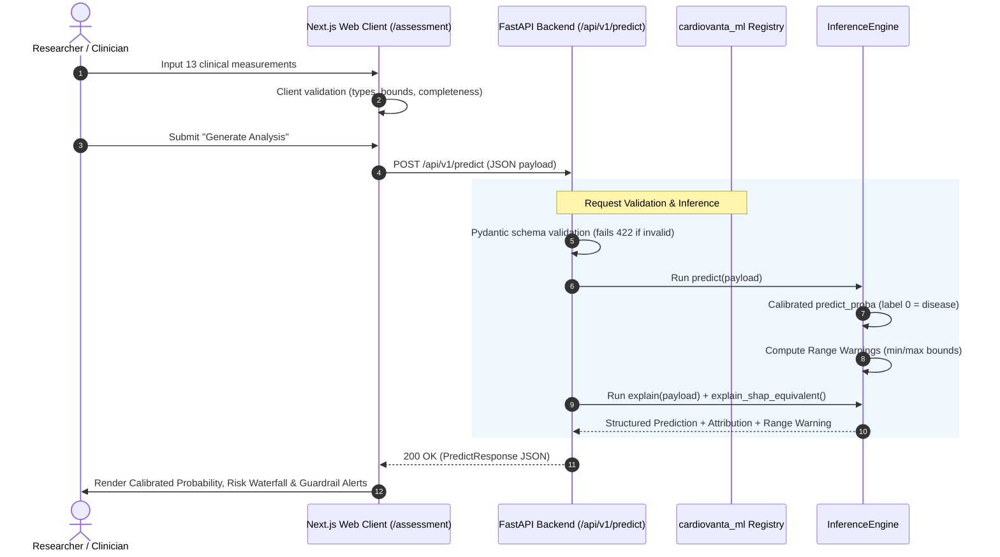

# Product Requirements Document (PRD) — CardioVanta

**Document Reference:** `PRD.md`\
**Product Name:** CardioVanta\
**Current Release Version:** 1.0.0 (R3 Architecture Alignment)\
**System Status:** Research Prototype / Educational ML Engineering Platform\
**Target Deployment:** Vercel Serverless (Next.js 16 + FastAPI / Python 3.12)\
**Authoritative ML Package:** `cardiovanta_ml` (v0.2.0)\
**Registered Model Identifier:** `cardiovanta-lr13@1.0.0`\

---

## Table of Contents

1. [Executive Summary & Problem Statement](#1-executive-summary--problem-statement)
2. [Vision, Purpose & Core Objectives](#2-vision-purpose--core-objectives)
3. [Target Audience & Stakeholder Personas](#3-target-audience--stakeholder-personas)
4. [Scope and System Boundaries](#4-scope-and-system-boundaries)
5. [Core Product Features](#5-core-product-features)
6. [User Workflows & Journey Mapping](#6-user-workflows--journey-mapping)
7. [Functional Requirements (FR)](#7-functional-requirements-fr)
8. [Non-Functional Requirements (NFR)](#8-non-functional-requirements-nfr)
9. [Data & Clinical Contract Specifications](#9-data--clinical-contract-specifications)
10. [Known Constraints, Limitations & Risks](#10-known-constraints-limitations--risks)
11. [Success Criteria & Acceptance Verification](#11-success-criteria--acceptance-verification)
12. [Mandatory Clinical & Regulatory Disclaimers](#12-mandatory-clinical--regulatory-disclaimers)

---

## 1. Executive Summary & Problem Statement

### 1.1 Executive Summary
CardioVanta is an interpretable machine learning engineering and research application engineered to demonstrate how structured clinical observations inform probabilistic risk modeling for obstructive coronary artery disease (CAD). The system ingests 13 standard physiological, laboratory, and diagnostic measurements and evaluates them using a strictly version-controlled, sigmoid-calibrated Logistic Regression estimator (`cardiovanta-lr13@1.0.0`). Alongside a calibrated probability estimate ($P(\text{disease present})$), the system generates transparent, dual-model feature-level attributions and development-range guardrails.

CardioVanta bridges the gap between opaque "black-box" clinical risk prediction and actionable, interpretable machine learning systems, while explicitly adhering to conservative safety policies regarding clinical boundaries and decision thresholds.

### 1.2 Problem Statement
Cardiovascular disease remains the leading cause of global mortality. While multi-parameter diagnostic models exist, deploying machine learning in medical domains faces critical barriers:
1. **Model Opacity ("Black-Box" Fallacy):** Complex models frequently produce risk percentages without verifiable feature attributions, preventing clinicians and researchers from auditing algorithmic reasoning.
2. **Probability Miscalibration:** Standard classification algorithms output decision scores or uncalibrated probabilities that deviate substantially from empirical event frequencies, distorting real-world likelihoods.
3. **Premature Binary Decision Thresholds:** Systems routinely apply arbitrary cutoff thresholds (e.g., $t = 0.50$) without clinical validation or health-economic utility justification, generating artificial positive/negative diagnoses.
4. **Data Leakage & Target Inversion Hazards:** In biomedical machine learning, subtle dataset distortions—such as target column inversion, patient overlaps between training and evaluation splits, and silent schema mismatches—frequently undermine research credibility.

CardioVanta directly addresses these engineering and methodological challenges through a contract-driven, leakage-resistant, and fully auditable software architecture.

---

## 2. Vision, Purpose & Core Objectives

### 2.1 Product Vision
To serve as an exemplary, auditable reference implementation of trustworthy, calibrated, and interpretable machine learning for cardiovascular risk analysis, emphasizing clinical safety guardrails, explicit provenance, and architectural rigor.

### 2.2 Core Product Objectives
* **Calibrated Probabilistic Estimation:** Deliver deterministic, reliable estimates of $P(\text{disease present})$ calibrated via 5-fold cross-validated sigmoid (Platt) scaling.
* **Dual-Model Explainability:** Provide exact additive decompositions of the underlying logistic regression decision function (log-odds scale) alongside SHAP-equivalent linear attributions calculated relative to a frozen development baseline.
* **Contract-Driven Consistency:** Enforce strict single-source-of-truth clinical input contracts across frontend interfaces, API serialization schemas, and backend runtime validators.
* **Zero-Trust Model Registry:** Enforce cryptographic SHA-256 integrity checks prior to model artifact deserialization, eliminating arbitrary code execution and artifact corruption risks.
* **Rigorous Safety Transparency:** Explicitly report mathematical operating points rather than unsupported clinical diagnoses, flagging out-of-distribution inputs with non-blocking guardrail warnings.

---

## 3. Target Audience & Stakeholder Personas

| Persona | Role & Context | Primary User Goal | Key Value Delivered |
|:---|:---|:---|:---|
| **ML & Biomedical Researcher** | Investigates risk estimation, calibration behavior, and cross-cohort transportability. | Evaluate calibration curves, inspect feature importance, and assess model stability across subgroups. | Full methodological transparency, access to OOF metrics, Brier scores, and reproducible training provenance. |
| **Clinical Decision-Support Auditor** | Evaluates software systems for safety, interpretability, and compliance with clinical evaluation standards. | Audit feature contribution logic, verify absence of unvalidated clinical claims, and review data boundaries. | Explicit clinical disclaimers, clear separation of log-odds vs. probabilities, and unvalidated threshold policy. |
| **Engineering / DevOps Reviewer** | Verifies architectural reliability, deployment pipelines, and security hygiene. | Review CI/CD workflows, smoke test suites, contract synchronization, and API robustness. | Fully automated verification pipelines, strict dependency pinning, and secretless CI deployments. |
| **Academic Evaluator (Kalvium)** | Assesses full-stack software architecture, ML engineering quality, and documentation fidelity. | Validate adherence to software design principles, API specifications, and architectural documentation. | Exhaustive PRD, HLD, and LLD artifacts reflecting the production codebase. |

---

## 4. Scope and System Boundaries

```mermaid
flowchart TD
    subgraph IN_SCOPE["In-Scope (System Boundaries)"]
        direction TB
        F1["13-Feature Clinical Assessment Interface"]
        F2["Calibrated Probability Inference Engine"]
        F3["Dual-Model Linear & SHAP-Equivalent Attribution"]
        F4["Cryptographic Model Registry (SHA-256 Verified)"]
        F5["Development-Range Guardrails (Min/Max Warnings)"]
        F6["Automated CI/CD Verification & Smoke Testing"]
    end

    subgraph OUT_OF_SCOPE["Out-of-Scope (Strict Exclusions)"]
        direction TB
        X1["Direct Clinical Diagnosis / Treatment Recommendations"]
        X2["Autonomous Patient Triage or Emergency Alerting"]
        X3["Real Patient Health Information (PHI) Storage / EHR Integration"]
        X4["Continuous Online Re-training or Automated Model Tuning"]
        X5["Arbitrary / Incomplete Clinical Input Profiles"]
    end
```

### 4.1 In-Scope Capabilities
* Interactive web assessment interface collecting exactly 13 structured clinical measurements.
* Stateless REST API endpoint (`POST /api/v1/predict`) accepting JSON payloads adhering to `feature_schema.v2.json`.
* Probability inference executing against the registered `cardiovanta-lr13@1.0.0` artifact bundle.
* Exact additive linear log-odds decomposition and SHAP-equivalent attribution against the frozen 242-sample Cleveland development background.
* Development-range warning subsystem checking continuous variables against historical empirical limits.
* End-to-end automated verification, synthetic test suites, and Vercel serverless continuous delivery.

### 4.2 Out-of-Scope Boundaries (Strict Exclusions)
* **Medical Device Functionality:** CardioVanta is not a certified diagnostic medical device (Software as a Medical Device - SaMD). It does not provide clinical guidance or treatment pathways.
* **Partial Profile Scoring:** Incomplete feature profiles (e.g., missing resting blood pressure or thallium stress test results) are rejected fail-closed; no server-side imputation is performed for missing production features.
* **Prohibition of Real Patient Health Information (PHI):** CardioVanta does not integrate an external database, Electronic Health Record (EHR) system, or persistent cloud storage. However, because telemetry, serverless runtime logs, and network transports have not undergone independent clinical privacy audits (e.g., HIPAA, GDPR, HITECH), inputting real, identifiable patient data is strictly prohibited and out of scope.
* **Online Learning:** The production model is immutable. Production traffic is never leveraged to auto-update model weights.

---

## 5. Core Product Features

### 5.1 Structured Clinical Assessment Interface
* Intuitive responsive input form dividing the 13 required clinical features into logical domains:
  1. *Demographics & Baseline:* Age, Biological Sex.
  2. *Symptom Presentation:* Chest Pain Type (`cp`).
  3. *Resting Physiological Markers:* Resting Blood Pressure (`trestbps`), Serum Cholesterol (`chol`), Fasting Blood Sugar (`fbs`), Resting ECG (`restecg`).
  4. *Exercise Tolerance & Stress Testing:* Maximum Heart Rate (`thalach`), Exercise-Induced Angina (`exang`), ST Depression (`oldpeak`), Peak Exercise ST Slope (`slope`).
  5. *Diagnostic Fluoroscopy & Scintigraphy:* Major Vessels Colored (`ca`), Thallium Stress Test (`thal`).
* Real-time client-side validation ensuring inputs conform to defined ranges and categorical domains before submission.

### 5.2 Calibrated Risk Engine
* Execution of the registered 5-member sigmoid-calibrated ensemble model (`model.joblib`).
* Production of a calibrated estimate representing $P(\text{disease present})$ where disease is defined as angiographic coronary artery disease ($>50\%$ diameter stenosis in at least one major vessel, UCI `num` > 0).
* Unvalidated decision threshold reporting: Returns `threshold_applied: null`, `class: null`, and `threshold_status: "no_validated_production_threshold_configured"` by default, preventing automated diagnosis.

### 5.3 Dual-Model Explainability Suite
* **Linear Log-Odds Decomposition:** Decomposes the uncalibrated Logistic Regression explanation model decision score into the sum of individual feature contributions plus intercept:
  $$\text{Score} = \text{Intercept} + \sum_{i=1}^{13} \text{Contribution}_i$$
* **SHAP-Equivalent Linear Attribution:** Computes exact closed-form SHAP attributions relative to the frozen 242-sample Cleveland development background expectations:
  $$\phi_i = \beta_i (x_i - \mathbb{E}[x_i])$$
* Visual attribution charts separating positive factors (increasing modeled disease log-odds) from negative factors (decreasing modeled disease log-odds).

### 5.4 Development-Range Safety Guardrails
* Non-blocking warning banner triggered whenever any continuous clinical input falls outside the empirical min/max bounds observed in the training cohort.
* Transparent notification indicating that while the input was mathematically evaluated, model reliability outside training support cannot be guaranteed.

---

## 6. User Workflows & Journey Mapping

### 6.1 Standard Assessment Workflow
1. **Navigation:** The user navigates to `/assessment`.
2. **Form Entry:** The user enters all 13 required variables. Helper tooltips provide standard medical units (mm Hg, mg/dl, bpm, mm).
3. **Execution:** The user clicks "Generate Analysis". The frontend dispatches `POST /api/v1/predict`.
4. **Result Inspection:** The interface renders:
   * Calibrated probability gauge ($P(\text{disease present})$).
   * Threshold policy banner affirming that no clinical decision cutoff is established.
   * Signed feature attribution breakdown identifying top protective and risk-elevating factors.
   * Technical audit log displaying exact log-odds shifts.
   * Development-range warning alerts if any measurement exceeds training bounds.

### 6.2 Error & Exception Workflows
* **Incomplete Submission:** If any of the 13 fields is omitted, the frontend blocks submission; direct API requests receive an HTTP 422 Unprocessable Entity.
* **Categorical Domain Violation:** Submitting unauthorized codes (e.g., `cp: 5`) triggers an HTTP 422 with sanitized field-level error messages.
* **Backend Runtime Fault:** Internal computation exceptions return HTTP 500 with scrubbed error messages that prevent stack trace or clinical data leakage.

---

## 7. Functional Requirements (FR)

### 7.1 Input Processing & Contract Validation
* **FR-1.1 (Exhaustive Input Contract):** The system shall accept exactly 13 predefined clinical features. Requests with missing or unexpected additional fields shall be rejected with HTTP 422.
* **FR-1.2 (Type & Domain Conformance):** Numeric fields must be finite floats/integers. Categorical and binary features must strictly match permissible discrete sets defined in `feature_schema.v2.json`.
* **FR-1.3 (Canonical Feature Ordering):** Preprocessing pipelines shall deterministically align inputs to the canonical contract sequence: `age`, `sex`, `cp`, `trestbps`, `chol`, `fbs`, `restecg`, `thalach`, `exang`, `oldpeak`, `slope`, `ca`, `thal`.

### 7.2 Model Loading & Provenance Verification
* **FR-2.1 (Explicit Version Pinning):** The runtime shall load model artifacts strictly by explicit ID (`cardiovanta-lr13`) and semantic version (`1.0.0`). Fallbacks to "latest" are forbidden.
* **FR-2.2 (Cryptographic Integrity Verification):** The system shall verify the SHA-256 digest of all model artifacts against `checksums.sha256` prior to deserializing any binary `.joblib` file. Any mismatch shall immediately abort startup.
* **FR-2.3 (Runtime Environment Verification):** The registry loader shall verify that the runtime `scikit-learn` version matches the artifact registration metadata (`1.9.1`).

### 7.3 Probabilistic Inference & Outcome Semantics
* **FR-3.1 (Calibrated Estimation):** Predictions shall be computed using the 5-fold sigmoid calibrated ensemble (`model.joblib`), outputting a continuous probability $p \in [0.0, 1.0]$.
* **FR-3.2 (Correct Outcome Orientation):** The output probability shall strictly represent $P(\text{significant obstructive CAD present})$. For artifact `cardiovanta-lr13@1.0.0`, the system shall extract probability from model label `0` (derived from target inversion findings documented in Phase 17).
* **FR-3.3 (Threshold Policy Enforcement):** When no threshold query parameter is provided, the API response shall explicitly populate `threshold_applied: null`, `class: null`, and set `threshold_status: "no_validated_production_threshold_configured"`. If a mathematical threshold $t$ is passed, the system shall classify $\hat{y} = 1$ if $p \ge t$, setting `threshold_status: "mathematical_model_operating_point"`.

### 7.4 Feature Attribution & Guardrails
* **FR-4.1 (Linear Log-Odds Decomposition):** The system shall compute exact additive contributions $\beta_i x_i$ using the uncalibrated explanation model (`explanation_model.joblib`), ensuring $\text{intercept} + \sum \text{contrib}_i = \text{decision\_function}$.
* **FR-4.2 (SHAP-Equivalent Attribution):** The system shall compute closed-form linear SHAP attributions against the frozen development background expectations.
* **FR-4.3 (Directional Alignment):** Attribution values shall be adjusted by `disease_log_odds_sign` (-1.0 for model v1.0.0) such that positive contributions indicate increased log-odds of disease presence.
* **FR-4.4 (Development-Range Alerting):** The API shall inspect all continuous features against the training cohort extrema and return `outside_development_range: true` with a list of offending feature names when boundaries are exceeded.

---

## 8. Non-Functional Requirements (NFR)

### 8.1 Performance & Responsiveness
* **NFR-1.1 (Inference Responsiveness):** The inference engine shall execute statelessly without blocking network calls or external database queries during request processing. Model artifacts and schemas shall be loaded into process memory once during startup. (Note: While the frontend user interface references sub-millisecond local attribution, formal end-to-end latency benchmarks under production load remain undocumented and unverified; no specific millisecond latency SLA is asserted).
* **NFR-1.2 (Cold-Start Efficiency):** The Python serverless function bundle shall include only production runtime dependencies to minimize initialization overhead and memory consumption during Vercel function cold starts.
* **NFR-1.3 (Lightweight Bundle Footprint):** The deployment package shall strictly exclude heavy development, experiment, and research data dependencies from the production bundle (governed via `api/requirements.txt` and `vercel.json`).

### 8.2 Security, Privacy & Compliance
* **NFR-2.1 (Stateless Architecture & Input Data Handling Policy):** The platform operates statelessly without database persistence or cloud storage. Error handlers strip raw input values from validation error responses (HTTP 422), and internal exceptions log only exception types. However, because data flow and telemetry have not been formally audited for medical privacy compliance (e.g., HIPAA, GDPR, HITECH), the product strictly prohibits the entry of real patient data.
* **NFR-2.2 (Error Sanitization):** Pydantic validation exceptions shall strip raw clinical input values from error responses and logs, preventing data leakage during client malformed request scenarios.
* **NFR-2.3 (CORS & Browser Hardening):** Cross-Origin Resource Sharing (CORS) shall disallow credentials and restrict origins to approved frontend deployments. HTTP security headers (`X-Content-Type-Options: nosniff`, `X-Frame-Options: DENY`, `Referrer-Policy: strict-origin-when-cross-origin`) shall be enforced across all responses.
* **NFR-2.4 (Deserialization Protection):** Joblib deserialization shall be strictly fenced behind SHA-256 manifest verification and directory traversal prevention checks.

### 8.3 Reliability & Maintainability
* **NFR-3.1 (Single Source of Truth):** All feature definitions, validation bounds, and categorical mappings shall be generated automatically from `cardiovanta_ml/contracts/feature_schema.v2.json`.
* **NFR-3.2 (Fail-Closed Architecture):** Any configuration mismatch, missing model file, or contract divergence during startup shall fail immediately with descriptive exit codes rather than serving degraded predictions.
* **NFR-3.3 (Auditability):** Every production release shall be traceable to a specific Git commit SHA and dataset SHA-256 hash recorded in immutable metadata.

---

## 9. Data & Clinical Contract Specifications

### 9.1 The 13 Canonical Clinical Features

| # | Feature Identifier | Label | Type | Permissible Domain / Development Range | Unit | Clinical Semantic Meaning |
|:---|:---|:---|:---:|:---|:---:|:---|
| 1 | `age` | Age | Continuous | $29.0 \le \text{age} \le 77.0$ | years | Patient age at baseline assessment |
| 2 | `sex` | Sex | Binary | `{0: Female, 1: Male}` | — | Biological sex recorded at intake |
| 3 | `cp` | Chest Pain Type | Categorical | `{0, 1, 2, 3}` | — | Training encoding (Patient-matched: 0=Asymptomatic, 1=Atypical Angina, 2=Non-anginal, 3=Typical Angina) |
| 4 | `trestbps` | Resting Blood Pressure | Continuous | $94.0 \le \text{trestbps} \le 200.0$ | mm Hg | Resting systemic arterial pressure on hospital admission |
| 5 | `chol` | Serum Cholesterol | Continuous | $126.0 \le \text{chol} \le 564.0$ | mg/dl | Total circulating serum cholesterol |
| 6 | `fbs` | Fasting Blood Sugar | Binary | `{0: False, 1: True}` | — | Fasting blood glucose $> 120\text{ mg/dl}$ |
| 7 | `restecg` | Resting ECG Results | Categorical | `{0: Normal, 1: ST-T Abnormality, 2: LVH}` | — | Resting 12-lead electrocardiographic assessment |
| 8 | `thalach` | Max Heart Rate Achieved | Continuous | $71.0 \le \text{thalach} \le 202.0$ | bpm | Maximum chronotropic response during exercise protocol |
| 9 | `exang` | Exercise-Induced Angina | Binary | `{0: No, 1: Yes}` | — | Provocation of angina pectoris during physical stress |
| 10 | `oldpeak` | ST Depression | Continuous | $0.0 \le \text{oldpeak} \le 6.2$ | mm | Exercise-induced ST-segment depression relative to resting baseline |
| 11 | `slope` | ST Segment Slope | Categorical | `{0: Upsloping, 1: Flat, 2: Downsloping}` | — | Slope of the ST segment at peak exercise (Training encoding) |
| 12 | `ca` | Major Vessels Colored | Categorical | `{0, 1, 2, 3, 4}` | — | Fluoroscopic vessel count colored by contrast media (Note: Code 4 undefined in UCI codebook) |
| 13 | `thal` | Thallium Scintigraphy | Categorical | `{0, 1: Normal, 2: Fixed Defect, 3: Reversible Defect}` | — | Thallium-201 myocardial perfusion defect status (Note: Code 0 undefined in UCI codebook) |

---

## 10. Known Constraints, Limitations & Risks

### 10.1 Dataset Sample Size & Demographics
* The primary development dataset contains only **242 retrospective patients**, with a locked evaluation partition of **61 patients** (Cleveland Clinic Foundation cohort).
* Because the dataset was collected between 1981 and 1984, diagnostic testing standards, surgical revascularization criteria, and pharmacological therapies differ significantly from modern cardiology practice.

### 10.2 Cleveland Locked Partition Status
* **Important Scientific Clarification:** The 61 locked observations must **not** be characterized as a pristine, independent holdout. They originate from the exact same institutional collection, clinician referral pipeline, and historical epoch as the development cohort, and share potential selection biases.

### 10.3 Subgroup Estimability Limitations
* Statistical estimation stability cannot be established for small patient subgroups ($N < 20$) or sparse class counts ($N < 5$). In particular:
  * `cp = 3` (Typical Angina, $N = 15$)
  * `restecg = 2` (Left Ventricular Hypertrophy, $N = 4$)
  * `slope = 0` (Upsloping, $N = 17$)
* Performance extrapolations to these clinical subgroups are unverified and statistically unreliable.

### 10.4 Association vs. Medical Causality
* Feature attributions (both linear log-odds decomposition and SHAP-equivalent values) quantify statistical associations within the fitted regression equation. They **do not** prove biological or clinical causality. A positive attribution does not imply that lowering that specific measurement will reduce cardiovascular risk.

---

## 11. Success Criteria & Acceptance Verification

| Criterion ID | Target Metric / Evaluation Method | Acceptance Threshold | Verification Mechanism |
|:---|:---|:---|:---|
| **SC-1: Contract Synchronization** | Agreement between JSON contract, Python schemas, and TypeScript interfaces. | $100\%$ zero-diff alignment on types, orders, and names. | `python contracts/codegen/generate.py --check` in CI |
| **SC-2: Integrity Enforcement** | Detection of corrupted, altered, or unregistered model artifacts. | $100\%$ immediate fail-closed rejection prior to deserialization. | `test_r2_registry.py` & `scripts/verify_artifact_integrity.py` |
| **SC-3: Calibration Fidelity** | Out-of-fold calibration performance across development folds. | Brier score $\le 0.1250$ with stable Log Loss ($\le 0.40$). | Sigmoid calibration protocol (`docs/calibration.md`) |
| **SC-4: Explanatory Additivity** | Mathematical consistency of linear attribution decomposition. | Exact match ($|\text{diff}| < 10^{-5}$) for linear ($\text{Intercept} + \sum \text{contrib}_i = \text{Score}$) and SHAP ($\mathbb{E}[\text{Score}] + \sum \phi_i = \text{Score}$). | Automated assert checks in `cardiovanta_ml.inference.explain` |
| **SC-5: CI/CD Pipeline Safety** | Automated gate execution on every PR and commit to `main`. | $100\%$ passing backend, frontend, security, and smoke tests. | GitHub Actions `.github/workflows/verify.yml` |

---

## 12. Mandatory Clinical & Regulatory Disclaimers

> [!IMPORTANT]
> **RESEARCH & EDUCATIONAL USE ONLY — NOT A CLINICAL MEDICAL DEVICE**
>
> 1. **No Clinical Validation:** CardioVanta has **not** undergone clinical validation, clinical trials, or formal evaluation in real-world patient cohorts. It is not approved, cleared, or registered with any health authority (e.g., FDA, EMA, CE-MDR) as Software as a Medical Device (SaMD).
> 2. **Not Medical Advice or Diagnosis:** Outputs generated by this software represent mathematical modeled probabilities based on historical retrospective datasets. They must **never** be interpreted as medical advice, clinical diagnoses, treatment plans, or prognostic assurances.
> 3. **Prohibition of Real Patient Data:** Users and researchers must **not** input real, identifiable Protected Health Information (PHI) or Personally Identifiable Information (PII) into this application.
> 4. **No Validated Decision Threshold:** This system does not configure or endorse any clinical cutoff threshold. Any categorization (Class 0 vs Class 1) obtained via optional query parameters represents an unvalidated mathematical operating point, not a diagnosis.
> 5. **Clinical Discretion Required:** Diagnostic and therapeutic decisions must always be made by qualified medical professionals using approved diagnostic modalities and established clinical guidelines.
