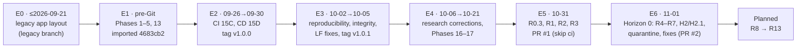
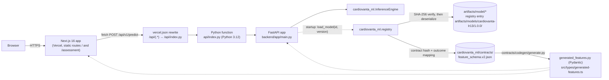
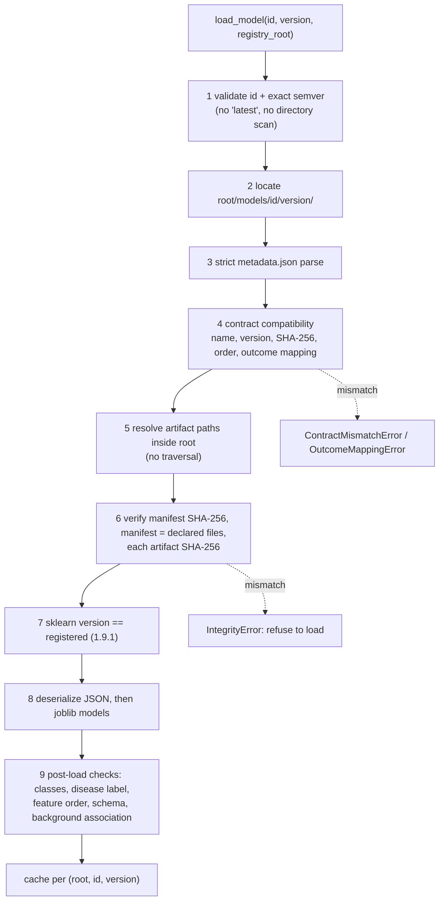
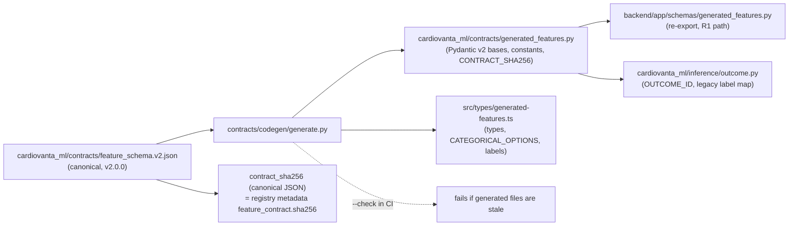
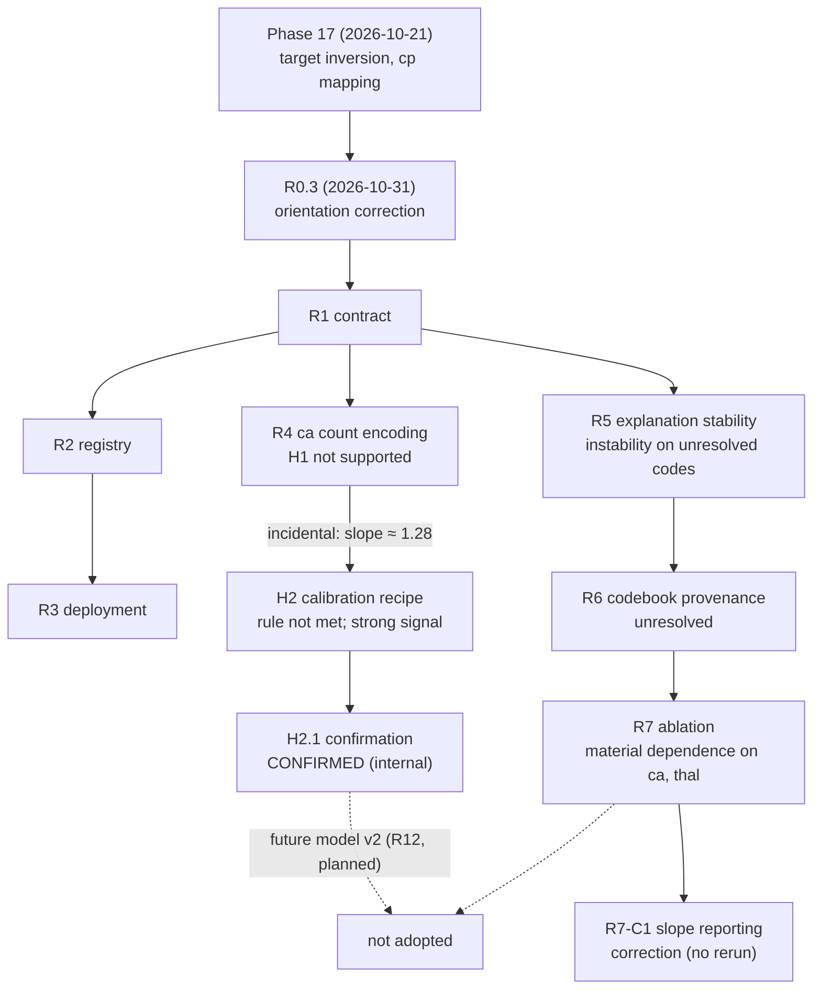
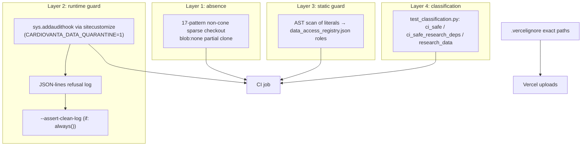
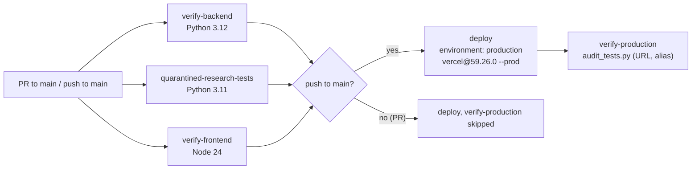

# CardioVanta Master Project Dossier

> **CardioVanta is a research and engineering project. It is not a medical device, it has not been clinically validated, and nothing in this document is clinical evidence.**

| Field | Value |
|---|---|
| Document | `reports/CARDIOVANTA_MASTER_PROJECT_DOSSIER.md` |
| Purpose | The definitive technical record of CardioVanta's development, architecture, research, verification and open risks |
| Audit date | 2026-11-01 |
| Audited revision | Branch `horizon0/research-ci-quarantine` at `0e179ce` (PR #2, open, not merged). `main` at `446788d` |
| Latest verified CI | GitHub Actions run `41321859343` on `0e179ce`: all three verification jobs passed (§11.2) |
| Evidence base | Tracked source, tests, workflows, configuration, reports, OpenSpec records, Git history on all branches, and GitHub metadata (PRs, workflow runs and job logs, environments, deployments, branch protection) |
| Data handling | No protected file was opened (§23.2). No patient row, identifier, credential or private path appears here |
| Relationship to other documents | Standalone. It links to and does not replace `README.md`, `PRD.md`, `HLD.md`, `LLD.md`, `docs/`, the model card, the research reports and OpenSpec |

### How to read this document

Every substantive statement carries, or sits under a heading that carries, one of these labels.

| Label | Meaning |
|---|---|
| **Implemented** | Present in the code at the audited revision. Where stated, exercised by tests or CI |
| **Evidence** | A documented research or verification result, with its source |
| **Recorded decision** | A decision written in a project record (report, OpenSpec change, model card or commit) |
| **Inferred** | This audit's interpretation. Not recorded by the project |
| **Planned** | Not implemented |
| **Not verified** | No evidence was available to this audit |

Short commit hashes are 7 characters. All paths are relative to the repository root.

---

## Contents

1. [Executive overview](#1-executive-overview)
2. [Complete project timeline](#2-complete-project-timeline)
3. [Technical architecture](#3-technical-architecture)
4. [Technology stack and dependencies](#4-technology-stack-and-dependencies)
5. [Dataset and data-quality history](#5-dataset-and-data-quality-history)
6. [Feature contract](#6-feature-contract)
7. [Model architecture and lifecycle](#7-model-architecture-and-lifecycle)
8. [Research ledger](#8-research-ledger)
9. [Experiment reproducibility](#9-experiment-reproducibility)
10. [Research-data protection and privacy](#10-research-data-protection-and-privacy)
11. [Testing and quality assurance](#11-testing-and-quality-assurance)
12. [CI/CD and deployment architecture](#12-cicd-and-deployment-architecture)
13. [Security audit](#13-security-audit)
14. [Frontend and product experience](#14-frontend-and-product-experience)
15. [API and backend](#15-api-and-backend)
16. [GitHub and development history](#16-github-and-development-history)
17. [Project directory guide](#17-project-directory-guide)
18. [Architecture decisions and trade-offs](#18-architecture-decisions-and-trade-offs)
19. [Risk register: limitations and unresolved issues](#19-risk-register-limitations-and-unresolved-issues)
20. [Roadmap](#20-roadmap)
21. [R8 readiness assessment](#21-r8-readiness-assessment)
22. [Maturity assessment and the ten most important next actions](#22-maturity-assessment-and-the-ten-most-important-next-actions)
23. [Appendices](#23-appendices): A. Glossary · B. Reproducibility guide · C. Onboarding guide · D. Evidence index · E. Audit method and data safety

---

## 1. Executive overview

### 1.1 What CardioVanta is

**Implemented.** CardioVanta is a web application with a research codebase. It estimates the probability of significant obstructive coronary artery disease from 13 structured clinical measurements, and shows how the model arrived at it and how far the estimate can be trusted.

| Part | What it is | Where |
|---|---|---|
| Assessment interface | A four-stage Next.js 16 form that collects the 13 inputs and renders the result | `src/app/assessment/page.tsx` |
| Inference API | FastAPI app exposed as a Vercel Python function: `POST /api/v1/predict`, `GET /api/v1/health` | `api/index.py`, `backend/app/` |
| ML package | `cardiovanta_ml` 0.2.0: the canonical contract, a versioned SHA-256-verified model registry, inference and explanation | `cardiovanta_ml/` |
| Production model | `cardiovanta-lr13@1.0.0`: a five-member sigmoid-calibrated logistic regression ensemble, plus a separate explanation model | `artifacts/model/`, `artifacts/models/cardiovanta-lr13/1.0.0/` |
| Research programme | Pre-registered, development-only studies with recorded negative results (R4–R7, H2, H2.1) and earlier phases | `experiments/`, `reports/`, `openspec/changes/` |
| Verification | Classified test suites, contract and artifact checks, wheel verification, dependency audits, and a research-data quarantine in CI | `.github/workflows/verify.yml`, `scripts/ci/`, `tests/`, `backend/tests/` |

The output is the **calibrated model-estimated probability that significant obstructive coronary artery disease is present**: angiographic stenosis greater than 50% in at least one major vessel, UCI `num` > 0 (`cardiovanta_ml/contracts/feature_schema.v2.json`, `outcome`). It is a research estimate. It is not a diagnosis.

### 1.2 Why it was created, and the original vision

**Recorded.** `PRD.md` §1–2 states the purpose: "an exemplary, auditable reference implementation of trustworthy, calibrated, and interpretable machine learning for cardiovascular risk analysis, emphasizing clinical safety guardrails, explicit provenance, and architectural rigor."

The PRD names four problems it set out to address:
1. model opacity;
2. probability miscalibration;
3. premature binary decision thresholds;
4. data leakage and target-inversion hazards.

`PRD.md` also lists an "Academic Evaluator (Kalvium)" persona, and PR #1 is titled `feat(kalvium): ...`. The 2026-10-31 architecture documents (`PRD.md`, `HLD.md`, `LLD.md`) were therefore prepared partly for an academic assessment.

**Evidence of earlier form.** The branch `legacy-cardio-vanta-backup` holds one commit, `4194380` (2026-09-21, "Initial commit of cleaned CardioVanta"). Its file names show a different, earlier application layout: `app.py`, `templates/`, `Procfile`, `database.py`, `prediction.py`, two pickled models and a copy of `heart.csv`. Only file names were inspected. Its design and behaviour are **Not verified**.

### 1.3 Product philosophy

> **"Know the risk. Know the why. Know how far to trust it."**

This is the project owner's statement of the product philosophy. It does not yet appear in any tracked document, and adding it to `README.md` or `PRD.md` is a recommendation of this audit. The table shows how the implementation maps onto it.

| Principle | What the system does (Implemented) | Why it matters |
|---|---|---|
| **Know the risk** | Returns a *calibrated* P(disease present), always disease-positive, with the class orientation taken from registry metadata (§7.4) | An uncalibrated score is not a probability. A wrongly oriented probability is worse than none: R0.3 found that the pre-R0.3 API returned P(disease *absent*) (§2.3) |
| **Know the why** | Returns two additive attributions (linear and SHAP-equivalent) of a separate, uncalibrated explanation model. Both carry explicit notes that they do not decompose the calibrated probability and do not imply causality | Users need to see which inputs moved the estimate, without being misled about what the numbers mean (§7.6) |
| **Know how far to trust it** | Development-range warnings; a verification status for every categorical code; no default decision threshold (`no_validated_production_threshold_configured`); `metadata.outcome_mapping` in every response; a model card; a research ledger with negative results | The dataset is small (242 development rows), historical, single-centre and partly unresolved (§5, §6). Honest limits are part of the output |

**Why these properties matter** (Inferred, from the project's own findings):
- **Calibration.** H2.1 showed that the production recipe is systematically under-confident: calibration slope about 1.27 (§8.7). Calibration is measured, not assumed, and it can be wrong even when discrimination is good.
- **Explainability.** R5 showed that explanation direction matched the change in probability in all 3,562 synthetic perturbations. It also showed that instability concentrates on inputs whose codes are unresolved (§8.8).
- **Data quality.** The training target was inverted, and the old UI labelled chest-pain codes in reverse (§2.3, §5.4). Data-quality problems were real, not hypothetical.
- **Uncertainty.** Every R-series study reports repeat-level and patient-level intervals and applies its pre-registered rule, including when the rule fails (H2, R4).
- **Honest limitations.** The 61-row Cleveland partition can no longer serve as an independent test set (§5.6). The project records this rather than continuing to quote it.

### 1.4 Intended users

**Recorded** (`PRD.md` §3): ML and biomedical researchers, clinical decision-support auditors, engineering and DevOps reviewers, and academic evaluators. **Out of scope** (`PRD.md` §4.2): diagnosis, triage, real patient data (PHI), EHR integration and online learning. The UI and README say not to submit real patient data.

### 1.5 Technical differentiators

**Implemented**, unless marked otherwise:
1. **One canonical clinical contract** (`feature_schema.v2.json`). Every categorical code carries a verification status and its evidence. Backend Pydantic and frontend TypeScript definitions are generated from it, and CI checks they are current (§6).
2. **Disease orientation as data, not assumption.** The disease-present label is declared per model in registry metadata (label **0** for `1.0.0`) and cross-checked against the contract. The positive class is never hard-coded (§7.4).
3. **A fail-closed versioned registry.** Selection is by explicit ID and exact version. SHA-256 is verified *before* deserialization. Contract, outcome and runtime compatibility are checked, and the scikit-learn version is locked exactly (§7.8).
4. **Calibrated ensemble plus a separate explanation model.** Both are documented honestly (§7).
5. **No default decision threshold.** A threshold is optional and is labelled a "mathematical model operating point" (§15).
6. **A pre-registered research programme.** Design hashes are fixed before execution. Results are deterministic, with verified content hashes. Negative and inconclusive results are reported as clearly as positive ones (§8).
7. **A research-data quarantine in CI** (§10):
   - sparse checkouts;
   - a runtime audit-hook guard, inherited by Python subprocesses;
   - a static AST guard and data-access registry;
   - an explicit test classification;
   - refused-access logging.
8. **Deployment hardening:**
   - pinned Python runtime (3.12) and numerical stack;
   - pinned Vercel CLI;
   - wheel verification in a clean venv;
   - exact-path upload exclusions (§12).

### 1.6 How it differs from a basic heart-disease prediction project

| Typical project | CardioVanta |
|---|---|
| Trains a classifier on `heart.csv` and reports accuracy | Reports calibrated probability. Records and corrects target inversion. Treats the locked partition as no longer independent |
| Treats label 1 as "disease" | Proved the Kaggle target inverted by patient matching (Phase 17), and carries orientation in metadata |
| Hard-codes UI labels | Generates labels from a contract that marks unverified codes as unverified |
| Loads `model.pkl` directly | Verifies checksums against a pinned manifest before unpickling, and fails closed on any mismatch |
| Shows SHAP plots | States which model the attribution explains, and that it does not decompose the displayed probability |
| Reports only improvements | Records rejected hypotheses (R4, H2's rule, ablation costs) and post-hoc corrections (R7-C1) |
| Runs tests on the real data | Runs CI with protected data absent and a guard that refuses and logs access |

### 1.7 Current maturity (summary)

**Inferred** (detail in §22):
- **Engineering and research method: strong for a research prototype.**
- **Product and deployment state: behind the code.**
  - The last recorded production deployment (`3b46957`, 2026-10-19) predates the R0.3 correction.
  - Production has never been deployed from the current architecture.
  - The R3.1 Linux Vercel build has never run.
  - `main` has no branch protection, and the `production` environment has no protection rules.
- **No clinical validity is claimed or established.**

### 1.8 Headline findings of this audit

| # | Finding | Section |
|---|---|---|
| 1 | The last GitHub-recorded production deployment is `3b46957` (2026-10-19). Code at that commit returns `predict_proba[:, 1]`, which is P(disease **absent**), labelled as risk, and labels `cp` codes in reverse. The live service was not queried, so what production serves is **Not verified** | §12.6, RISK-01 |
| 2 | The README's illustrative "70.2%" result and technical-audit contributions equal the **legacy-orientation** output for the assessment form's default synthetic profile: 1 − 0.2984 and the sign-negated current contributions | §14.5, RISK-20 |
| 3 | `main` HEAD `446788d` has never run CI (`[skip ci]`), and the last `main` push run (`60f1feb`) failed | §16.3 |
| 4 | The R-series is methodologically sound. H2.1 confirmed a calibration fix, but it is **not adopted**. R7 showed material dependence on `ca` and `thal`, whose codes are partly unresolved (R6) | §8 |
| 5 | The quarantine keeps protected files off CI runners and stops accidental Python access. The full dataset is nonetheless **public** in this repository: `data/raw/heart.csv` on `main` since `4683cb2`, and an identical blob on the legacy branch | §10.9 |
| 6 | Four readable reports outside the quarantine contain aggregate locked-test metrics | §10.10, RISK-09 |
| 7 | `audit_tests.py`, the production smoke test, makes no assertions and disables TLS verification | §13.7 |

---

## 2. Complete project timeline

### 2.1 Sources and their limits

- **The GitHub repository was created on 2026-09-21** (GitHub API). The first commit on `main` is `4683cb2` (2026-09-25, "Initial CardioVanta repository").
- **Research Phases 1–5 and Phase 13 predate Git history.** Their code (`src/experiment/*.py`, `src/experiment/phase13/*`) and reports arrived together in `4683cb2`. Their individual dates are **Not verified**. Phases 6–12 and 14 are not identified in any tracked record (**Not verified**).
- **R0–R3 were committed as one squashed commit**, `f72ae4d` (2026-10-31, 71 files, +8,262/−464, with `[skip ci]`), and merged as PR #1 (`446788d`). Their internal sequencing comes from OpenSpec records and code comments.
- **R0.1 and R0.2 are not described in any tracked file** (**Not verified**). R0.3 is documented in code, tests and the contract.

### 2.2 Eras at a glance



### 2.3 Milestone ledger

| Era / milestone | Dates and key commits | Planned (as recorded) | Implemented | Problems discovered | Changed / rejected | Unfinished |
|---|---|---|---|---|---|---|
| **E0 Legacy app** | `4194380` 2026-09-21 (branch `legacy-cardio-vanta-backup`) | Not verified | A different Python app layout (file names only) | Not verified | Superseded by the Next.js + FastAPI architecture (Inferred) | Branch still published, with a copy of the full dataset (§10.9) |
| **E1 Research Phases 1–5, 13** | Pre-Git; in `4683cb2` 2026-09-25 | Split, baselines, nested CV, calibration, thresholds, robustness, packaging; SHAP and TabICL feasibility | 242/61 stratified split; Phase 2B nested CV; Phase 3 calibration (sigmoid chosen); Phase 4A/4B threshold, robustness and subgroups; Phase 5 package; Phase 13 SHAP decision | Thresholds and "recall" computed for label 1, later found to be disease-*absent* (§7.10) | SHAP library rejected for production in favour of a closed-form equivalent (§8.3) | Phase 2C and later locked-set evaluations are quarantined (§10.3) |
| **E2 CI/CD (Phase 15C, 15D)** | `2af461e` 09-26 (CI) → `1cd416c`…`0916c3f` 09-29 (Vercel CD) → `9ce6db7` 09-30 (tag `v1.0.0`) | Automated verification and continuous delivery | `verify.yml` with deploy and `verify-production`; Node 24; first GitHub production deployments 09-29 | Vercel CLI prompts and missing credentials (five failing CD runs on 09-29: `1cd416c`, `6cb4d34`, `634ca42`, `46c0f97`, `ab0f9b2`) | Credentials handled through environment secrets | Smoke test without assertions (§13.7) |
| **E3 v1.0.1 hardening** | `5073e22` 10-02 (ML reproducibility), `a1cf0a3` (artifact integrity), `87e3990` (backend security), `dab582a`/`b79ba3f` (frontend factual corrections) → `d74cc93`…`bd2f57e` 10-05 (LF/binary fixes), `cfd3424` (package regenerated), `d4e0eaf` (tag `v1.0.1`), `7c23cd3`, `410f79d` | Reproducible training, integrity checks, sanitised errors, factual UI | `scripts/verify_artifact_integrity.py`, `configs/artifact_hashes.json`, `.gitattributes` binary rules; regenerated production package (metadata records build commit `4385948`) | Line-ending conversion corrupted joblib files on Linux CI | `*.joblib binary`, `eol=lf` for artifacts | OpenSpec `artifact-integrity` task 2.2 unticked; four changes unarchived (RISK-28) |
| **E4 Research corrections and Phases 16–17** | `006d7fe` 10-06 (global nested CV freeze), `b859362` 10-10 (formal error analysis), `4dad9c4` 10-19 (lazy optional deps), `cb80d11` 10-19 (master audit timeline; introduced a raw row), `88fae59` (Phase 16), `4155feb` (nested LDA, threshold optimisation, "90%" study), `3b46957` (Phase 17 proposal), `b17901b` 10-21 (Phase 17), `60f1feb` 10-21 (UI) | Correct earlier evaluation leakage; external validation | Archived OpenSpec corrections (`2026-10-06-*`); Phase 16 (frozen baseline kept); Phase 17 LOCO on Hungary/Long Beach/Cleveland development | **Phase 17 found the `heart.csv` target inverted** and the `cp` encoding different from UCI (§5.4) | Harmonised target in research loaders only; production untouched | Phase 17 did not cover the 13-feature production model (§8.4) |
| **E5 R0.3, R1, R2, R3** | `f72ae4d` 2026-10-31 `[skip ci]`; merged as `446788d` (PR #1, 2026-10-31T09:45Z) | Fix outcome semantics; single contract; package and registry; deployment reproducibility | **R0.3:** disease-positive orientation, corrected `cp` labels, log-privacy. **R1:** contract v2.0.0 and codegen. **R2:** `cardiovanta_ml` and registry. **R3:** Python 3.12 runtime, pins, wheel verification, CI restructure | Python 3.11 tests versus a 3.12 Vercel runtime; unpinned numpy/scipy; legacy loader without checksums (R3 proposal) | Legacy loader delegates to the registry; compatibility wrappers kept | **R3.1** Linux `vercel build` never run (§12.7). Merge not CI-verified (§16.3) |
| **E6 Horizon 0 (PR #2)** | `8c829a6`…`6211fd7` (R4–R7, H2, H2.1), `f60c101` (redaction), `e1b800a` (quarantine CI), `2be1e09`, `eff366c`, `0bbb7c5`, `9f3b872`, `4bcbfe1`, `2da5ac0`, `ea331f2`, `020da47`, `0e179ce` (2026-11-01) | Research questions from R4 onward; bring research into `main` safely | Six studies; CI quarantine; dependency security fixes; deployment-safety fixes | Two false-positive quarantine refusals in CI (bytecode caches, `dir_fd` deletes) | Fixed without weakening the guard (§10.6) | PR #2 open; merge triggers production deployment (§12.6) |

### 2.4 What R0.3 corrected

**Evidence** (`cardiovanta_ml/inference/outcome.py` docstring; `backend/tests/test_r0_outcome_semantics.py`, 24 test functions; R1 proposal; Git comparison with `3b46957`):

1. **Probability orientation.**
   - Before: `src/inference/predict.py` returned `predict_proba(df)[0, 1]`. For this model that is P(label 1) = P(disease absent).
   - After: the probability is read from the column of the declared disease label, which is 0 for `1.0.0`. Attributions are multiplied by the disease log-odds sign.
2. **Chest-pain labels.** Before, the UI labelled `cp` 0 "Typical Angina" and 3 "Asymptomatic". Phase 17 patient matching established 0 = asymptomatic and 3 = typical angina. Labels now come from the contract.
3. **Log privacy.** Inference exceptions are logged by type only, because messages could embed raw clinical values (`backend/app/api/endpoints/predict.py`).

---

## 3. Technical architecture

### 3.1 System context



### 3.2 Components

| Component | Location | Responsibility | Communicates with |
|---|---|---|---|
| Landing page | `src/app/page.tsx`, `src/app/landing.css` | Product narrative (9 sections), Framer Motion animation | Links to `/assessment` |
| Assessment page | `src/app/assessment/page.tsx` (1,306 lines), `CoronaryArteryVisual.tsx`, `assessment.css` | Four-stage form, result rendering, explanation charts | `src/lib/api.ts` → API |
| API client | `src/lib/api.ts` | Calls `${NEXT_PUBLIC_API_BASE_URL}/api/v1/predict`. Same-origin in production when unset; `http://127.0.0.1:8000` in development | FastAPI |
| Frontend types | `src/types/index.ts` (re-exports), `src/types/generated-features.ts` (generated) | Request and response types, categorical options | Contract |
| Vercel adapter | `api/index.py` | Imports `backend.app.main.app` | FastAPI |
| FastAPI app | `backend/app/main.py`, `core/config.py`, `core/logging.py`, `api/middleware.py`, `api/endpoints/predict.py`, `schemas/predict.py` | Startup model load, CORS, validation, error sanitisation, request IDs, JSON logs, endpoints | `cardiovanta_ml` |
| ML package | `cardiovanta_ml/` (`contracts`, `registry`, `inference`, `config.py`) | Contract, registry, inference and explanations. No FastAPI dependency | Artifacts, contract |
| Compatibility wrappers | `src/inference/{predict,outcome}.py`, `backend/app/core/model_loader.py`, `backend/app/schemas/generated_features.py` | Keep pre-R2 import paths working through the verified registry | `cardiovanta_ml` |
| Training and research code | `src/experiment/`, `experiments/`, `src/cardiovanta/data/`, `src/data/`, `src/preprocessing/` | Production training (`phase5.py`), research studies, data loaders | Research data (quarantined in CI) |
| Codegen | `contracts/codegen/generate.py` | Generates the Pydantic and TypeScript contract modules; `--check` mode in CI | Contract |
| CI scripts | `scripts/ci/*`, `scripts/verify_artifact_integrity.py` | Quarantine, static guard, classification, wheel and bundle checks | CI |

### 3.3 Prediction flow, from source

```mermaid
sequenceDiagram
    participant UI as Assessment page
    participant API as FastAPI /api/v1/predict
    participant V as Pydantic PredictRequest
    participant E as InferenceEngine
    participant M as Calibrated ensemble (model.joblib)
    participant X as Explanation model + background
    UI->>API: POST JSON (13 fields) [+ ?threshold=0..1]
    API->>V: validate (extra fields forbidden, Literal codes, finite numbers)
    V-->>API: 422 with sanitised errors (raw input removed), or OK
    API->>API: out-of-range list from schema min/max
    API->>E: predict(payload)
    E->>E: re-validate (feature set, numeric, allowed codes, range flag)
    E->>M: predict_proba(frame in contract order)
    M-->>E: [P(label 0), P(label 1)]
    E-->>API: probability = column of disease label (0 for 1.0.0); class if threshold
    API->>E: explain + explain_shap_equivalent
    E->>X: coef·x and coef·(x − background mean), sign → disease orientation
    X-->>API: contributions (additivity asserted to 5 decimals)
    API-->>UI: prediction, development_range_warning, explanation, shap_equivalent_explanation, metadata
    API->>API: JSON log "prediction_event" (no raw inputs)
```

| Step | What happens (Implemented) | Source |
|---|---|---|
| 1. Clinical inputs | 13 fields across four stages, with defaults pre-filled. Categorical options are rendered from the generated contract | `src/app/assessment/page.tsx` (`initialData`, `STAGES`, `renderOptions`) |
| 2. Request | `fetch` POST JSON. Errors raise `ApiError` with the server's `detail` | `src/lib/api.ts` |
| 3. Routing | Vercel rewrites `/api/(.*)` to the Python function, whose bundle includes `artifacts/**`, `src/**`, `backend/**`, `configs/**` and `cardiovanta_ml/**` | `vercel.json` |
| 4. Middleware | UUID request ID and start time; unhandled exceptions logged by type | `backend/app/api/middleware.py` |
| 5. Validation (1) | `PredictRequest` inherits the generated `ClinicalFeaturesBase` with `extra='forbid'`. Codes are `Literal` values; continuous values must be finite. Failures return 422 with `input` stripped from each error | `backend/app/schemas/predict.py`, `cardiovanta_ml/contracts/generated_features.py`, `backend/app/main.py` |
| 6. Range check | Continuous values outside the development range are listed. They are not rejected | `predict_endpoint` |
| 7. Validation (2) | The engine re-checks feature presence, numeric type and allowed codes, and builds a one-row frame in contract order | `cardiovanta_ml/inference/predict.py` `_validate_input`, `_frame` |
| 8. Model | Loaded once at startup by `load_model("cardiovanta-lr13", "1.0.0")`. Startup fails if loading fails | `backend/app/main.py` `lifespan`, `cardiovanta_ml/registry/loader.py` |
| 9. Calibrated prediction | `CalibratedClassifierCV.predict_proba` averages five calibrated members. The disease column is located with `disease_label_index(classes_, 0)` | `cardiovanta_ml/inference/outcome.py` |
| 10. Threshold (optional) | `?threshold` in [0, 1] gives `class` = 1 if P(disease) ≥ threshold, with status `mathematical_model_operating_point`. Otherwise `no_validated_production_threshold_configured` | `predict_endpoint`, `InferenceEngine.predict` |
| 11. Explanation | Linear: intercept + Σ coef·x of the explanation model. SHAP-equivalent: coef·(x − background mean) with expected value. Both are summed back to the 13 raw features and multiplied by ±1 to disease orientation | `cardiovanta_ml/inference/explain.py` |
| 12. Response | `PredictResponse` with five blocks (§15.4) | `backend/app/schemas/predict.py` |
| 13. Telemetry | `prediction_event` JSON log: request ID, latency, probability, outcome, threshold status, out-of-range feature *names*. No raw inputs | `predict_endpoint`, `backend/app/core/logging.py` |
| 14. Rendering | Probability, threshold text, range warning, "Why the model responded this way" (SHAP-equivalent) and "Technical Audit (Logistic Regression)" (linear) | `src/app/assessment/page.tsx` |

### 3.4 Startup and model loading



**Implemented** in `cardiovanta_ml/registry/loader.py` (module docstring and `_check_contract`, `_check_runtime`, `_validate_loaded`). There are eight typed exceptions in `cardiovanta_ml/registry/exceptions.py`.

### 3.5 Contract generation



### 3.6 Artifact verification layers

| Layer | When | What it checks | Source |
|---|---|---|---|
| Registry load-time check | Every process start | Manifest SHA-256 pinned in metadata; manifest lists exactly the declared files; each file's SHA-256; *before* unpickling | `cardiovanta_ml/registry/integrity.py`, `loader.py` |
| CI integrity script | Backend CI job | Six artifact SHA-256 values against `configs/artifact_hashes.json` | `scripts/verify_artifact_integrity.py` |
| Integrity tests | CI (`ci_safe`) | Hash expectations and presence | `tests/test_artifact_integrity.py`, `backend/tests/test_r2_registry.py` |
| Wheel verification | Backend CI job | 14 checks in an isolated clean venv: contract hash consistency, integrity re-verification, golden values, thresholds, explanation direction, no FastAPI dependency, working-directory independence | `scripts/ci/verify_wheel_install.py` |
| Git attributes | Every checkout | `*.joblib binary`; `eol=lf` for artifact JSON/CSV, registry files and the contract; the R6 evidence file `-text` | `.gitattributes` |

**Limitation (Recorded in the model card, §11):** the checks are unsigned. They detect modification relative to the registered manifest, but they do not prove authenticity against someone who can rewrite the manifest and metadata together.

---

## 4. Technology stack and dependencies

Versions are from manifests and lockfiles at `0e179ce`. CI runtime versions are from run `41321859343` job logs.

### 4.1 Languages and runtimes

| Technology | Version | Use |
|---|---|---|
| Python (production function) | 3.12 (`api/.python-version`, root `.python-version`); CI CPython **3.12.15** | Vercel function, backend CI job |
| Python (research CI, legacy training) | CI CPython **3.11.17**; model trained under **3.11.9** (registry metadata) | Research job; `phase5.py` training |
| `cardiovanta_ml` `requires-python` | `>=3.11,<3.13` | Package |
| TypeScript | 5.9.3 (lockfile) | Frontend |
| Node.js | 24 (workflow); CI **v24.22.1** | Build, tests |

### 4.2 Production runtime dependencies (`api/requirements.txt`)

| Package | Version | Role |
|---|---|---|
| fastapi | 0.141.1 | HTTP API framework |
| pydantic / pydantic-settings | 2.10.4 / 2.7.1 | Request and response models, environment configuration |
| scikit-learn | 1.9.1 | Model objects. The registry refuses any other version |
| joblib | 1.6.0 | Model deserialization (only in `registry/loader.py`) |
| pandas | 3.0.6 | Input frame for the pipeline |
| numpy / scipy / threadpoolctl | 2.4.6 / 1.17.1 / 3.7.0 | Transitive numerical stack, pinned in R3 to the validated versions |

`backend/requirements.txt` repeats these and adds **uvicorn 0.34.0** (local ASGI server; not in the Vercel bundle) and **httpx 0.28.1** (FastAPI `TestClient` in tests).

### 4.3 ML package (`cardiovanta_ml/pyproject.toml`)

`cardiovanta-ml` 0.2.0. It depends on numpy, scipy, pandas, scikit-learn, joblib and pydantic, pinned as above, with a `test` extra containing `pytest==9.1.1`. The wheel built in CI is `cardiovanta_ml-0.2.0-py3-none-any.whl`, about 35 KB.

### 4.4 Frontend (`package.json`, `package-lock.json`, lockfile v3, 719 packages)

| Package | Locked version | Kind | Role |
|---|---|---|---|
| next | 16.4.3 | prod | App Router, Turbopack build |
| react, react-dom | 19.2.8 | prod | UI |
| framer-motion | 13.4.5 | prod | Landing-page animation (imported only by `src/app/page.tsx`) |
| typescript | 5.9.3 | dev | `tsc --noEmit` in CI |
| jest, jest-environment-jsdom | 30.5.2 | dev | Unit tests |
| @testing-library/react, /dom, /jest-dom | 16.3.3, 10.4.2, 7.0.1 | dev | Component tests |
| eslint, eslint-config-next | 9.39.5, 16.4.3 | dev | Linting (not run in CI; §4.8) |
| sharp | 0.35.5 | transitive (next) | Image optimisation |

Fonts are self-hosted with `next/font/local` (`public/fonts/`). No CSS framework is used: there is no Tailwind, and plain CSS files are used instead.

### 4.5 Research dependencies (`requirements.txt`, used by the research CI job)

numpy 2.4.6, pandas 3.0.6, scikit-learn 1.9.1, scipy 1.17.1, joblib 1.6.0, matplotlib 3.11.2, seaborn 0.13.2, **xgboost 3.2.0**, **pillow 13.0.0**, pytest 9.1.1, plus pinned transitive packages (contourpy, cycler, fonttools, kiwisolver, packaging, pyparsing, python-dateutil, six, tzdata, iniconfig, pluggy, Pygments, colorama, cloudpickle, narwhals, threadpoolctl).

### 4.6 Tooling, CI and deployment

| Tool | Version | Where |
|---|---|---|
| GitHub Actions | `actions/checkout@v4`, `setup-python@v5`, `setup-node@v4`, `upload-artifact@v4` | `.github/workflows/` |
| Vercel CLI | **59.26.0** (pinned; equality regression-tested) | `deploy` job, `vercel-linux-build.yml` |
| pip-audit | unpinned (latest at install) | Both Python CI jobs |
| npm audit | npm bundled with Node 24 | Frontend job (`--audit-level=critical`) |
| OpenSpec CLI | 1.13.2 locally (global install; not pinned in the repository, not run in CI) | `openspec validate --all` (16 items pass) |
| Turbopack | bundled with Next.js 16.4.3 | `next build` |

### 4.7 Model storage and experiment tooling

- **Model storage.** joblib pickles stored in Git (`artifacts/model/`), with registry metadata, a checksum manifest and a model card (`artifacts/models/cardiovanta-lr13/1.0.0/`). There is no external model store.
- **Experiment tooling.** Plain Python scripts with fixed seeds, deterministic JSON results with canonical content hashes, OpenSpec changes holding pre-registered designs, and pytest suites. There is no experiment-tracking server (MLflow or similar), which is one of the R11 objectives (§20).

### 4.8 Deprecated, optional, unused or unnecessary dependencies

| Item | Evidence | Assessment |
|---|---|---|
| `"lint": "next lint"` in `package.json` | Next.js 16 docs (`node_modules/next/dist/docs/01-app/02-guides/upgrading/version-16.md`) say `next lint` was removed; the CLI lists no `lint` command | `npm run lint` no longer works, and ESLint is not run in CI (RISK-19) |
| `cloudpickle`, `narwhals` (research pins) | No tracked Python file imports them | Possibly transitive or leftover. Not verified which package needs them |
| `lightgbm`, `catboost`, `tabicl`, `shap` | Imported by `experiments/advanced_model_search.py` and `src/experiment/phase13/*` (lazily since `4dad9c4`), but **not pinned** in any requirements file | Those studies cannot be rebuilt from pinned dependencies (RISK-29) |
| `xgboost` 3.2.0 (research) | Used by research scripts; installed in the research job | Research only; never in the production path |
| `uvicorn` | Only in `backend/requirements.txt` | Local development server; correctly excluded from `api/requirements.txt` |
| Starlette `TestClient` with httpx | Local runs emit `StarletteDeprecationWarning` ("install `httpx2`") | Test-only deprecation |
| `X-XSS-Protection` header | `next.config.ts` | Deprecated by browsers; harmless. No Content-Security-Policy is set (RISK-26) |
| `glob@10.5.0` | `npm ci` reports it deprecated | Transitive dev tooling (§13.3) |

---

## 5. Dataset and data-quality history

> This section was written from code, metadata, documentation and aggregate project records. No dataset file was opened. No row, index or patient-level value is reproduced.

### 5.1 Provenance

| Item | Evidence | Status |
|---|---|---|
| Source family | UCI Heart Disease (Janosi, Steinbrunn, Pfisterer, Detrano, 1989), DOI 10.24432/C52P4X, CC BY 4.0 | Documented (`reports/phase17_multicenter_validation.md` §3, README) |
| Training file | `data/raw/heart.csv`, 303 rows (package metadata), SHA-256 `7c3014…d859` | A Kaggle redistribution of the Cleveland data (R6 report §3) |
| Kaggle publisher page | `kaggle.com/datasets/ronitf/heart-disease-uci` returned HTTP 404 on 2026-10-31 (R6) | **Unavailable**. The project records no URL, version or download date |
| External cohorts | `data/external/raw/hungarian.data` (294 records, SHA-256 `b8e4bb…9a75`) and `long-beach-va.data` (200, `16d44b…3353`) | Verified by SHA-256 (`reports/external_data_profiling.md`) |
| UCI codebook | `data/external/raw/heart-disease.names` | The only `data/` file allowed in CI (documentation, no observations) |

### 5.2 Feature availability

All 13 features exist in the Cleveland training data. In the external cohorts, `slope`, `ca` and `thal` are largely missing:
- **Hungary:** `ca` 290, `thal` 266, `slope` 190 missing (`-9` sentinel).
- **Long Beach VA:** `ca` 198, `thal` 159, `slope` 101 missing.

Long Beach cholesterol has 49 exact zeros and 7 `-9` values. Sources: H2.1 report §5 and `reports/external_data_profiling.md`. This is why Phase 17 used 9- and 10-feature candidates, and why the 13-feature production model has **no external validation**.

### 5.3 Cleaning, preprocessing and duplicates

- **Production preprocessing** (`src/preprocessing/preprocessor.py`, `linear` family):
  - `StandardScaler` on 5 continuous features;
  - passthrough on 3 binary features;
  - `OneHotEncoder(handle_unknown="ignore")` on 5 categorical features (§7.2).
- **No imputation in production.** Missing, NaN or infinite inputs are rejected.
- **Duplicates.** Exact duplicate feature rows inside the 242 development rows are grouped: **241 groups for 242 rows** (R4, H2, R7 reports). Production calibration and every R-series split use `StratifiedGroupKFold` on these groups (`phase5.py`).
- The split itself (`src/data/split.py`: `train_test_split(test_size=0.20, random_state=42, stratify=target)`) is **not** duplicate-aware. Whether any duplicate straddles the development and locked partitions is **Not verified**; checking would require reading the data.

### 5.4 Outcome-label verification: the target inversion

**Evidence** (`reports/phase17_multicenter_validation.md` §3):
- All 303 `heart.csv` rows were matched 1-to-1 against UCI `processed.cleveland.data`, on `age`, `sex`, `trestbps`, `chol` and `thalach`.
- Every canonical `num == 0` (healthy) patient has `target = 1`, and every `num > 0` patient has `target = 0`. The Kaggle target is **inverted**.
- Research loaders use `disease = 1 − target` (`parse_cleveland_dev_cohort`; the R4 loader).
- The same matching established the `cp` correspondence `{0:4, 1:2, 2:3, 3:1}` (`src/cardiovanta/data/validation.py` `KAGGLE_CP_TO_CANONICAL`).

**Consequence for production.** Model `1.0.0` was trained on the raw target, so its label 0 means disease. The model was not retrained. The registry declares `disease_present_label: 0` (`mapping_status: interim_legacy`), and R0.3 corrected the API (§2.4).

**Unresolved discrepancy (R6 §7):** the UCI codebook class distribution implies 164 healthy Cleveland patients; Phase 17 reports 165. The total of 303 agrees. This was not investigated, because doing so needs patient rows.

### 5.5 Train, validation and test separation, and grouped cross-validation

| Partition | Size | Use |
|---|---|---|
| Development | 242 rows (`data/processed/dev_indices.json`, SHA-256 `382f0f…5e6`) | Training, tuning and calibration of the production model; all R-series studies |
| "Locked" Cleveland | 61 rows (the complement; no separate file) | Historically used for final evaluations (Phase 2C and later). Now quarantined |

The R-series studies use repeated nested cross-validation (10–20 repeats × 5 outer folds, inner tuning, fold-local preprocessing and calibration) with duplicate-aware groups, and never touch the 61 rows. The R4 loader parses only the header and the 242 development lines. Lines for other indices are skipped before tokenisation, which a synthetic test verifies.

### 5.6 Development versus locked data: the locked set is no longer independent

**Recorded** (model card §7): "The 61-row Cleveland partition is not an independent test set. It has been scored in several experiments and used for error analysis that informed later research, so any metric on it is optimistically biased."

Phase 17's patient matching also covered all 303 rows. This dossier therefore cites no locked-set metric.

### 5.7 Leakage prevention

**Implemented and tested:**
- fold-local fitting of scalers, encoders, C selection and calibration (R4–R7 designs and synthetic tests);
- outer-test labels never used (H2 test flips them and checks predictions are unchanged);
- identical splits across arms, recorded by hash;
- Phase 17's leakage tests (`tests/test_multicenter_leakage.py`);
- the CI quarantine, which keeps locked data out of every CI test (§10).

### 5.8 Why dataset uncertainty is treated seriously

**Inferred from the evidence:**
- The dataset is small, historical (1981–1989 cohorts), single-centre for training, and a third-party redistribution whose recoding is undocumented.
- Its target was inverted.
- Two of its categorical encodings (`slope`, `thal`) and two codes (`ca = 4`, `thal = 0`) have no established meaning.
- R7 showed the model depends materially on exactly those features.

Treating the data as certain would produce confident-looking but unfounded outputs.

---

## 6. Feature contract

### 6.1 The canonical contract

**Implemented.** `cardiovanta_ml/contracts/feature_schema.v2.json`:
- contract `cardiovanta.clinical_feature_and_outcome_contract`, version 2.0.0;
- shipped as package data and read through `importlib.resources`;
- two hashes:
  - **file bytes** SHA-256 `50249533…`, unchanged since R1 (`tests/test_r6_codebook_resolution.py`);
  - **canonical-JSON** SHA-256 `ec8918e7…5c431b`, which the generated modules and registry metadata embed. Computed by `cardiovanta_ml/contracts/canonical.py`, so it is independent of whitespace, key order and line endings.

Top-level sections: `contract`, `contract_version`, `description`, `compatible_model_input_schema` (`artifacts/model/feature_schema.json`), `evidence_sources`, `verification_levels`, `outcome`, `model_label_mappings`, `features`, `feature_order`.

**Verification levels** (defined in the contract):

| Level | Meaning |
|---|---|
| `verified_patient_matched` | Established by 1-to-1 patient matching against canonical UCI records |
| `codebook_and_project_contract` | Stated by the UCI codebook with the same code values and adopted by the project. Not patient-matched |
| `unverified` | Accepted input; the correspondence to a clinical category is not established. The display label is a legacy UI label |
| `undefined_in_codebook` | Accepted input; the UCI codebook does not define the code. Not assumed to mean "missing" |

### 6.2 The 13 production features

Validation behaviour for all features:
- **required:** missing fields → 422;
- **extra fields** → 422;
- **non-finite values** → 422;
- **categorical/binary codes** outside the accepted set → 422 (Pydantic `Literal`), and checked again in the engine;
- **continuous values** outside the development range are **accepted** and flagged with `development_range_warning`.

| # | Feature | Meaning (contract) | Type | Accepted values | Unit | Encoding in model | Verification status | Source evidence | Known ambiguity |
|---|---|---|---|---|---|---|---|---|---|
| 1 | `age` | Patient age | continuous | finite; development range 29–77 | years | StandardScaler | Unit from codebook | UCI codebook, model input schema | None recorded |
| 2 | `sex` | Biological sex at baseline | binary | 0 female, 1 male | — | passthrough | `codebook_and_project_contract` | Codebook "1 = male; 0 = female" | Not patient-matched |
| 3 | `cp` | Chest pain type (training encoding) | categorical | 0 asymptomatic, 1 atypical angina, 2 non-anginal pain, 3 typical angina | — | one-hot | **`verified_patient_matched`** (UCI 4, 2, 3, 1) | Phase 17 `KAGGLE_CP_TO_CANONICAL` | A naive "+1" mapping would invert typical and asymptomatic. The pre-R0.3 UI did exactly that (§2.4) |
| 4 | `trestbps` | Resting blood pressure on admission | continuous | finite; 94–200 | mm Hg | StandardScaler | Unit from codebook | Codebook | None recorded |
| 5 | `chol` | Serum cholesterol | continuous | finite; 126–564 | mg/dl | StandardScaler | Unit from codebook | Codebook | External cohorts encode missing as `0` or `-9` (§5.2); production rejects missing |
| 6 | `fbs` | Fasting blood sugar > 120 mg/dl | binary | 0 false, 1 true | — | passthrough | `codebook_and_project_contract` | Codebook | Not patient-matched |
| 7 | `restecg` | Resting ECG | categorical | 0 normal, 1 ST-T wave abnormality, 2 probable/definite LVH (Estes) | — | one-hot | `codebook_and_project_contract` | Codebook attribute 19; project domain contract | Not patient-matched. Code 2 is rare (subgroup size 4, `docs/model-evaluation.md`) |
| 8 | `thalach` | Maximum heart rate achieved | continuous | finite; 71–202 | bpm | StandardScaler | Unit **inferred by convention** (the codebook states none) | Codebook | Unit not stated by source |
| 9 | `exang` | Exercise-induced angina | binary | 0 no, 1 yes | — | passthrough | `codebook_and_project_contract` | Codebook | Not patient-matched |
| 10 | `oldpeak` | ST depression induced by exercise relative to rest | continuous | finite; 0.0–6.2 | mm (**unverified**: pre-R1 UI convention) | StandardScaler | Unit unverified | Codebook (no unit) | Unit not stated by source |
| 11 | `slope` | Slope of peak exercise ST segment (training encoding 0–2) | categorical | 0, 1, 2 | — | one-hot | **`unverified`** for all codes | Codebook uses 1 upsloping, 2 flat, 3 downsloping; no mapping established (R6) | The display labels "Upsloping / Flat / Downsloping" are legacy and carry `clinical_meaning: null`. The UI marks them "not yet verified" |
| 12 | `ca` | Number of major vessels coloured by fluoroscopy | categorical | 0, 1, 2, 3, 4 | — | one-hot (count encoding rejected in R4) | 0–3: `codebook_and_project_contract`; **4: `undefined_in_codebook`** | Codebook defines 0–3 | Code 4 has no canonical counterpart. "Missing sentinel" is a secondary-source hypothesis only (R6) |
| 13 | `thal` | Thallium scintigraphy result (training encoding 0–3) | categorical | 0, 1, 2, 3 | — | one-hot | **0: `undefined_in_codebook`; 1–3: `unverified`** | Codebook uses 3 normal, 6 fixed, 7 reversable; no mapping established | Four production codes versus three canonical codes. Labels "Normal / Fixed Defect / Reversable Defect" are legacy and carry `clinical_meaning: null` |

Development ranges come from `artifacts/model/feature_schema.json` (`min`/`max`) and are reproduced in the contract's `development_range`. They describe the training data, not clinical validity limits.

### 6.3 Outcome definition and model label mapping

- **`outcome.id`:** `significant_obstructive_cad_present`. Positive value 1 means disease present (UCI `num` > 0). The output is "P(disease present)".
- **`model_label_mappings.packages`:** `cardiovanta-lr13` 1.0.0 has `disease_present_label: 0`, status `interim_legacy`. The reason is training on the inverted raw target.

This mapping is artifact metadata. The contract states explicitly that it is not the definition of the clinical outcome.

### 6.4 How the contract reaches the backend and frontend

1. `python contracts/codegen/generate.py` is deterministic and uses only the standard library. It writes:
   - `cardiovanta_ml/contracts/generated_features.py`: Pydantic bases (`ClinicalFeaturesBase`, `FeatureContributionsBase`), `OUTCOME_ID`, `PROBABILITY_DEFINITION`, `LEGACY_PACKAGE_DISEASE_LABELS`, `CONTRACT_SHA256`;
   - `src/types/generated-features.ts`: types, `CATEGORICAL_OPTIONS`, `CATEGORICAL_LABELS`, `CONTRACT_SHA256`.
2. `python contracts/codegen/generate.py --check` runs in the backend CI job. In run `41321859343` it printed "OK: generated files are up to date with contract v2.0.0".
3. The backend's `PredictRequest` inherits the generated base. The frontend renders options with `renderOptions()` from `CATEGORICAL_OPTIONS`.
4. Contract consistency is tested in `backend/tests/test_r1_feature_contract.py` (27 test functions) and `__tests__/contract.test.ts`.

---

## 7. Model architecture and lifecycle

### 7.1 Identity and status

| Field | Value |
|---|---|
| Registry entry | `artifacts/models/cardiovanta-lr13/1.0.0/` (`metadata.json`, `checksums.sha256`, `model_card.md`) |
| Model ID / version | `cardiovanta-lr13` / `1.0.0`. Package metadata: `package_version` 1.0.0, `model_version` "Phase5-Final" |
| Status | **The only registered version, and the one served** (`MODEL_ID` and `MODEL_VERSION` defaults in `backend/app/core/config.py`). Outcome mapping `interim_legacy` |
| Artifacts | `artifacts/model/`, registered in place and unmodified since `cfd3424` (2026-10-05) |
| Training | `src/experiment/phase5.py`; build commit recorded in metadata `4385948`; seed 42; scikit-learn 1.9.1; Python 3.11.9 |

### 7.2 Preprocessing and base estimator

`Pipeline`:
- `ColumnTransformer`:
  - `("num", StandardScaler(), [age, trestbps, chol, thalach, oldpeak])`;
  - `("bin", "passthrough", [sex, fbs, exang])`;
  - `("cat", OneHotEncoder(handle_unknown="ignore"), [cp, restecg, slope, ca, thal])`;
  - `remainder="drop"`.
- Then `LogisticRegression(C=0.1, class_weight="balanced", solver="lbfgs", random_state=42)`.

This is L2-regularised (the default penalty). Source: `src/preprocessing/preprocessor.py`, `phase5.py`.

### 7.3 Calibrated ensemble

- `CalibratedClassifierCV(estimator=pipeline, method="sigmoid", cv=splits)`, where `splits` are 5 `StratifiedGroupKFold` folds over duplicate groups of the 242 development rows. The default `ensemble=True` produces **5 calibrated members**.
- Each member is a pipeline fitted on four folds, with a Platt sigmoid fitted on the held-out fold (about 48 rows). `predict_proba` averages the five members' calibrated probabilities.
- **Evidence of a weakness:**
  - R4, H2 and H2.1 found the recipe under-confident (out-of-fold calibration slope about 1.27–1.29).
  - H2.1 confirmed, internally, that a single pooled out-of-fold sigmoid (`ensemble=False`) corrects it (§8.7).
  - **Not adopted.** Adoption requires a new model version.

### 7.4 Disease-positive class selection

**Why label 1 cannot be assumed to mean disease:** the training target is inverted (§5.4), so for `1.0.0` label 1 is *disease absent*. Assuming label 1 is exactly the defect R0.3 corrected.

**Implemented:**
- The registry metadata declares `model_classes: [0, 1]`, `class_label_semantics: {"0": "disease_present", "1": "disease_absent"}` and `outcome_semantics.disease_present_label: 0`.
- The loader checks that this agrees with the contract's `model_label_mappings`.
- `disease_label_index(classes_, 0)` selects the probability column.
- `disease_log_odds_sign` converts the explanation model's log-odds of `classes_[1]` into disease log-odds: −1 for this model.

A future model must declare `outcome_semantics` explicitly, and the interim path then becomes unused without code changes (`cardiovanta_ml/inference/outcome.py`).

### 7.5 Ensemble aggregation semantics

For a binary sigmoid-calibrated classifier, scikit-learn fits a sigmoid for the positive label and defines P(label 0) = 1 − P(label 1) per member. Averaging preserves this. So P(disease) = `predict_proba[:, index(0)]`, exactly 1 − P(label 1) (registry `calibration.probability_semantics`).

### 7.6 The separate explanation model

- `explanation_model.joblib` is an **uncalibrated** `LogisticRegression` with the same preprocessing and hyperparameters, fitted on all 242 development rows.
- It explains **its own** log-odds exactly: additivity is asserted to 5 decimals at runtime, and R5 measured a maximum error of 1.8e-15.
- It is **not** the calibrated ensemble and does **not** decompose the displayed probability. Both API notes say so.
- **Reference vector.** `shap_background.json` holds frozen per-column background means and the `expected_value` used by the SHAP-equivalent method: φᵢ = coefᵢ·(xᵢ − μᵢ). The linear method uses the scaler mean as its implicit reference: contributions are coef·x in standardised space.
- **Evidence (R5):** on 3,562 synthetic single-feature perturbations, the perturbed feature's contribution moved in the same direction as the calibrated P(disease) in **100%** of cases. The two models are directionally concordant. That does not make them identical.

### 7.7 Prediction model versus explanation model

| | Prediction model (`model.joblib`) | Explanation model (`explanation_model.joblib`) |
|---|---|---|
| Type | `CalibratedClassifierCV` (5 sigmoid-calibrated LR pipelines) | One uncalibrated LR pipeline |
| Fitted on | 5 group folds of the 242 rows | All 242 rows |
| Produces | The reported probability | Linear and SHAP-equivalent contributions |
| Scale | Calibrated probability | Log-odds |
| Can be decomposed additively? | No | Yes, exactly |

### 7.8 Loading, registry versioning and SHA-256 verification

See §3.4.
- **Versions are immutable.** The registry never selects "latest". IDs and versions must be exact.
- **Changes need a new version.** Any change to artifacts requires a new version directory with its own metadata, checksums and model card (R2 design; H2.1 §6).
- **Manifest pinning.** `checksums.sha256` has its own SHA-256 (`2e385c35…`) pinned in `metadata.json`.
- **Artifact hashes:**

| Artifact | SHA-256 (prefix) |
|---|---|
| `model.joblib` | `18e2268e…` |
| `explanation_model.joblib` | `da66de61…` |
| `feature_schema.json` | `eeb6c2bd…` |
| `metadata.json` | `c6936399…` |
| `reference_predictions.csv` | `43c226b0…` |
| `shap_background.json` | `f5964e2a…` |

`configs/artifact_hashes.json` holds the same values.

### 7.9 Model card and golden predictions

- **Model card** (`artifacts/models/cardiovanta-lr13/1.0.0/model_card.md`): identity, architecture, intended use, inputs and verification statuses, output and orientation, provenance, performance (development-only), limitations, calibration and explanation caveats, and integrity limits.
- **Reference predictions** (`reference_predictions.csv`): `dev_index` and `reference_probability` for the 242 development rows. The probability is `predict_proba[:, 1]` = P(label 1), the **legacy orientation**. It is a production artifact, uploaded to Vercel and checksummed. It contains no feature values. Contents were not opened.
- **Golden synthetic predictions:**
  - `backend/tests/fixtures/pre_r2_api_snapshot.json` holds API snapshots for synthetic profiles `frontend_default`, `high_risk`, `low_risk` and `out_of_range`, each with and without threshold 0.5;
  - `backend/tests/test_r2_registry.py::test_golden_disease_probabilities` and `scripts/ci/verify_wheel_install.py` (`golden_high`, `golden_low`, tolerance 1e-6) pin them.

### 7.10 Performance evidence (development data only)

| Evidence | Value | Source | Caveat |
|---|---|---|---|
| Nested CV ROC-AUC (5×5) | mean 0.902 | `reports/phase2b_nested_cv_results.csv` via the model card | Plain StratifiedKFold, not duplicate-grouped |
| Sigmoid calibration CV | Brier 0.121, log loss 0.386 | `reports/phase3_calibration_results.json` | Development only |
| Production recipe, repeated nested CV (R4/H2/R7 baseline) | ROC-AUC 0.9128, log loss 0.3780, Brier 0.1169, slope 1.287 | `reports/r4_ca_count_encoding.md` and others | Development only; under-confident |
| H2.1 production arm (20 repeats) | ROC-AUC 0.9112, slope 1.267 | `reports/h2_1_calibration_confirmation.md` | Development only |

**Orientation caveat (model card §7).** Threshold-dependent figures in Phase 2–16 reports refer to label 1, the disease-*absent* class. This includes recall, precision, specificity, Youden and max-F1 thresholds, and the F1 values in `docs/threshold-policy.md`. ROC-AUC and Brier score are unaffected in magnitude. The threshold candidates in package metadata (0.50, 0.46, 0.43) are in that legacy orientation, are not applied by default, and are not exposed by the API.

**No external validation and no clinical validation** of this 13-feature model exist.

---

## 8. Research ledger

### 8.1 Lineage



### 8.2 Ledger summary

| Study | Date | Type | Data | Pre-registered | Outcome | Production changed? | Result hash |
|---|---|---|---|---|---|---|---|
| Phase 2B–5 | pre-Git | Model development | Dev, plus locked (2C) | No | LR + sigmoid selected and packaged | **Yes** (created `1.0.0`) | n/a |
| Phase 13 | pre-Git | SHAP/TabICL feasibility | Dev, plus locked | No | SHAP library rejected; closed form kept; TabICL not adopted | No | n/a |
| Global nested CV / advanced ML | `006d7fe` 10-06 | Correction / search | Dev, plus locked evaluation | Partly (OpenSpec) | Frozen evaluation | No | Locked-derived outputs |
| Formal error analysis | `b859362` 10-10 | Diagnostics | Locked | No | Quarantined | No | Locked-derived |
| Phase 16 | `88fae59` 10-19 | Feature engineering | Dev, plus retrospective locked check | Gates predefined | Frozen baseline kept | No | n/a |
| Nested LDA, threshold optimisation, "90%" study | `4155feb` 10-19 | Alternatives | Dev, plus locked | Not verified | Outputs locked-derived; conclusions **not reviewed** here | No | Locked-derived |
| Phase 17 | `b17901b` 10-21 | External LOCO | Dev 242, Hungary 294, Long Beach 200 | Margin predefined | Target inversion found; Candidate B non-inferior in Hungary and Cleveland development, not Long Beach VA | No | n/a |
| R0.3 | 10-31 | Safety correction | Synthetic | n/a | Orientation and `cp` labels fixed | **Yes** (code, not artifacts) | n/a |
| R1, R2, R3 | 10-31 | Engineering | Synthetic | OpenSpec | Contract, registry, runtime | **Yes** (code) | n/a |
| R4 | 10-31 | Hypothesis test | Dev 242 | **Yes** | **H1 not supported** | No | `495c4496…` |
| H2 | 10-31 | Hypothesis test | Dev 242 | **Yes** | **Rule not met**; strong descriptive signal | No | `0c8b7588…` |
| H2.1 | 11-01 | Confirmation | Dev 242 | **Yes** | **Confirmed** (4/4 criteria) | No | `70b6b136…` |
| R5 | 10-31 | Behaviour study | Synthetic 100 profiles | Design fixed | Expectations confirmed; instability on unresolved codes | No | `94c30837…` |
| R6 | 10-31 | Provenance | Documents only | Evidence standard | **Unresolved** | No | `ed4c17b1…` (raw bytes) |
| R7 | 10-31 | Ablation | Dev 242 | **Yes** | Material dependence on `ca`, `thal` | No | `7931f88c…` (original content) |
| R7-C1 | 11-01 | Reporting correction | Saved results | Documented post hoc | Slope direction restated; labels unchanged | No | Verified against `7931f88c…` |

Hashes are canonical-JSON content hashes excluding runtime, except R6, whose hash is of raw file bytes. Each is verified by two independent runs (R6: two byte-identical builds).

### 8.3 Historical phases (before R-series)

**Phase 2B, nested CV (development).**
- *Question:* which algorithm and hyperparameters?
- *Design:* 5×5 nested CV on 242 rows.
- *Finding:* LR with C = 0.1 and balanced weights selected; ROC-AUC mean 0.902.
- *Limitation:* not duplicate-grouped.
- *Production:* the basis of `1.0.0`.
- *Files:* `src/experiment/nested_cv.py`, `reports/phase2b_*`.

**Phase 2C, final evaluation.**
- Evaluated the locked 61 rows. Its outputs (`reports/phase2c_*`) are locked-derived and quarantined, and no metrics are reproduced here.
- The model card now states that the 61-row partition is not independent.

**Phase 3, calibration and explainability (development 5-fold).**
- Compared none, sigmoid, isotonic and temperature calibration. Isotonic had the lowest Brier but a high log loss, which was read as overfitting. Sigmoid was selected (`docs/calibration.md`, `reports/phase3_*`).
- Permutation importance ranked `thal`, `cp`, `ca`, `oldpeak` and `sex` highest (`docs/explainability.md`). This is model behaviour, with no clinical meaning.
- *Production:* sigmoid calibration.
- *Tests:* `tests/test_phase3.py`, the only research-dependency suite run in CI.

**Phase 4A/4B, thresholds, perturbation, resampling, subgroups (development).**
- Descriptive. Subgroups smaller than 20 are marked "not estimable".
- Threshold figures are in legacy (label 1) orientation (§7.10).
- *Files:* `src/experiment/phase4a.py`, `phase4b.py`, `reports/phase4a_*`, `phase4b_*`.

**Phase 5, packaging.** Built `1.0.0` (§7). Regenerated in `cfd3424` (2026-10-05).

**Phase 13, SHAP and TabICL.**
- *SHAP:* adopting `shap.LinearExplainer` was **not recommended**. The reasons were about 147 MB of bundle size and a 2.65 s cold-start import, against Vercel's 500 MB function limit (`reports/phase13/shap_production_decision.md`). **Recorded decision:** a closed-form SHAP-equivalent, verified equivalent in `reports/phase13/shap_equivalent_validation.md` (not re-run here).
- *TabICL:* foundation-model feasibility and benchmark. Not adopted for serverless deployment (`reports/ml_revision_audit.md` notes about 105 MB of VRAM overhead). Its report includes locked-set metrics, which are not reproduced here.

**Phase 16, feature engineering** (`88fae59`).
- Tested interaction (age × thalach) and quadratic `oldpeak` representations with predefined adoption gates.
- **Recorded decision:** "MAINTAIN FROZEN BASELINE".
- *Caveat:* its recall gate refers to label 1 (legacy orientation). The report also contains a retrospective locked-set evaluation, not reproduced here.

**Nested LDA, nested threshold optimisation, "90%" high-accuracy study** (`4155feb`). These produced locked-derived JSON outputs, which are quarantined. Their conclusions are **Not verified** by this audit.

### 8.4 Phase 17: multicentre external validation (LOCO)

| Item | Record |
|---|---|
| 1. Question | Do models trained on historical CAD data transport across centres, and is a 9-feature non-invasive model (Candidate B, no cholesterol) non-inferior to a 10-feature missing-aware model (Candidate A)? |
| 2. Hypothesis | Candidate B non-inferior to A within a 0.01 ROC-AUC margin |
| 3. Design | 3-fold leave-one-centre-out. Each candidate is wrapped in `CalibratedClassifierCV(sigmoid, StratifiedKFold(5))`, with fold-local imputation and scaling; fixed threshold 0.5 |
| 4. Scope | Cleveland development 242, Hungary 294, Long Beach VA 200 (736). The locked 61 are excluded from prediction (code asserts this) |
| 5. Validation | Paired within-centre stratified bootstrap (1,000) |
| 6. Metrics | ROC-AUC, calibration, ECE, and others |
| 7. Findings | External ROC-AUC: Hungary A 0.8858 / B 0.8897; Long Beach A 0.7523 / B 0.7596. Substantial calibration-in-the-large shift at external centres (model card §9). **Target inversion of `heart.csv` discovered** (§5.4) |
| 8. Limitations | 1980s cohorts; within-centre CIs only; Cleveland results are retrospective (familiar case mix) |
| 9. Result | Non-inferiority confirmed in Hungary and in Cleveland development; **not** in Long Beach VA (CI lower bound below −0.01) |
| 10. Decision | Research only |
| 11. Production changed? | No (it led to R0.3) |
| 12. Files | `experiments/phase17_multicenter_validation.py`, `reports/phase17_*.md`, `experiments/results/phase17_*`, six research-data test modules (114 tests), `openspec/changes/archive/2026-10-21-phase-17-multicenter-validation/` |
| 13. Hash | Not recorded as a canonical content hash |

**It did not validate the production model.** Candidates A and B use 9–11 inputs. The patient matching for the target audit read all 303 Cleveland rows.

### 8.5 R4: count encoding of `ca`

| Item | Record (`reports/r4_ca_count_encoding.md`) |
|---|---|
| 1. Question | Does replacing `ca`'s five one-hot columns with a standardised count (codes 0–3) plus a code-4 indicator improve calibration and stability without losing discrimination? |
| 2. Hypothesis (H1) | Yes |
| 3. Design | Baseline versus candidate on identical splits; 10 repeats × 5 outer folds; inner C tuning by OOF log loss; secondary analysis with fixed C = 0.1 |
| 4. Scope | 242 development rows; 241 duplicate groups; disease = 1 − target |
| 5. Validation | Repeated nested CV and a paired group bootstrap (2,000) |
| 6. Metrics | ROC-AUC, PR-AUC, Brier, log loss, ECE, calibration slope and intercept, prediction SD |
| 7. Findings | Every discrimination, log-loss and Brier point estimate favoured the baseline. ΔAUC −0.003, with CI lower bound −0.0137. The stability gain was confounded by C selection. **Incidental:** slope about 1.28 in both arms (under-confidence) |
| 8. Limitations | n = 242; rare codes (code 4: 5 rows); a single ordinal form tested |
| 9. Result | **H1 not supported** |
| 10. Decision | Production encoding retained |
| 11. Production changed? | No |
| 12. Files | Design `openspec/changes/r4-ca-count-encoding/design.md` (`c2700c19…`); `experiments/r4_ca_count_encoding.py`; `experiments/results/r4_ca_count_encoding.json`; `tests/test_r4_ca_count_encoding.py` |
| 13. Hash | `495c4496…` (two identical runs) |

### 8.6 H2: calibration of the production recipe

| Item | Record (`reports/h2_calibration_recipe.md`) |
|---|---|
| 1. Question | Is the under-confidence caused by class weighting or by per-fold ensemble calibration? |
| 2. Hypothesis | Removing either one improves calibration (pre-registered rule on \|slope − 1\| or log loss) |
| 3. Design | Four arms: A production; B no weighting; C pooled OOF (`ensemble=False`); D both. 10 × 5 nested CV; identical splits |
| 4. Scope | 242 development rows |
| 5. Validation | Repeat-level paired differences; paired group bootstrap with Bonferroni correction |
| 6. Metrics | Calibration slope, \|slope − 1\|, log loss, ROC-AUC guardrail, Brier, ECE |
| 7. Findings | Pooled OOF moved the slope from 1.287 to 1.024 in **10/10** repeats; signed Δslope 95% CI [−0.335, −0.217]. Class weighting had no effect. ΔAUC within 0.0006 |
| 8. Limitations | The folded endpoint \|slope − 1\| proved noisy under resampling; the log-loss interval includes 0 |
| 9. Result | **No arm met the pre-registered rule. H2 not supported as stated** |
| 10. Decision | Run a confirmatory study (H2.1) rather than adopt |
| 11. Production changed? | No |
| 12. Files | `openspec/changes/h2-calibration-recipe/design.md` (`ad120765…`); `experiments/h2_calibration_recipe.py`; results JSON; `tests/test_h2_calibration_recipe.py` |
| 13. Hash | `0c8b7588…` |

### 8.7 H2.1: pooled OOF calibration confirmation

| Item | Record (`reports/h2_1_calibration_confirmation.md`) |
|---|---|
| 1. Question | Does pooled OOF sigmoid calibration correct the under-confidence, tested prospectively? |
| 2. Hypothesis | Δslope (C − A) < 0, with an AUC guardrail |
| 3. Design | 20 repeats × 5 folds; new seeds disjoint from H2's; a single signed primary endpoint |
| 4. Scope | Same 242 development patients |
| 5. Validation | Paired group bootstrap (2,000, seed 4242); Bonferroni-adjusted secondaries |
| 6. Metrics | Δslope (primary); ΔAUC guardrail; log loss, Brier, ECE (supportive) |
| 7. Findings | Slope 1.267 → **1.003**; Δslope **−0.271 [−0.341, −0.216]**; 20/20 repeats; ΔAUC −0.0003 [−0.0017, +0.0011]. Secondaries move the right way but are not significant at the adjusted level |
| 8. Limitations | Internal replication on the same patients; no external data (by design); one recipe |
| 9. Result | **Confirmed: 4/4 pre-registered criteria pass** |
| 10. Decision | Evidence for a future model version. **Adoption requires a new registered version and explicit approval** |
| 11. Production changed? | No |
| 12. Files | Design `134535e1…`, proposal `3ac7cc98…`; `experiments/h2_1_calibration_confirmation.py`; results JSON; `tests/test_h2_1_calibration_confirmation.py` |
| 13. Hash | `70b6b136…` |

This is a **confirmed** internal finding. It is not evidence of calibration in other populations.

### 8.8 R5: explanation stability

| Item | Record (`reports/r5_explanation_stability.md`) |
|---|---|
| 1. Question | How stable are production explanations under one-feature perturbations? |
| 2. Hypothesis | Pre-stated expectations: locality, additivity below 1e-9, shared deltas between the two methods |
| 3. Design | 100 deterministic synthetic profiles (seed 20261031); ±5% and ±10% range shifts; every alternative code; 3,562 perturbations |
| 4. Scope | **Synthetic only**; production model loaded read-only through the registry |
| 5. Validation | Deterministic; two identical runs |
| 6. Metrics | \|Δp\|, Spearman ρ, top-k overlap, sign flips, direction agreement, additivity error |
| 7. Findings | All expectations confirmed (additivity 1.8e-15). Direction agreement **100%**. Continuous explanations are stable (ρ ≈ 0.99). SHAP-equivalent rankings are more stable than linear ones for binary changes. **Largest probability changes and least stable rankings occur on `thal`** (maximum \|Δp\| 0.30) and on `ca = 4` (up to 0.15) |
| 8. Limitations | Independent uniform sampling ignores real correlations; locality is structural for linear models |
| 9. Result | Expectations confirmed; a robustness concern on unresolved codes |
| 10. Decision | Reinforces resolving `slope` and `thal` before any model v2 |
| 11. Production changed? | No |
| 12. Files | Design `79ef1183…`; `experiments/r5_explanation_stability.py`; results JSON; `tests/test_r5_explanation_stability.py` |
| 13. Hash | `94c30837…` |

### 8.9 R6: feature codebook resolution

| Item | Record (`reports/r6_feature_codebook_resolution.md`) |
|---|---|
| 1. Question | Can the meanings of `slope`, `thal`, `ca = 4` and `thal = 0` in the training encoding be verified? |
| 2. Hypothesis | n/a (provenance study). Evidence standard E1–E4; only E1 (patient-matched) or E2 (primary-source statement) verifies |
| 3. Design | A deterministic evidence builder reading documentation and project records only |
| 4. Scope | 0 dataset rows read (enforced by test) |
| 5. Validation | Two byte-identical builds; evidence and contract statuses must agree |
| 6. Metrics | Evidence levels per code |
| 7. Findings | **No mapping can be verified.** The Kaggle page is 404; the canonical file is not in the repository; patient matching would expose the locked patients; Phase 17 recorded no `slope`/`thal`/`ca` cross-tabulation. Hygiene: a raw row in the master audit report (later redacted); a Cleveland healthy-count discrepancy of 164 vs 165 |
| 8. Limitations | Resolution needs authorisation (option A) or archived publisher documentation (option B) |
| 9. Result | **Unresolved**; statuses unchanged; no meanings assigned |
| 10. Decision | Options A, B or C await your decision (R6 §8) |
| 11. Production changed? | No |
| 12. Files | `experiments/r6_codebook_evidence.py`; `experiments/results/r6_codebook_evidence.json`; `tests/test_r6_codebook_resolution.py`; `openspec/changes/r6-feature-codebook-resolution/` |
| 13. Hash | `ed4c17b1…` (raw bytes; `-text` in `.gitattributes`) |

### 8.10 R7: unverified-feature ablation, and R7-C1

| Item | Record (`reports/r7_unverified_feature_ablation.md`) |
|---|---|
| 1. Question | How much do discrimination and calibration depend on `slope`, `thal` and `ca`? |
| 2. Hypotheses | H7.1 `thal` dependence; H7.2 `slope` (exploratory); H7.3 `ca` (exploratory); H7.4 the joint effect ≥ the largest single effect |
| 3. Design | Five arms (baseline, without each, without all three); 10 × 5 nested CV; identical splits (hash `f191e82d…`) |
| 4. Scope | 242 development rows |
| 5. Validation | Paired group bootstrap; Bonferroni 98.75% sensitivity analysis |
| 6. Metrics | ΔAUC, ΔPR-AUC, Δlog loss, ΔBrier, Δslope |
| 7. Findings | Removing all three: ΔAUC −0.036, Δlog loss +0.064 (intervals exclude 0). `ca`: material dependence, robust. `thal`: material dependence at 95%, **not** robust to multiplicity. `slope`: inconclusive, close to 0. Ablation does **not** fix the under-confidence |
| 8. Limitations | Single cohort; project-convention margins; dependence is not meaning |
| 9. Result | H7.1 supported (not robust), H7.3 robust, **H7.4 supported** |
| 10. Decision | Raises the value of resolving R6. Product options (prediction ranges across `thal` codes, or a 10-feature tier) **not acted on** |
| 11. Production changed? | No |
| 12. Files | Design `1805b17f…`; `experiments/r7_unverified_feature_ablation.py`; results JSON; `tests/test_r7_unverified_feature_ablation.py` |
| 13. Hash | `7931f88c…` (original content excluding runtime) |

**R7-C1** (2026-11-01, `experiments/r7_slope_reporting_correction.py`, `tests/test_r7_slope_reporting_correction.py`):
- **The defect:** the saved field `calibration_slope.repeats_ablation_worse` counted a lower signed slope as worse. Every slope is above 1, so lower means closer to 1, i.e. better.
- **The correction:** adds a `reporting_corrections` block that restates the comparison by \|slope − 1\|. There is no rerun, and every original field is unchanged.
- **Safeguards:** it refuses to run unless the original content hash is `7931f88c…`, and it is idempotent.
- **Effect:** ablation moves the slope slightly closer to 1, at most −0.06 in \|slope − 1\|, about a fifth of H2.1's effect. Every interval includes 0. The conclusions are unchanged.

### 8.11 Negative and inconclusive findings, stated plainly

1. R4: count-encoding `ca` is not better, and probably slightly worse.
2. H2: its own pre-registered rule failed. It was confirmed only by a new study (H2.1), not by reinterpreting H2.
3. R6: no codebook mapping could be verified.
4. R7: `slope` is inconclusive. The `thal` result is not robust to multiplicity. Dropping the unresolved features costs performance and does not fix calibration.
5. Phase 17: non-inferiority is not shown at Long Beach VA, and the production model has no external validation at all.

### 8.12 Exploratory versus confirmed

| Confirmed (pre-registered rule passed) | Exploratory or descriptive |
|---|---|
| H2.1 Δslope (internal) | R4 incidental slope finding; H2 descriptive signal; R5 behaviour; R7 slope observations; Phase 16; Phase 13 decisions; Phase 17 calibration shift |
| R7 `ca` and joint dependence (robust labels) | R7 `thal` (not robust); R7 `slope` (inconclusive) |

No study establishes clinical usefulness or generalisation.

---

## 9. Experiment reproducibility

### 9.1 Conventions (R-series)

| Convention | Implementation |
|---|---|
| Pre-registration | `openspec/changes/<study>/design.md` written before code or results; its SHA-256 is embedded in the results JSON |
| Data access | The R4 loader verifies the `heart.csv` and `dev_indices.json` SHA-256 against production provenance and parses only development lines |
| Duplicates | `StratifiedGroupKFold` on exact-duplicate groups everywhere |
| Seeds | Fixed per repeat (for example outer `1000+r`, inner `2000+r`, calibration `3000+r`; H2.1 uses `5000+r` and up) |
| Determinism | Two full runs per study; canonical-JSON content hash excluding runtime must match |
| Result JSON | `experiments/results/<study>.json`, write-protected in CI; corrections appended, never overwritten (R7-C1) |
| Isolation evidence | Each report's verification table: artifact integrity passes; no changes under `artifacts/`, `cardiovanta_ml/`, `backend/`, `src/`, `api/`, `data/`, `vercel.json` |
| Tests | Synthetic suites per study, all `ci_safe` and run in both Python CI jobs |

### 9.2 Reproducible versus needing confirmation

| Category | Items |
|---|---|
| **Reproduced** (two identical runs, hash recorded) | R4, H2, H2.1, R5, R7 (content hashes); R6 (byte-identical) |
| **Reproducible in principle, not re-run in this audit** | Phase 17 (documented steps; needs research data); Phases 2B–5 |
| **Not reproducible from pinned dependencies** | Phase 13 TabICL and SHAP benchmarks; advanced model search (LightGBM, CatBoost unpinned) |
| **Needs confirmation beyond internal data** | H2.1 calibration fix (external transportability check proposed in H2 §9); every model-performance claim |

### 9.3 Known missing experiment infrastructure

- No experiment registry or tracking service (planned R11).
- The 19 research-data test suites run nowhere in CI (§11.3).
- No standard dataset-provenance record at acquisition (R6 recommendation).
- No archived copy of the Kaggle dataset card (R6 option B).
- No signed artifacts or hashes.

---

## 10. Research-data protection and privacy

### 10.1 Threat model

**Recorded** (`openspec/changes/ci-data-quarantine/design.md`): the quarantine prevents *accidental* access to the locked Cleveland observations, and to research data generally, in default CI. A deliberately malicious change to the workflow is **out of scope**; branch protection and review are meant to cover that, but neither is configured (§12.6).

### 10.2 Architecture



### 10.3 Protected paths (`scripts/ci/data_quarantine.py`)

| Category | Paths | Rule |
|---|---|---|
| `LOCKED_SOURCES` (1) | `data/raw/heart.csv` | Read denied; absent in CI |
| `LOCKED_DERIVED` (14) | `experiments/results/{error_analysis, candidate_comparison, nested_lda_evaluation, nested_threshold_optimization, nested_cv_90pct_results}.json`; `experiments/phase13/{test_results, tabicl_test_results}.json`; `reports/{error_analysis.md, phase2c_final_evaluation.csv, phase2c_final_evaluation.json, phase2c_model_selection.json, model_baseline_results.csv, model_baseline_results.json, cardio_vanta_master_audit.md}` | Read denied; absent in CI. Classified from the producing code, never by opening the file |
| `RESEARCH_DATA_GLOBS` | `data/*` (covers `data/processed/dev_indices.json`, `data/external/raw/hungarian.data`, `long-beach-va.data`) | Read denied; absent in CI |
| `ALLOWED_DATA_DOCS` | `data/external/raw/heart-disease.names` | Allowed (codebook text) |
| `WRITE_PROTECTED_DIRS` | `artifacts`, `data`, `experiments/results`, `experiments/phase13`, `reports`, `cardiovanta_ml/contracts` | No write, delete or rename while the guard is active |

The total is **18 protected files**: 1 + 3 + 14.

### 10.4 Sparse checkout

All five jobs in `verify.yml` use the same checkout as of `020da47`: `sparse-checkout-cone-mode: false`, with the patterns `/*`, `!/data/*`, `/data/external/raw/heart-disease.names` and `!/<each of the 14 locked-derived files>`.

**Implemented** guarantees:
- `--assert-absent` fails CI if any denied file exists.
- `--check-sparse-checkout` checks the workflow against the generated patterns.
- `test_workflow_runs_only_classified_safe_tests_under_quarantine` requires every job that checks out the repository to use the patterns.

**Evidence** (disposable partial clone of `020da47`, emulating `actions/checkout`):
- 0 blobs after the blobless fetch;
- 667 files checked out, exactly the 18 protected paths skip-worktree;
- **0/18** protected blobs in the object store;
- 0/18 files on disk.

### 10.5 Runtime audit hook

**Implemented** in `scripts/ci/data_quarantine.py`, activated by `scripts/ci/quarantine_site/sitecustomize.py`:
- It refuses `open` of denied paths, and writes, deletes or renames in write-protected directories.
- Each refusal raises `PermissionError` and appends a log record, so a refusal swallowed by a test still fails `--assert-clean-log`.
- Child Python processes inherit it through `PYTHONPATH`.
- `CARDIOVANTA_QUARANTINE_EXTRA_ROOTS` protects additional checkouts.

### 10.6 The `dir_fd` correction and its limits

**Evidence** (`9f3b872`; OpenSpec `ci-data-quarantine` task 6.2):
- **The trigger.** `pip-audit -r requirements.txt` builds a temporary venv. Its cleanup and the pip uninstall use `shutil.rmtree`, which on Linux calls `os.rmdir("data", dir_fd=…)`.
- **The defect.** The guard ignored `dir_fd`, resolved `"data"` against the working directory (the repository), and falsely refused the call as the protected `data/`.
- **The fix.** For `os.remove`, `os.rmdir`, `os.chmod`, `shutil.rmtree`, `os.rename`, `os.link` and `os.symlink`, the guard resolves `dir_fd`-relative paths through `/proc/self/fd` (Linux) or `F_GETPATH` (macOS). An unresolvable descriptor keeps the stricter working-directory resolution.
- **A converse gap closed.** A `dir_fd`-relative delete *inside* a protected directory had previously resolved against the working directory and been allowed.
- **No new exceptions.** No exception was added for `data/`, and `rmdir` is not allowed broadly.

**Known limitation (Recorded):**
- CPython's `open` audit event carries no `dir_fd`. A route via a descriptor on a directory, e.g. `os.open("raw/heart.csv", dir_fd=fd)`, would be resolved against the working directory.
- **Mitigations:** the file is absent from CI checkouts, and the static guard flags such literals.
- Optional hardening, refusing `open()` of protected directories themselves, is a recommendation only.

### 10.7 Static code-access guard and registry

**Implemented** (`scripts/ci/check_data_access.py`, `scripts/ci/data_access_registry.json`):
- An AST scan for non-docstring literals naming protected resources, or uses of `load_locked_test`.
- Every referencing file must be registered with a role: `research_data_access`, `negative_assertion` or `path_reference`.
- It fails on unregistered references, stale entries, or `ci_safe` tests with a data-access role.
- **CI:** "51 referencing file(s) checked, 0 problem(s)".

### 10.8 Test classification and allowlists

**Implemented** (`scripts/ci/test_classification.py`): 41 modules are classified explicitly, and the `--check` mode verifies completeness.

| Class | Count | Where it runs |
|---|---|---|
| `ci_safe` | 21 | Both Python CI jobs |
| `ci_safe_research_deps` | 1 (`tests/test_phase3.py`) | Research job |
| `research_data` | 19 | **Nowhere in CI** |

CI runs `pytest $(test_classification.py --list …)`, never a directory.

### 10.9 Scope of protection: what each layer does and does not cover

| Context | Protection (Implemented) | Not covered |
|---|---|---|
| **GitHub verification runners** (3 jobs) | Files absent, blobs not fetched, runtime guard, static guard, classified tests, clean-log assertion | C-level or non-Python opens (covered by absence); interpreters started with `-I`/`-E` (the clean-venv wheel check reads only artifacts) |
| **Deployment runners** (`deploy`, `verify-production`) | The same sparse checkout since `020da47` | No runtime guard (they run no Python tests). **Not yet exercised**: these jobs run only on a push to `main` |
| **`vercel-linux-build.yml`** (manual) | `.vercelignore` exclusions | Full checkout |
| **Vercel uploads** | `.vercelignore`: `data`, `reports`, `docs`, `tests` and the 7 locked-derived `experiments/` files (since `ea331f2`; simulated upload 453 → 446) | `experiments/results/phase17_loco_predictions.csv` (per-patient predictions with row indices for development and external patients; not locked) **is still uploaded** (RISK-22). The 14 existing deployments keep whatever they uploaded |
| **Manual `vercel` from a developer machine** | The same `.vercelignore` | Anything not listed |
| **Git history and the public repository** | **None.** The repository is public. `data/raw/heart.csv`, all 303 rows including the 61 locked ones, has been tracked on `main` since `4683cb2`, and an **identical blob** sits at the root of `legacy-cardio-vanta-backup`. A raw row once in `reports/cardio_vanta_master_audit.md` was redacted in `f60c101` but remains in history from `cb80d11` | The quarantine is a **research-integrity** control for automated jobs, not confidentiality. The data is a public, de-identified research dataset under CC BY 4.0 |

### 10.10 Historical exposure and current redaction

- **`f60c101`** redacted the raw row and its indices from the master audit report and kept the duplicate-group finding.
- **Regression tests:**
  - `test_readable_reports_and_docs_contain_no_patient_rows` scans readable reports and docs in CI;
  - `test_master_audit_report_raw_row_is_redacted` runs only on full checkouts, because CI skips it.
- **The audit report stays locked-derived**, because it contains locked-set summary results.
- **An inconsistency** found by this audit: four readable reports outside the quarantine also contain aggregate locked-set metrics:
  - `reports/phase16_feature_engineering.md`
  - `reports/advanced_ml_performance_investigation.md`
  - `reports/ml_revision_audit.md`
  - `reports/phase13/tabicl_benchmark.md`

  They contain no patient rows, and `reports/` is not uploaded to Vercel. Their classification should be decided (RISK-09).

### 10.11 Production privacy

**Implemented:**
- Validation errors are returned and logged without `input`.
- Inference exceptions are logged by type only.
- Prediction telemetry logs the probability and out-of-range feature names, not raw inputs.
- There is no database or persistent storage.

**Not verified:** the Vercel log retention and access settings, and any formal privacy review. `PRD.md` §4.2 prohibits real patient data for this reason.

---

## 11. Testing and quality assurance

### 11.1 Test systems

| System | Location | Scope | In CI? |
|---|---|---|---|
| Backend and API (stages 1–6) | `backend/tests/test_stage{1..6}*.py` | Startup, validation, errors, security, contract | Yes |
| R0.3 outcome semantics | `backend/tests/test_r0_outcome_semantics.py` (24) | Orientation, synthetic profiles, log privacy | Yes |
| R1 contract | `backend/tests/test_r1_feature_contract.py` (27) | Contract, codegen, consistency | Yes |
| R2 registry and golden predictions | `backend/tests/test_r2_registry.py` (41) | Integrity, tampering, metadata, golden values, install tests | Yes (install tests in the backend job) |
| R3 deployment | `backend/tests/test_r3_deployment.py` (19, including the new `.vercelignore` test) | Runtime pins, bundle, CI enforcement, `.vercelignore` | Yes |
| Phase 13 SHAP equivalence | `backend/tests/test_phase13_shap.py` | Closed-form attribution | Yes |
| Artifact integrity | `tests/test_artifact_integrity.py`, `scripts/verify_artifact_integrity.py` | SHA-256 | Yes |
| Quarantine regression | `tests/test_data_quarantine.py` (22 functions) | Guard, `dir_fd`, workflow, patient-row scan | Yes |
| R-series studies | `tests/test_r4…r7*.py`, `test_h2*.py` | Synthetic | Yes |
| Monitoring | `tests/test_monitoring.py` | Synthetic telemetry | Yes |
| Phase 3 | `tests/test_phase3.py` | Research stack | Research job only |
| Research-data suites | 19 modules (§11.3) | Real data | **No** |
| Frontend | `__tests__/page.test.tsx`, `__tests__/landing.test.tsx`, `__tests__/contract.test.ts` (13 tests) | Rendering, contract options | Yes |
| TypeScript | `npx tsc --noEmit` | Types | Yes |
| Next.js build | `npm run build` | Production build | Yes |
| Dependency audits | `pip-audit` (both jobs), `npm audit --audit-level=critical` | Advisories | Yes |
| Wheel verification | `scripts/ci/verify_wheel_install.py` (14 checks) | Installed package | Yes |
| Production smoke | `audit_tests.py` | Live URLs | Only after deploy; **makes no assertions** (§13.7) |
| Linux Vercel build | `vercel-linux-build.yml`, `scripts/ci/inspect_vercel_bundle.py` | Real build | **Never run** |

The Python files contain 486 test functions statically, which parametrisation expands (§11.2).

### 11.2 Test results from GitHub Actions (run `41321859343`, head `0e179ce`, 2026-11-01)

| Job | Runtime | Result | Detail |
|---|---|---|---|
| Backend, ML package & contracts (production Python) | CPython 3.12.15 | **PASS** | Quarantine: 0 files present; static guard 0 problems; classification 41 modules, 0 problems. Contract `--check` OK. Artifact integrity 6/6. Wheel built and verified 14/14. **pytest `ci_safe`: 656 passed, 2 skipped** (5 min 18 s). `pip-audit` (api + backend): no known vulnerabilities. Quarantine log: 0 refused |
| Classified safe research tests (Python 3.11, research stack, quarantined) | CPython 3.11.17 | **PASS** | Same quarantine checks. **pytest `ci_safe` + `ci_safe_research_deps`: 660 passed, 3 skipped** (3 min 29 s). `pip-audit -r requirements.txt`: no known vulnerabilities. 0 refused |
| verify-frontend | Node v24.22.1 | **PASS** | `npm ci`; `tsc` OK; **Jest 3 suites, 13 tests passed**; Next.js 16.4.3 build: routes `/`, `/_not-found`, `/assessment` (static); `npm audit --audit-level=critical` exit 0, with 34 findings (3 low, 31 moderate) |
| deploy | n/a | **SKIPPED** | Runs only on a push to `main` |
| verify-production | n/a | **SKIPPED** | Depends on `deploy` |

**Skips (Inferred from skip conditions; CI does not itemise them):**
- Backend: the Windows-only case-insensitivity test and `test_master_audit_report_raw_row_is_redacted` (guard active).
- Research: those two plus the R2 install test, because `CARDIOVANTA_RUN_INSTALL_TESTS` is not set in that job.

The previous runs `41321108856` (`ea331f2`) and `41321812269` (`020da47`) also passed all three verification jobs.

### 11.3 Tests not running in CI, and why

The **19 `research_data` modules** each have a recorded refused access, or depend on raw data:
- test_drift_data_gen (helper; no tests);
- test_drift_detection;
- test_error_analysis;
- test_experiment;
- test_external_provenance;
- test_external_schema;
- test_foundation;
- test_global_leakage;
- test_loco_evaluation;
- test_multicenter_comparison;
- test_multicenter_leakage;
- test_multicenter_pipelines;
- test_nested_lda_evaluation;
- test_nested_threshold_optimization;
- test_next_research_phase;
- test_phase16_feature_engineering;
- test_phase4a;
- test_phase4b (which also retrains and rewrites `reports/phase4b_*`);
- test_phase5.

Several of them need the locked file or locked-derived results, so they cannot run in a quarantined CI by design. Running the development-only subset would need a separately authorised environment with research data (RISK-14).

### 11.4 Other gaps

- **ESLint** is not run (`next lint` removed; RISK-19).
- **Jest** runs with `--passWithNoTests`, so a missing test directory would pass.
- **No accessibility or browser end-to-end tests.**
- **Deployment checks** (`verify-production`) have no assertions.

---

## 12. CI/CD and deployment architecture

### 12.1 Workflows

| Workflow | Trigger | Jobs |
|---|---|---|
| `.github/workflows/verify.yml` ("CI Verification") | `pull_request` to `main` and `push` to `main`; `permissions: contents: read` | `verify-backend`, `quarantined-research-tests`, `verify-frontend`, `deploy`, `verify-production` |
| `.github/workflows/vercel-linux-build.yml` | `workflow_dispatch`, or a push to `ci/vercel-linux-build` | `vercel-linux-build` (no deploy) |



### 12.2 Verification jobs

See the step lists in §10 and §11.2. Both Python jobs export `PYTHONDONTWRITEBYTECODE=1` (`9f3b872`). This stops Python writing bytecode caches into the write-protected `cardiovanta_ml/contracts`, which had caused false refusals.

### 12.3 Production deployment job

- **Conditions:** `if: github.event_name == 'push' && github.ref == 'refs/heads/main'`; `needs: [verify-backend, quarantined-research-tests, verify-frontend]`; `environment: production`; `concurrency: production-delivery`.
- **Steps:**
  1. sparse checkout (since `020da47`);
  2. Node 24;
  3. `npm install -g vercel@59.26.0`;
  4. checks that `VERCEL_TOKEN` and the org/project IDs are present;
  5. `vercel --prod --yes`.
- **Output:** `DEPLOYMENT_URL`.

The Vercel build itself runs **remotely on Vercel** from the uploaded files.

### 12.4 Production verification job

`needs: [deploy]`. Python 3.11, `pip install requests urllib3` (unpinned). It runs `audit_tests.py` against the deployment URL and then the production alias `https://cardio-vanta-prod.vercel.app`. See §13.7 for its weaknesses.

### 12.5 Runtime and packaging

- **Python version.** Vercel reads `api/.python-version` (3.12). R3 verified locally that a root-only file is ignored for `/api` functions.
- **Function bundle.** `vercel.json` `includeFiles` is `{artifacts/**,src/**,backend/**,configs/**,cardiovanta_ml/**}`. Dependencies come from `api/requirements.txt`.
- **Upload set.** `.vercelignore` excludes local environments, `data`, `notebooks`, `reports`, caches, `.git`, `.next`, `node_modules`, `docs`, `tests`, `_uv`, and the 7 exact locked-derived paths.

### 12.6 Production environment and actual deployment state

| Item | State (Evidence: GitHub API, 2026-11-01) |
|---|---|
| `production` environment protection rules | **None** (no required reviewers, no branch policy) |
| `main` branch protection | **Not protected** |
| GitHub deployment records | 14, all to `production`, from 2026-09-29 to 2026-10-19 |
| Last recorded deployment | **`3b46957`** (2026-10-19) |
| Last `push` run on `main` | `60f1feb` (2026-10-21): **failure**, no deployment |
| `main` HEAD `446788d` (PR #1 merge) | **No workflow run**; the merge message contains `[skip ci]` |
| Vercel Git integration (deploys outside GitHub Actions) | **Not verified** |
| What the live site serves | **Not verified** (not queried by this audit) |

**Consequence (Inferred).** If production still runs the `3b46957` deployment, it serves the pre-R0.3 API and UI: P(disease absent) labelled as "Model Probability" or "Calibrated Risk Assessment", and reversed `cp` labels (§2.4). Merging PR #2 would trigger the first CI deployment of the R0.3–R3 architecture. Because nothing protects the environment, that deployment would happen immediately on merge.

### 12.7 What has and has not been verified

| Check | Status |
|---|---|
| PR CI: all verification jobs | **Verified** (runs `41321108856`, `41321812269`, `41321859343`) |
| `deploy` / `verify-production` with the new sparse checkout | **Not exercised** (push to `main` only); verified on a disposable clone (§10.4) |
| Local `vercel build` (Windows) with Python 3.12 | Recorded in R3 task 1.1 (not re-run here) |
| **Linux `vercel build` with real project settings (R3.1)** | **Never run**: 0 runs of `vercel-linux-build.yml`; R3 task 5.3 open |
| Function bundle size and model load on Vercel's Linux builder | **Not verified** |
| A production deployment of the current architecture | **Never performed** |

---

## 13. Security audit

### 13.1 Verified fixes (PR #2)

| Fix | Commit | Evidence |
|---|---|---|
| Next.js 16.4.3 (critical GHSA-2464-fhr4-w9xw); `eslint-config-next` 16.4.3; `sharp` 0.35.5 | `eff366c` | CI frontend PASS; build OK |
| Compatible npm security updates (zod, source-map-js) | `0bbb7c5` | Lockfile only |
| Pillow 13.0.0 in research requirements (39 advisories) | `4bcbfe1` | Research `pip-audit` clean |
| Locked-derived files excluded from Vercel uploads | `ea331f2` | Simulation 453 → 446; regression test |
| Deployment-job sparse checkout | `020da47` | Disposable clone; regression test |
| Quarantine false-positive fixes (no weakening) | `9f3b872` | Regression-tested on Linux |
| Patient-row redaction | `f60c101` | Regression tests |

### 13.2 Python dependencies

`pip-audit` reports "No known vulnerabilities found" for `api/requirements.txt` + `backend/requirements.txt`, and for `requirements.txt` (run `41321859343`).

### 13.3 Remaining npm findings (31 moderate, 3 low)

- **Packages affected:**
  - `minimatch` < 11.0.1 (GHSA-g3hv-75wg-m249) and `glob` 3.0.0–14.0.1 (GHSA-3g3m-2fjr-6pw4), moderate;
  - `deepmerge` ≥ 4.2.0 (GHSA-gcqx-w48m-w2h4), low.
- **Exposure.** All of them sit inside ESLint 9 and Jest 30 **development tooling**, not the production bundle (Inferred from the dependency paths).
- **Why forced overrides were not used.** No released Jest (30.5.2 latest) or ESLint (10.14.0) depends on fixed versions. `npm audit fix --force` would make breaking changes, and blind overrides could break tooling. Both were rejected under the project's dependency rules, and the findings are documented in PR #2.

### 13.4 npm install scripts

- `@parcel/watcher` and `unrs-resolver` declare install scripts.
- **Evidence (PR #2 review):** `@parcel/watcher`'s script does nothing unless building from source, and `unrs-resolver` uses `napi-postinstall` only if a binding is missing. Prebuilt bindings were present.
- npm 11's `allowScripts` is currently advisory, and a future npm may block unapproved scripts. There is no `.npmrc` or `allowScripts` policy yet (RISK-16).

### 13.5 Vercel and protected-file upload risks

- **Fixed for future uploads:** the 7 locked-derived files. The 14 existing deployments still contain them (deleting deployments needs approval).
- **Remaining:**
  - `experiments/results/phase17_loco_predictions.csv` (per-patient predictions with indices for development and external patients) and other research results are uploaded but unused;
  - `vercel-linux-build.yml` uses a full checkout.

### 13.6 Repository and history exposure

- **Public data.** The repository is **public** and has **no license file**. The full dataset is in history (§10.9).
- **A historical row.** The row added in `cb80d11` remains in history; history was intentionally not rewritten.
- **Integrity, not authenticity.** Artifact integrity is unsigned (§3.6).
- **No secret material was found** in tracked files reviewed for this audit. `.env.example` contains placeholders only, and `.gitignore` excludes `.env*` and `.vercel/`.

### 13.7 Weaknesses in `audit_tests.py`

1. **No assertions:** every check only prints, so `verify-production` passes unless a request raises an exception.
2. TLS verification is disabled (`verify=False`) and its warnings are suppressed.
3. No request timeouts.
4. It does not check probability orientation, model version or `outcome_mapping`, so it could not detect a regression like the pre-R0.3 defect.
5. A bare `except` on the out-of-range check.
6. `requests` and `urllib3` are installed unpinned in the job.

### 13.8 Application security controls (Implemented)

- **Configuration:** CORS is restricted by `CORS_ORIGINS` (empty by default), with credentials disallowed. API docs are disabled by default (`/docs` returns 404).
- **Input handling:** strict schemas forbid extra fields. Errors are sanitised.
- **Headers:** `X-Content-Type-Options`, `X-Frame-Options: DENY`, `Referrer-Policy` and `poweredByHeader: false`. **There is no Content-Security-Policy.**
- **Deserialization:** happens only after checksum verification, in one module (AST-tested in R3).

---

## 14. Frontend and product experience

### 14.1 Pages (Implemented)

| Route | File | Content |
|---|---|---|
| `/` | `src/app/page.tsx` | Landing page with sections: hero, intro, pipeline ("Built around clarity"), model ("From measurements to modelled probability"), explanation ("Every prediction, explained"), engineering ("Rigorous by design"), monitoring ("Monitored and verified"), responsible use ("Built with clear boundaries"), CTA |
| `/assessment` | `src/app/assessment/page.tsx` | Assessment form and results |
| `/_not-found` | Next.js default | 404 |

All three are statically prerendered (CI build output).

### 14.2 Assessment flow

Four stages, totalling 13 fields:

| Stage | Fields |
|---|---|
| 01 Patient Profile | `age`, `sex` |
| 02 Vitals & Laboratory | `trestbps`, `chol`, `fbs`, `restecg` |
| 03 Exercise Response | `thalach`, `exang`, `oldpeak`, `slope` |
| 04 Diagnostic Markers | `cp`, `ca`, `thal` |

- **Defaults** are pre-filled (`initialData`).
- **Partial profiles** are not scored (UI text and API rejection).
- **Categorical options** come from the generated contract.
- **Helper text** marks `slope` and `thal` labels as "not yet verified against the training encoding" and `ca = 4` as "outside the UCI codebook; its meaning is unverified".
- **Requests** are cancellable with an `AbortController`.

### 14.3 Result handling

- **Probability:** a percentage of P(disease present).
- **Threshold text:** "No validated decision threshold is configured. Probability only." by default.
- **Range warning:** names the affected fields.
- **"Why the model responded this way":** SHAP-equivalent contributions.
- **"Technical Audit (Logistic Regression)":** linear contributions with the API note.
- **Coronary artery visual:** `CoronaryArteryVisual.tsx`, an illustration.
- **Errors** from `ApiError` are displayed.

### 14.4 Visual design, UI technology and accessibility

- **Design and technology:** plain CSS (`globals.css`, `landing.css`, `assessment.css`), self-hosted fonts (Playfair Display, Inter, Syne) and Framer Motion on the landing page. Design reference material is in `docs/design-reference/`.
- **Accessibility (partly verified):**
  - the assessment page uses 13 `htmlFor` label associations, 19 `aria-*` attributes and 3 `role` attributes;
  - the landing page uses `alt` text on images but no `aria-*` attributes;
  - `<html lang="en">` is set.
- **No accessibility audit or automated a11y test exists** (Not verified beyond this static count).

### 14.5 Present versus claimed

| Claim (location) | Reality (Evidence) |
|---|---|
| "Backend verification passing", "Frontend verification passing", "Production deployment verified", "Post-deploy smoke tests passing" (landing, static text) | Hard-coded, not live. The last `main` push run failed; `main` HEAD has no run; the smoke test has no assertions |
| "Drift detection … in incoming data" (landing) | `scripts/detect_drift.py` is an offline script that reads research data. There is no production wiring |
| "126+ Automated Tests … verified on every push" | Stale; CI passes 656 (backend) and 660 (research) Python tests plus 13 Jest tests |
| "<1ms Explanation Latency" | No benchmark recorded for the current architecture. The README also declines to claim it |
| README illustrative result "70.2%" and contribution table | They equal the **legacy-orientation** output for the form's default synthetic profile: the current API gives P(disease present) = 0.2984, and 1 − 0.2984 = 0.7016; each README contribution is the exact sign-negation of the current linear contribution. The README predates R0.3 |
| README input table `cp` order "Typical, Atypical, Non-anginal, Asymptomatic" | Matches the pre-R0.3 UI, not the verified encoding (0 = asymptomatic) |
| "0 External ML Dependencies" (landing) | Means no SHAP library. The model itself depends on scikit-learn, numpy, scipy and pandas |

**Planned, not implemented:** the Model Explorer and the assessment redesign (R10), the evidence ledger UI (R9), and displaying prediction ranges across unresolved `thal` codes (R7 option).

---

## 15. API and backend

### 15.1 Architecture

- **FastAPI app** (`backend/app/main.py`):
  - a `lifespan` startup that loads the model through the registry and fails startup on error;
  - CORS middleware;
  - `MonitoringMiddleware`;
  - JSON logging (`backend/app/core/logging.py`);
  - exception handlers for 422 and `HTTPException`.
- **Router:** under `/api/v1`.
- **Vercel adapter:** `api/index.py` adds the project root to `sys.path` and exports `app`.

### 15.2 Configuration (`backend/app/core/config.py`)

| Variable | Default | Notes |
|---|---|---|
| `ENVIRONMENT` | `production` | |
| `MODEL_ID` / `MODEL_VERSION` | `cardiovanta-lr13` / `1.0.0` | Explicit pin. No "latest" |
| `MODEL_REGISTRY_ROOT` | `<root>/artifacts` | Must be absolute when overridden |
| `CORS_ORIGINS` | `[]` | Accepts a JSON list or comma-separated values |
| `ENABLE_DOCS` | `False` | `/docs`, `/redoc` and `/openapi.json` are off by default |

### 15.3 Routes

| Method and path | Behaviour |
|---|---|
| `GET /api/v1/health` | `{"status": "ok", "service": "CardioVanta"}`, or 503 if the model is not loaded |
| `POST /api/v1/predict[?threshold=0..1]` | Prediction, explanations and metadata |

### 15.4 Request and response, from a synthetic example

This was generated by this audit with FastAPI's `TestClient` against `cardiovanta-lr13@1.0.0`, under the quarantine guard (0 refusals). The input is the assessment form's **built-in default profile** (`initialData`). It is synthetic, not a patient. Values are rounded to 4 decimals and notes are truncated.

```json
POST /api/v1/predict
{"age": 45, "sex": 1, "cp": 0, "trestbps": 120, "chol": 200, "fbs": 0, "restecg": 1,
 "thalach": 150, "exang": 0, "oldpeak": 1.0, "slope": 1, "ca": 0, "thal": 2}
```

```json
200 OK
{
 "prediction": {"probability": 0.2984, "outcome": "significant_obstructive_cad_present",
   "probability_definition": "Calibrated model-estimated probability that significant obst…",
   "threshold_applied": null, "class": null,
   "threshold_status": "no_validated_production_threshold_configured"},
 "development_range_warning": {"outside_development_range": false, "features": [], "note": null},
 "explanation": {"intercept": -0.3615, "decision_function_log_odds": -0.6267,
   "contributions": {"age": -0.0093, "sex": 0.4333, "cp": 0.6724, "trestbps": -0.073, "chol": -0.2549,
     "fbs": -0.0, "restecg": -0.1372, "thalach": 0.0017, "exang": -0.0, "oldpeak": -0.0245,
     "slope": 0.2526, "ca": -0.5549, "thal": -0.5713}, "note": "These feature contributions explain …"},
 "shap_equivalent_explanation": {"expected_value": 0.1109, "decision_function_log_odds": -0.6267,
   "contributions": {"age": -0.0105, "sex": 0.1387, "cp": 0.454, "trestbps": -0.0819, "chol": -0.296,
     "fbs": -0.0027, "restecg": -0.1217, "thalach": -0.0213, "exang": -0.16, "oldpeak": -0.0177,
     "slope": 0.2691, "ca": -0.3439, "thal": -0.5436}, "note": "SHAP-equivalent linear attribution …"},
 "metadata": {"package_version": "1.0.0", "model_type": "Logistic Regression",
   "calibration_method": "sigmoid", "outcome_mapping": "interim_legacy_inverted_target_mapping"}
}
```

Positive contributions move toward disease presence. The contributions explain the explanation model's log-odds (−0.6267), not the calibrated 0.2984. Other observed behaviour on the same synthetic profile:

| Request | Response |
|---|---|
| `?threshold=0.5` | `threshold_applied` 0.5, `class` 0, `threshold_status` `mathematical_model_operating_point` |
| `sex = 3` | 422 `literal_error` "Input should be 0 or 1" (input value not echoed) |
| `age` omitted | 422 `missing` |
| Extra field | 422 `extra_forbidden` |
| `age = 90` | 200, `outside_development_range: true`, `features: ["age"]`, note "Development-data ranges are dataset guardrails, not clinical validity limits." |
| `NaN` in the body | 422 |
| `GET /docs` | 404 |

### 15.5 Model selection, execution and errors

- **Model selection** is only by the configured ID and version (§7.8).
- **Execution** is synchronous within the request. The model is loaded once per process.
- **Errors:**
  - 422 for validation, with sanitised details;
  - 500 "Internal inference failure" for any engine exception, logged by type only;
  - 503 from health when the model is not loaded.

### 15.6 Dependency strategy

Exact pins in `api/requirements.txt` for the function, including the transitive numerical stack (R3). The package declares the same pins. The registry enforces scikit-learn 1.9.1 at load time.

---

## 16. GitHub and development history

### 16.1 Branches

| Branch | Tip | Status |
|---|---|---|
| `main` | `446788d` (2026-10-31, merge of PR #1) | 48 commits; not branch-protected |
| `horizon0/research-ci-quarantine` | `0e179ce` (2026-11-01) | 65 commits; PR #2; level with GitHub |
| `kalvium-assessment` | `f72ae4d` | Merged by PR #1 |
| `fix/v1.0.1-ml-reproducibility` | `b955432` (2026-10-02) | Merged into `main` |
| `legacy-cardio-vanta-backup` | `4194380` (2026-09-21) | 1 commit, earlier layout, contains `heart.csv` |

Tags: `v1.0.0` → `9ce6db7` (2026-09-30); `v1.0.1` → `d4e0eaf` (2026-10-05).

### 16.2 Pull requests

| PR | Title | State |
|---|---|---|
| #1 | `feat(kalvium): complete architecture and documentation [skip ci]` (`kalvium-assessment` → `main`) | Merged 2026-10-31T09:45:03Z; **no CI run on the merge** |
| #2 | Horizon 0: research R4–R7 and H2.1, CI research-data quarantine, pinned Vercel CLI … (`horizon0/research-ci-quarantine` → `main`) | **Open, not merged**; mergeable; head `0e179ce` |

### 16.3 CI history

- 36 workflow runs recorded on GitHub on 2026-11-01, before this dossier's commit. All are "CI Verification"; `vercel-linux-build.yml` has 0.
- **`main` push runs:** 27, of which 11 succeeded and 16 failed. The last was `60f1feb` (failure).
- **PR #2 runs:**

| Run | Head | Result | Note |
|---|---|---|---|
| `41289736991` | `2be1e09` | failure | First run; two quarantine false positives (bytecode, `dir_fd`); dependency audit failures |
| `41297234008` | `eff366c` | failure | Remaining known failures |
| `41298089016` | `0bbb7c5` | failure | Remaining known failures |
| `41299000047` | `9f3b872` | failure | Pillow advisories still open |
| `41299157173` | `4bcbfe1` | success | First green run |
| `41303575788` | `2da5ac0` | success | |
| `41321108856` | `ea331f2` | success | Vercel exclusions |
| `41321812269` | `020da47` | success | Deployment sparse checkout |
| `41321859343` | `0e179ce` | success | **Latest verified** |

### 16.4 Commit groups on PR #2 (17 commits beyond `main`)

| Group | Commits |
|---|---|
| Research | `8c829a6` R4, `05f5bc1` H2, `e15c7e1` H2.1, `18a59c1` R5, `648ce9d` R6, `6211fd7` R7 + R7-C1 |
| Privacy | `f60c101` redaction; `2da5ac0` R6 record update; `0e179ce` quarantine comment correction |
| CI and quarantine | `e1b800a` quarantine, classified tests, pinned Vercel CLI; `2be1e09` contract line endings; `9f3b872` bytecode and `dir_fd` fixes |
| Security and dependencies | `eff366c` Next.js 16.4.3; `0bbb7c5` npm compatible updates; `4bcbfe1` Pillow 13.0.0 |
| Deployment safety | `ea331f2` Vercel exclusions; `020da47` deployment sparse checkout |

### 16.5 Latest verified GitHub commit

**`0e179ce`** ("docs(ci): correct the stale master-audit comment in the quarantine policy") on `horizon0/research-ci-quarantine`, green in run `41321859343`. The commit that adds this dossier follows it; see that commit's own CI run.

---

## 17. Project directory guide

| Path | Purpose | Key files |
|---|---|---|
| `src/app/` | Next.js App Router pages and styles | `page.tsx` (landing), `assessment/page.tsx`, `assessment/CoronaryArteryVisual.tsx`, `layout.tsx`, `*.css` |
| `src/lib/`, `src/types/` | API client; types (generated and re-exported) | `api.ts`, `generated-features.ts` (generated, do not edit), `index.ts` |
| `__tests__/` | Jest tests | `page.test.tsx`, `landing.test.tsx`, `contract.test.ts` |
| `public/` | Static assets: brand (8), fonts (21), images (10), video (1) | |
| `api/` | Vercel Python function | `index.py`, `requirements.txt`, `.python-version` |
| `backend/app/` | FastAPI integration layer | `main.py`, `api/endpoints/predict.py`, `schemas/predict.py`, `core/config.py` |
| `backend/tests/` | Backend, contract, registry and deployment tests | `test_r0…r3*.py`, `test_stage*.py`, `fixtures/pre_r2_api_snapshot.json` |
| `cardiovanta_ml/` | Installable ML package | `contracts/` (canonical contract, generated module), `registry/`, `inference/`, `pyproject.toml`, `README.md` |
| `contracts/codegen/` | Contract code generator | `generate.py` |
| `artifacts/model/` | Production artifacts (write-protected in CI) | 6 files (§7.8) |
| `artifacts/models/cardiovanta-lr13/1.0.0/` | Registry entry | `metadata.json`, `checksums.sha256`, `model_card.md` |
| `configs/` | Model input schema and artifact hashes | `feature_schema.json`, `artifact_hashes.json` |
| `src/experiment/` | Historical training and research (Phases 2–5, 13) | `phase5.py` (production training) |
| `src/cardiovanta/data/`, `src/data/` | Data loaders, split, validation (`src/data/external_loader.py` is a shim) | `external_loader.py`, `validation.py`, `split.py` |
| `src/preprocessing/`, `src/config/`, `src/inference/` | Preprocessing factory; paths and seed; compatibility wrappers | |
| `experiments/` | Research scripts (Phases 16–17, R4–R7, H2, H2.1) | `r*_*.py`, `h2*.py`, `phase17_multicenter_validation.py` |
| `experiments/results/`, `experiments/phase13/` | Result JSON/CSV (write-protected in CI; 7 locked-derived) | `r4…r7*.json`, `h2*.json`, `phase17_*` |
| `reports/` | Research and audit reports (7 locked-derived; not uploaded to Vercel) | `r4…r7*.md`, `h2*.md`, `phase17_*.md`, this dossier |
| `data/` | Datasets (absent in CI; never opened for this dossier) | Codebook `external/raw/heart-disease.names` is the only allowed file |
| `tests/` | Research, quarantine and integrity tests | `test_data_quarantine.py`, `test_r*.py`, `test_h2*.py` |
| `scripts/ci/` | Quarantine, static guard, classification, wheel and bundle checks | `data_quarantine.py`, `check_data_access.py`, `test_classification.py`, `verify_wheel_install.py`, `inspect_vercel_bundle.py` |
| `scripts/` | Integrity, drift, profiling | `verify_artifact_integrity.py`, `detect_drift.py`, `profile_external_data.py` |
| `openspec/` | Specifications and change records | `changes/<change>/{proposal,design,tasks}.md`, `changes/archive/`, `specs/` |
| `.github/workflows/` | CI/CD | `verify.yml`, `vercel-linux-build.yml` |
| `docs/` | Short topic documentation (partly stale; RISK-20); README screenshots; design references | `api.md`, `calibration.md`, `threshold-policy.md`, … |
| Root | Manifests and configuration | `vercel.json`, `.vercelignore`, `.gitattributes`, `package.json`, `requirements.txt`, `pytest.ini`, `audit_tests.py`, `PRD.md`, `HLD.md`, `LLD.md` |
| `.agents/`, `AGENTS.md`, `CLAUDE.md` | AI-assistant skills and instructions (development tooling) | |

---

## 18. Architecture decisions and trade-offs

| Decision | Recorded rationale | Source | Trade-off |
|---|---|---|---|
| A canonical feature contract with generated code | Labels and orientation had been hand-copied into at least five places and "drifted apart undetected" | R1 proposal | Requires running the generator; CI `--check` enforces it |
| Immutable, explicitly selected model versions | No "latest"; reproducibility; fail closed | R2 proposal and design; `cardiovanta_ml/config.py` | Every change needs a new version directory and approval |
| Production stays on `1.0.0` | Research findings (H2.1, R7) are not adoption decisions; adoption needs a new registered version and explicit approval | H2.1 §6; R4–R7 non-goals | The known under-confidence persists in production |
| Dynamic class orientation | The training target is inverted; label 1 cannot be assumed | R0.3, `outcome.py` | An interim legacy path to maintain until model v2 |
| Calibration matters | Probabilities must mean what they say; sigmoid chosen over isotonic for log-loss stability | `docs/calibration.md`, model card §9 | Ensemble calibration is under-confident (H2.1) |
| A separate explanation model | Exact additive explanation; calibrated ensembles do not decompose | Phase 5 (`phase5.py` comment); model card §10 | Explains a related, not identical, model; disclosed in every response |
| A closed-form SHAP-equivalent instead of the SHAP library | 147 MB bundle and 2.65 s cold start | Phase 13 decision report | Restricted to linear models |
| Python 3.12 runtime with pinned numerical stack | Vercel does not support 3.11; avoid untested resolves | R3 proposal | Training was on 3.11.9; both versions are tested in CI |
| Classified research tests and quarantine | Broad `pytest tests/` read the locked rows in CI | `ci-data-quarantine` proposal | 19 suites run nowhere |
| No forced npm overrides | Breaking changes; no compatible fixed releases | PR #2 | 34 moderate/low dev-tooling findings remain |
| No default decision threshold | A statistical operating point is not a validated clinical threshold | `docs/threshold-policy.md`; metadata `threshold_policy` | Users get a probability, not a decision |
| Trustworthy estimation over inflated accuracy | **Inferred** from consistent practice: pre-registration, reporting failed hypotheses, refusing locked-set confirmation, a "90%" study kept research-only | R-series reports | Lower headline numbers; higher credibility |

---

## 19. Risk register: limitations and unresolved issues

Severity: **Critical**, **High**, **Medium** or **Low**, judged against this project's purpose as a research and engineering system. "Blocks R8" means it should be resolved before R8 starts. "Approval" means it needs the project owner's explicit decision.

| ID | Issue | Severity | Impact | Status | Evidence | Recommended action | Blocks R8 | Approval |
|---|---|---|---|---|---|---|---|---|
| RISK-01 | Live production probably pre-R0.3 (inverted probability, reversed `cp` labels) | **High** | Users may see P(disease absent) labelled as risk | Unverified | §12.6, §14.5 | Query production with a synthetic payload (read-only) and compare with §15.4; deploy the current architecture under controlled conditions | Yes | Yes (deployment) |
| RISK-02 | `main` HEAD never CI-verified; last `main` push failed | Medium | Unknown state of the default branch | Open | §16.3 | Ensure the PR #2 merge runs CI (no `[skip ci]` in the merge message) | Yes | Yes (merge) |
| RISK-03 | No branch protection; no `production` environment rules; merge deploys immediately | **High** | An unreviewed push could deploy | Open | §12.6 | Require PR review and status checks on `main`; add required reviewers to `production` | Yes | Yes |
| RISK-04 | R3.1 Linux `vercel build` never run | **High** | Function size, Python detection and model load on Vercel's builder unverified | Open | §12.7 | Run `vercel-linux-build.yml` by `workflow_dispatch` | Yes | Yes (uses production secrets) |
| RISK-05 | New deployment sparse checkout unexercised on GitHub | Medium | First exercised by the merge deployment | Open | §10.4 | Watch the first `main` run, or add a dispatchable dry-run job | No | Yes |
| RISK-06 | `audit_tests.py` makes no assertions; TLS off | Medium | `verify-production` cannot fail on wrong behaviour | Open | §13.7 | Add assertions (status codes, orientation against a golden synthetic value, model version), timeouts, TLS on | Yes | Yes (deployment check) |
| RISK-07 | Vercel Git integration status unknown | Medium | Deploys could bypass CI | Not verified | §12.6 | Check the Vercel project settings | Yes | No (inspection) |
| RISK-08 | Full dataset public in the repository and history; historical row in `cb80d11` | Medium | Locked rows readable by anyone; quarantine is integrity only | By design so far | §10.9 | Decide: keep (public CC BY data) or remove from the tip and legacy branch; history rewrite is a separate decision | No | Yes |
| RISK-09 | Locked-set aggregate metrics in four non-quarantined reports | Low | Inconsistent classification; could seed contamination | Open | §10.10 | Classify them as locked-derived, or annotate them as historical | No | Yes |
| RISK-10 | The 61-row partition is no longer independent | **High** (research) | No internal holdout for confirmation | Permanent | Model card §7 | New external data, or a prospectively held-out source, for any confirmatory claim | No | n/a |
| RISK-11 | `slope`, `thal`, `ca = 4`, `thal = 0` unresolved; model depends on `ca`/`thal`; UI shows legacy labels for `slope`/`thal` | **High** (model v2) | Users cannot meaningfully choose `thal`; a model v2 design is blocked | Unresolved | R6, R7, R5 | Decide R6 option A, B or C | No (blocks R12) | Yes |
| RISK-12 | Dataset provenance gaps (Kaggle 404; no URL, version or date; 164 vs 165 healthy) | Medium | Limits all claims | Open | R6 §3, §7 | Record provenance; seek an archived dataset card | No | No |
| RISK-13 | Production calibration under-confident (slope ≈ 1.27); fix confirmed but not adopted | Medium | Probabilities compressed toward 0.5 | Open | H2.1 | Plan model v2 (R12) with pooled OOF calibration | No | Yes |
| RISK-14 | 19 research-data suites run nowhere | Medium | Regressions in research code undetected | Open | §11.3 | An authorised, development-only research CI or local protocol | No | Yes |
| RISK-15 | 31 moderate + 3 low npm findings (dev tooling) | Low | Development-only exposure | Documented | §13.3 | Re-check on each Jest/ESLint release | No | Yes (if a major upgrade) |
| RISK-16 | npm install-script policy for future npm | Low | A future install may block scripts | Open | §13.4 | Add explicit `allowScripts` decisions | No | Yes |
| RISK-17 | `open` audit event lacks `dir_fd` | Low | Theoretical bypass, mitigated by absence | Documented | §10.6 | Optional: refuse `open()` of protected directories | No | Yes |
| RISK-18 | Guard bypass classes (`-I`/`-E`, C-level, non-Python) | Low | Mitigated by absence | Documented | §10.9 | None beyond absence | No | No |
| RISK-19 | `npm run lint` broken (`next lint` removed); no ESLint in CI | Low | Lint regressions undetected | Open | §4.8 | Switch to the ESLint CLI (Next.js codemod) and add a CI step | No | Yes |
| RISK-20 | Stale documentation and claims: README (pre-R0.3 figures and `cp` order, "needs verification" notes), `docs/*.md` (label-1 F1, Next 16.3.8, "completely isolated", `api.md` missing fields), landing page static claims | Medium | Misleading readers and users | Open | §14.5, §4.8 | Update docs and landing copy after deployment is verified | No | Yes (content) |
| RISK-21 | Threshold candidates in metadata are in legacy orientation | Low | Could mislead if a threshold is applied | Documented in model card | §7.10 | Recompute any operating points in disease orientation for model v2 | No | No |
| RISK-22 | `phase17_loco_predictions.csv` (per-patient, non-locked) and other research files uploaded to Vercel | Low/Medium | Unnecessary patient-level data in deployments | Open | §10.9 | Exclude by exact path, after approval | No | Yes |
| RISK-23 | Integrity unsigned | Low | Detects modification only | Documented | §3.6 | Consider signed manifests (R8) | No | Yes |
| RISK-24 | Exact scikit-learn 1.9.1 pickle lock | Medium | Blocks dependency upgrades | By design | Model card §8 | R8 portable runtime with numerical parity | Defines R8 | Yes |
| RISK-25 | Telemetry logs per-request probability; logging retention not reviewed | Low | Privacy review missing | Open | §10.11 | Review Vercel log settings | No | No |
| RISK-26 | No Content-Security-Policy | Low | Defence in depth | Open | §13.8 | Add a CSP | No | Yes |
| RISK-27 | No `LICENSE` file | Low | Reuse terms unclear | Open | GitHub API | Choose a licence | No | Yes |
| RISK-28 | OpenSpec housekeeping (4 changes unarchived; `artifact-integrity` task 2.2 unticked) | Low | Record clarity | Open | §2.3 | Archive completed changes | No | No |
| RISK-29 | Research dependencies unpinned (LightGBM, CatBoost, TabICL, SHAP); `cloudpickle`/`narwhals` pinned but unused | Low | Some historical studies are not reproducible | Open | §4.8 | Pin, or document as historical-only | No | No |
| RISK-30 | `vercel-linux-build.yml` full checkout | Low | Protected files on that runner | Open | §10.9 | Apply the same sparse checkout | No | Yes |
| RISK-31 | Split not duplicate-aware between development and locked partitions | Low | Possible straddling duplicate | Not verified | §5.3 | Check only within an authorised data protocol | No | Yes |

---

## 20. Roadmap

> **Everything in this section is planned, not implemented.** The milestone names come from the project owner's roadmap. The repository records only "Horizon 0" (`openspec/changes/ci-data-quarantine/tasks.md` §4) and "R8 is not started" (R7 proposal). The objectives, implementation outlines and acceptance criteria below are **this audit's proposals**, derived from the evidence. They are not recorded agreements.

| Milestone | Objective | Expected implementation | Dependencies | Acceptance criteria (proposed) | Major risks | Unlocks |
|---|---|---|---|---|---|---|
| **Horizon 0**: release and CI foundation (*in progress*: PR #2) | A verified, protected path from `main` to production | Merge PR #2 with CI; branch and environment protection; R3.1 Linux build; real smoke assertions; verify the live deployment | None | All jobs green on `main`; protected `main`; R3.1 run green; live API returns disease-positive output for a golden synthetic profile | Merge deploys immediately (RISK-03) | Everything below |
| **R8**: Portable Model Runtime | Remove the exact-version pickle lock while preserving behaviour | Export `1.0.0` to a portable representation (coefficients, scaler, encoder, calibrators, background); a runtime that needs no unpickling; registry support for the format | Horizon 0 | Numerical parity with `1.0.0` on golden synthetic profiles and a dense synthetic grid (tolerance pre-registered, e.g. ≤ 1e-9 probability); identical explanations; registry immutability; deploy-verified | Silent numerical drift; changing outputs counts as a new version | Dependency upgrades; signed artifacts; R12 deployment |
| **R9**: Evidence Ledger | Machine-readable record of every study, decision and hash | Structured ledger (e.g. JSON) of the §8.2 table, with design/result hashes, verdicts and adoption status; consistency tests | R8 not required | Each study has an entry with verified hashes; CI checks hashes match files | Becoming a second, divergent source of truth | R10 Evidence UI, R11 |
| **R10**: Assessment and Model Explorer | Product experience matching the philosophy | Updated assessment results (uncertainty and verification status shown); explorer of model behaviour (synthetic only); prediction ranges across unresolved codes (R7 option) | R8, R9 | No unverified meaning presented as verified; claims sourced from the ledger; accessibility checks | Over-interpretation by users | R13 |
| **R11**: Experiment Lifecycle Tooling | Make pre-registration, determinism and hashing standard | Templates for design/proposal; a runner that records hashes and run metadata; an authorised research-CI path for the 19 suites | R9 | New studies created through tooling; double-run determinism automated | Tooling cost exceeding value | R12 |
| **R12**: Model V2 research | A better-calibrated, contract-honest model | Pre-registered: harmonised target (disease = 1), pooled OOF calibration (H2.1), a decision on unresolved features (R6/R7), external transportability check | R6 decision, R11 | Pre-registered criteria met; new version registered with model card, checksums, golden predictions; explicit approval | Data limits (n = 242); no independent holdout (RISK-10) | R13 |
| **R13**: Flagship CardioVanta Platform | A cohesive, publishable research platform | Integration of R8–R12; documentation consolidated; public evidence pages | R8–R12 | Every public claim traceable to the ledger; deployment protected and verified | Scope creep; implying clinical validity | — |

---

## 21. R8 readiness assessment

**Verdict (Inferred): not yet ready to start R8.** The model-side foundation is ready. The deployment foundation (Horizon 0) is not finished, and R8's acceptance depends on it.

| Area | Available now | Needed before R8 |
|---|---|---|
| Model definition | Fully specified pipeline, calibration and explanation (§7); registry with immutable `1.0.0`; golden synthetic predictions; wheel verification | Agree the parity tolerance and the synthetic test grid (pre-register) |
| Numerical baseline | scikit-learn 1.9.1, numpy 2.4.6, scipy 1.17.1 pinned; CI on 3.12.15 and 3.11.17 both green | Record a reference output set from the *deployed* runtime, which needs RISK-01/RISK-04 resolved |
| Deployment | PR CI green; Vercel exclusions and deployment sparse checkout in place | Merge with CI (RISK-02), protection (RISK-03), R3.1 Linux build (RISK-04), real smoke assertions (RISK-06), live verification (RISK-01) |
| Governance | Quarantine, classification, OpenSpec | An R8 OpenSpec change with explicit non-goals (no retraining, no behaviour change) |

**What R8 must preserve:**
1. Output = P(disease present) via the declared disease label (0 for `1.0.0`), including the 1 − P(label 1) identity.
2. Five-member averaging of sigmoid-calibrated pipelines, identical preprocessing (scaler means and scales, one-hot categories with `handle_unknown="ignore"`), and L2 LR coefficients.
3. Both explanations, with their sign convention, background means, expected value and additivity.
4. Validation behaviour (accepted codes, finite checks, development-range warnings) and the API response shape.
5. **Registry immutability.** `1.0.0` must stay byte-identical. A portable form is either a new artifact role under a new version, or a new version entirely. It is never an in-place edit.

**Risks not to overlook:**
- float32 versus float64 differences;
- scikit-learn's internal clipping in sigmoid calibration;
- one-hot category order;
- `handle_unknown` behaviour for unseen codes (production rejects them earlier);
- the legacy orientation of `reference_predictions.csv`;
- explanation sign handling;
- an untested Vercel Linux build.

---

## 22. Maturity assessment and the ten most important next actions

### 22.1 Assessment (Inferred, with evidence)

| Dimension | Assessment | Basis |
|---|---|---|
| Engineering quality | **Strong for a research prototype** | Contract-generated types; fail-closed registry; typed errors; 656/660 tests green in CI; wheel verification |
| ML research quality | **Strong method, small data** | Pre-registration, nested CV, duplicate-aware groups, negative results reported, post-hoc corrections documented |
| Statistical rigour | **Good** | Paired group bootstraps, repeat-level consistency, Bonferroni sensitivity, explicit margins. Limited by n = 242 and no independent holdout |
| Reproducibility | **Good for the R-series; partial for history** | Hash-verified double runs; Phase 13 and advanced search not reproducible from pins |
| Data governance | **Good in CI; weak at repository level** | Four-layer quarantine; full dataset public in history; inconsistent report classification |
| Security | **Adequate** | Critical and high findings fixed; 34 moderate/low dev-tooling findings; no CSP; unsigned artifacts; unprotected deployment path |
| Deployment readiness | **Not ready** | R3.1 unrun, production probably pre-R0.3, no protection, smoke test without assertions |
| Product completeness | **Functional, behind the code in the live site** | Assessment and explanations work locally; stale claims and README; planned explorer not built |
| Documentation | **Extensive but uneven** | Excellent model card and R-series reports; stale `docs/`, README and landing claims |
| Portfolio value | **High, if presented honestly** | Uncommon depth: orientation discovery, contract verification levels, a data quarantine, documented failures. Its credibility depends on fixing the production state and the stale claims first |

**Clinical validity: none established or claimed.**

### 22.2 The ten most important next actions (priority order)

1. **Verify what production serves** with a read-only synthetic request, compared with §15.4 (RISK-01).
2. **Protect `main` and the `production` environment** (required reviews, required status checks, environment reviewers) before merging (RISK-03).
3. **Make `verify-production` meaningful.** Add assertions, timeouts, TLS and an orientation check to `audit_tests.py` (RISK-06).
4. **Run the R3.1 Linux Vercel build** (`workflow_dispatch`) and inspect the bundle report (RISK-04).
5. **Check the Vercel Git integration** settings (RISK-07).
6. **Merge PR #2 with CI**, without `[skip ci]`, then watch the first `deploy` and `verify-production` runs, including the sparse checkout (RISK-02, RISK-05).
7. **Correct the public-facing record:** README figures and `cp` order, the `docs/` pages and the landing-page claims (RISK-20).
8. **Decide the data-exposure questions:** the public `heart.csv` and legacy branch, the four reports with locked metrics, and the Phase 17 predictions upload (RISK-08, RISK-09, RISK-22).
9. **Decide R6** (option A, B or C) to unblock any model v2 (RISK-11).
10. **Open the R8 OpenSpec change**, with pre-registered parity criteria, once actions 1–6 are complete (§21).

---

## 23. Appendices

### A. Glossary

| Term | Meaning in this project |
|---|---|
| **CAD** | Coronary artery disease. The outcome is *significant obstructive* CAD: >50% stenosis, UCI `num` > 0 |
| **Development rows / development set** | The 242 Cleveland rows listed in `dev_indices.json`. All training and R-series research use only these |
| **Locked rows / locked partition** | The remaining 61 Cleveland rows. Historically a test set; now quarantined and no longer independent |
| **Locked-derived** | A research output computed on the locked partition. Classified from its producing code |
| **Quarantine** | The CI controls in §10 that keep protected files absent and refuse Python access to them |
| **Canonical contract** | `feature_schema.v2.json`, the single source of the 13 inputs and the outcome |
| **Verification level** | The evidence status of a categorical code (§6.1) |
| **Training (Kaggle) encoding** | The code values in `heart.csv`, which differ from canonical UCI codes |
| **Interim legacy mapping** | Model `1.0.0`'s disease-present label 0, a consequence of the inverted target |
| **Calibrated ensemble** | `CalibratedClassifierCV(ensemble=True)`: 5 sigmoid-calibrated members averaged |
| **Pooled OOF calibration** | `ensemble=False`: a single sigmoid fitted on pooled out-of-fold decision values (H2/H2.1) |
| **Explanation model** | The separate uncalibrated LR whose log-odds the API explains |
| **SHAP-equivalent** | Closed-form linear SHAP: coef·(x − background mean) |
| **Calibration slope** | The slope of logit(observed) on logit(predicted). Above 1 means under-confident |
| **Development range** | The min–max of each continuous input in the training data. Values outside it are flagged, not rejected |
| **Registry** | `artifacts/models/<id>/<version>/` with metadata, a checksum manifest and a model card |
| **Golden predictions** | Pinned outputs for synthetic profiles used in regression tests |
| **Pre-registration** | Design fixed and hashed before any code or result |
| **Content hash** | SHA-256 of a result's canonical JSON excluding runtime fields |
| **LOCO** | Leave-one-centre-out validation (Phase 17) |
| **R-series** | Post-R0 milestones: R0.3–R3 engineering; R4–R7 research; R8–R13 planned |
| **Horizon 0** | Release and CI foundation work (PR #2) |
| **E1–E4** | R6 evidence levels. Only E1 (patient-matched) and E2 (primary-source) verify a mapping |

### B. Reproducibility guide

**Production-equivalent environment (Python 3.12):**

```bash
python -m venv .venv312 && . .venv312/bin/activate            # Windows: .venv312\Scripts\activate
python -m pip install -r backend/requirements.txt -r api/requirements.txt
python -m pip install "./cardiovanta_ml[test]"
python contracts/codegen/generate.py --check
python scripts/verify_artifact_integrity.py
```

**Run the tests exactly as CI does, under the quarantine guard:**

```bash
export PYTHONDONTWRITEBYTECODE=1 CARDIOVANTA_DATA_QUARANTINE=1 \
       CARDIOVANTA_QUARANTINE_LOG="$PWD/.quarantine.jsonl" \
       PYTHONPATH="$PWD/scripts/ci/quarantine_site"
python scripts/ci/check_data_access.py
python scripts/ci/test_classification.py --check
CARDIOVANTA_RUN_INSTALL_TESTS=1 python -m pytest $(python scripts/ci/test_classification.py --list ci_safe)
python scripts/ci/data_quarantine.py --assert-clean-log "$CARDIOVANTA_QUARANTINE_LOG"
```

**Research environment (Python 3.11):** `pip install -r requirements.txt -r backend/requirements.txt -r api/requirements.txt`. Each R-series study reproduces with `python experiments/<study>.py`, followed by its test module; compare the content hash in §8.2.

- **Data needed:** R4, H2, H2.1 and R7 need `data/raw/heart.csv` and `dev_indices.json`, and parse only the development rows. R5 and R6 need no dataset.
- **Never run them under the quarantine guard**, which will (correctly) refuse.
- **Do not run any study that touches the locked rows without explicit authorisation.**

**Frontend:**

```bash
npm ci && npx tsc --noEmit && npm run test -- --passWithNoTests && npm run build
```

**OpenSpec:** `openspec validate --all --no-interactive`. 16 items pass at `0e179ce`.

### C. Onboarding guide for a new developer

1. **Read first:**
   - this dossier's §1, §3 and §19;
   - `artifacts/models/cardiovanta-lr13/1.0.0/model_card.md`;
   - `cardiovanta_ml/README.md`;
   - the R6 report, for the data caveats.
2. **Never open** `data/raw/heart.csv`, the 61 locked rows or any `LOCKED_DERIVED` file. Run Python with the quarantine guard when in doubt.
3. **Change inputs or labels only in the contract**, then run `python contracts/codegen/generate.py` and commit the generated files.
4. **Never edit** `artifacts/model/` or a registry version. A model change is a new version, with metadata, checksums, model card, golden predictions and approval.
5. **Never assume label 1 means disease.** Use `disease_label_index` and `disease_log_odds_sign`.
6. **New research:**
   - an OpenSpec change with `design.md` committed before code;
   - development rows only, through the R4 loader;
   - double runs with a content hash;
   - synthetic tests classified in `scripts/ci/test_classification.py` and referencing files registered in `scripts/ci/data_access_registry.json`.
7. **CI is the source of truth for "passing".** Do not use `[skip ci]`. Merging to `main` deploys to production.
8. **Local servers:**
   - backend: `uvicorn backend.app.main:app --port 8000` (environment from `.env.example`);
   - frontend: `npm run dev`, which calls `http://127.0.0.1:8000` in development.

### D. Evidence index

| Kind | Identifiers |
|---|---|
| Key commits | `4194380` legacy; `4683cb2` initial; `2af461e` CI; `1cd416c` CD; `9ce6db7` v1.0.0; `5073e22` reproducibility; `a1cf0a3` integrity; `87e3990` backend security; `cfd3424` package regenerated; `4385948` recorded build commit; `d4e0eaf` v1.0.1; `006d7fe` nested CV freeze; `b859362` error analysis; `cb80d11` raw row introduced; `88fae59` Phase 16; `4155feb` LDA/threshold/90%; `3b46957` last recorded deployment; `b17901b` Phase 17; `60f1feb` last `main` push run; `f72ae4d` R0.3–R3; `446788d` PR #1 merge; `8c829a6`–`6211fd7` R4–R7; `f60c101` redaction; `e1b800a` quarantine; `9f3b872` guard fixes; `eff366c`, `0bbb7c5`, `4bcbfe1` security; `2da5ac0` R6 update; `ea331f2`, `020da47`, `0e179ce` deployment safety and documentation |
| CI runs | `41289736991`, `41297234008`, `41298089016`, `41299000047` (failures); `41299157173`, `41303575788`, `41321108856`, `41321812269`, `41321859343` (success) |
| Result hashes | R4 `495c4496…`; H2 `0c8b7588…`; H2.1 `70b6b136…`; R5 `94c30837…`; R6 `ed4c17b1…`; R7 `7931f88c…` |
| Design hashes | R4 `c2700c19…`; H2 `ad120765…`; H2.1 `134535e1…` (proposal `3ac7cc98…`); R5 `79ef1183…`; R7 `1805b17f…` |
| Data and contract hashes | `heart.csv` `7c3014…d859`; `dev_indices.json` `382f0f…5e6`; contract file bytes `50249533…`, canonical `ec8918e7…`; checksum manifest `2e385c35…` |

### E. Audit method and data safety

1. **Method.**
   - Read source, tests, workflows, configuration, the model card and non-quarantined reports.
   - Git metadata (log, `ls-tree`, blob IDs) and the GitHub API (PRs, runs, job logs, environments, deployments, branch protection).
   - One synthetic API run (§15.4) under the quarantine guard.
2. **Not opened:** `data/raw/heart.csv`, `data/processed/dev_indices.json`, the external cohort files, all 14 `LOCKED_DERIVED` files, `reference_predictions.csv`, `phase17_loco_predictions.csv`, images in `reports/`, and the legacy branch's files. Their existence and identity were established from names, sizes, blob IDs and producing code only.
3. **Locked-set metrics** seen in readable reports while classifying them are deliberately **not reproduced**.
4. **Scans before commit:** this document was checked for patient-row patterns (the project's own detector), credentials, private paths, broken path references and unverified commit or run identifiers.
5. **Not done:** no deployment, no production query, no merge, no change to research results, artifacts or protected files.
