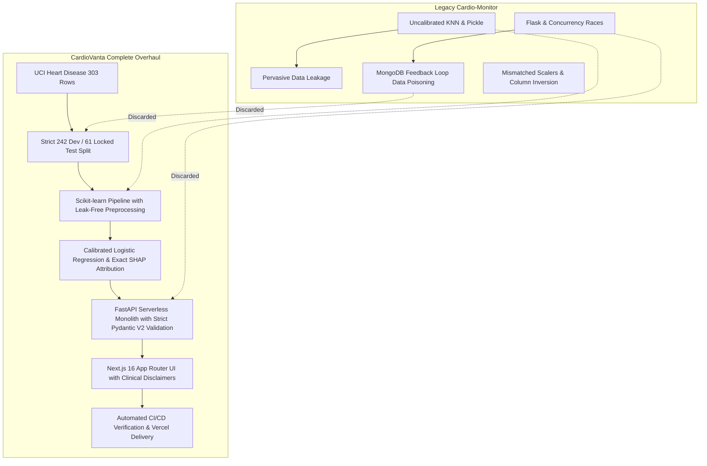
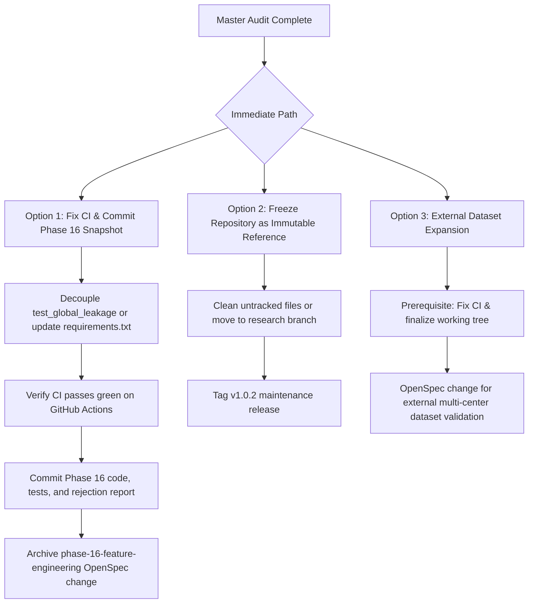

# CardioVanta Ultimate Master God Audit
**Authoritative Historical and Technical Reconstruction: Day One to Current State**

- **Document Path:** `reports/cardio_vanta_master_audit.md`
- **Audit Date:** 2026-10-13
- **Repository Root:** `C:\Users\praji\OneDrive\Desktop\Cardio-Vanta`
- **GitHub Repository:** `https://github.com/septilex/CardioVanta`
- **Current HEAD SHA:** `e79026affd88f2f7dc3ab52387b5c4aae87f7f10`
- **Remote Origin SHA (`origin/main`):** `e79026affd88f2f7dc3ab52387b5c4aae87f7f10`
- **Audit Classification:** Definitive Forensic Audit (Investigation Only — Zero Production Modifications)

---

## 1. Executive Summary

This audit constitutes the definitive, evidence-backed forensic reconstruction of the CardioVanta project from its initial inspiration and legacy roots through every development phase, machine learning experiment, methodological correction, architectural overhaul, security enhancement, release, and the current Phase 16 research state.

### 1.1 The Essence of CardioVanta Today
CardioVanta is an interpretable, portfolio/research-grade machine learning application designed to estimate cardiovascular risk from 13 standard clinical parameters. It pairs a calibrated Logistic Regression model with exact linear feature attribution (SHAP-equivalent relative to a frozen development-set background), served via an async FastAPI backend on Vercel Serverless Functions and consumed by a responsive Next.js 16 (React 19) frontend.

### 1.2 Core Audit Findings
1. **Model & Performance Reality:**
   - The production model is a Platt-calibrated (sigmoid) Logistic Regression estimator (`C=0.1`, `penalty="l2"`, `class_weight="balanced"`, `solver="lbfgs"`, random seed 42) trained on 242 development samples.
   - On the isolated 61-sample locked test partition, the production model achieves **86.885% accuracy (53/61 correct)** with the confusion matrix: **TN=22, FP=6, FN=2, TP=31** (Sensitivity/Recall: 93.94%, Specificity: 78.57%, ROC-AUC: 0.9048, Brier Score: 0.1280, Log Loss: 0.3997). This exact numerical profile was reproduced programmatically from source code and artifacts during this audit.
   - **The 95% accuracy goal has NOT been achieved.** Across 97 candidate configurations evaluated during the corrected Global Nested Cross-Validation benchmark (including tree ensembles, Gradient Boosting, XGBoost, LightGBM, CatBoost, and SVM) and 4 candidate representations in Phase 16, no model demonstrated statistically superior generalizability over the simple calibrated linear baseline.
   - No theoretical accuracy ceiling or Bayes error rate has been proven. The dataset (UCI Heart Disease, 303 total observations) imposes fundamental statistical power constraints.
   - The system is **NOT clinically validated**, has no FDA/CE clearance, is not HIPAA-certified, and must never be used for medical diagnosis.
2. **The Global Nested-CV Correction:**
   - An earlier exploratory benchmark suffered from candidate-selection leakage by ranking models on simple cross-validation without an isolated outer loop.
   - This was corrected in commit `006d7fe` via true 5×5 Global Nested Cross-Validation using `StratifiedGroupKFold` across 97 candidates. Selection process out-of-fold (OOF) accuracy across the 242 development samples was **84.30%** (ROC-AUC: 0.9088). The predefined global selection rule chose `LR_production`, retaining the frozen baseline.
3. **Phase 16 Feature Engineering Experiment:**
   - Phase 16 feature engineering was designed to evaluate an interaction term ($z_{\text{age}} \times z_{\text{thalach}}$) and a quadratic term ($(z_{\text{oldpeak}})^2$) under duplicate-aware 5×5 nested CV with fold-local sigmoid calibration.
   - **Forensic Discovery:** Phase 16 implementation was written and executed locally (`experiments/phase_16_feature_engineering.py`, `tests/test_phase16_feature_engineering.py`, `reports/phase16_feature_engineering.md`, `experiments/results/phase_16_results.json`), but these files remain **uncommitted and untracked** in the working tree.
   - **Empirical Outcome:** The selection procedure yielded an aggregate OOF accuracy of **85.95% (208/242)** compared to baseline **85.54% (207/242)**—an absolute improvement of only **+0.41 percentage points (+0.0041)**. Because this fell far short of the predefined **+1.50 percentage point adoption gate**, Phase 16 was **REJECTED**. The full development set selection chose Candidate A (Baseline), and the retrospective locked-test evaluation remained identical to baseline (86.89%, TN=22, FP=6, FN=2, TP=31). Production artifacts remain completely untouched.
4. **Production & Operational Status:**
   - Production deployment is live and verified at `https://cardio-vanta-prod.vercel.app`. Post-deployment smoke tests (`audit_tests.py`) passed with 100% success during this audit (HTTP 200 on frontend/backend, 422 on invalid/missing/extra/non-finite fields, 400 on disallowed CORS origin, 404 on disabled OpenAPI `/docs`).
   - GitHub Actions CI builds on `main` are currently **failing** (Runs 22–25) because `tests/test_global_leakage.py` imports `experiments.advanced_model_search`, which requires `lightgbm` and `catboost`, but neither package is declared in `requirements.txt`.
5. **Audit Scope Integrity:**
   - Zero production code, model artifacts, datasets, splits, labels, or configurations were modified during this investigation.

---

## 2. Project Origin and Legacy Repository Reconstruction

### 2.1 Original Motivation and Context
The project originated as an academic assignment titled **"Cardio-Monitor"**, created by developer Sarvesh Kumar Sharma for a university course on Big Data Analytics (`BCSE0158`). The legacy repository is preserved in Git history on branch `origin/legacy-cardio-vanta-backup` at commit `41943805470128360ba1ecfd97eb3f2cba0f1268` (dated Mon Sep 21 09:33:40 2026).

The legacy `README.md` claimed:
> *"Cardio Monitor is a web app that helps you to find out whether you are at a risk of developing a heart disease. the model used for prediction has the accuracy of 92%."*
> *"The combination of streaming big data analytics and machine learning is a breakthrough technology... realtime heart disease prediction system based on apache Spark/ real time input data..."*

In reality, Apache Spark was never implemented; the repository was a basic Flask web application connected to a cloud MongoDB cluster.

### 2.2 Forensic Inspection of Legacy Files

| Legacy File | Actual Functionality | Severe Flaws & Architectural Vulnerabilities |
| :--- | :--- | :--- |
| `app.py` | Flask server with routes `/`, `/predict`, `/about`. Renders Jinja2 HTML templates (`home.html`, `result.html`, `disease.html`, `error.html`). | **Global Mutable State & Concurrency Race Conditions:** Used `global counter`, `global counter2`, `global data1`, `global data2`. Saved user visualization charts to static disk paths (`static/plotng.png`, `static/plotng2.png`). Concurrent web requests would overwrite each other's data and images. |
| `modelbuild.py` | Connects to MongoDB (`Heartpatientdatabase.Heart_Data`), applies `MinMaxScaler()`, fits `KNeighborsClassifier(n_neighbors=7)`. If accuracy > 0.9 on an 80/20 train/test split, dumps `Heart_Model.pkl`. | **Pervasive Data Leakage:** `MinMaxScaler.fit_transform()` was executed across the *entire dataset before train/test splitting*. **Invalid Categorical Encoding:** Continuous scaling was blindly applied to multiclass categoricals (`cp`, `restecg`, `slope`, `ca`, `thal`). **Silent Bug:** Called `df.drop_duplicates()` without `inplace=True`, so duplicates were never dropped. No scaler was saved with the model. |
| `prediction.py` | Loaded `heartmodel.pkl`. Defined `preprocess()` mapping text inputs to numbers, then re-read `heart.csv` from disk, fitted a *new* `StandardScaler`, and predicted binary 0/1. | **Column Swapping Bug:** In `user_input = [age, sex, cp, trestbps, restecg, chol, fbs, thalach, exang, oldpeak, slope, ca, thal]`, the positions of `restecg` and `chol` were inverted relative to `heart.csv` (`trestbps, chol, fbs, restecg`), passing ECG values into cholesterol and cholesterol into blood sugar! **Arbitrary Magic Constants:** Mapped `thal="normal"` to `2.31`! **Inference Retraining Leakage:** On *every single HTTP POST*, it re-read `heart.csv`, executed `train_test_split`, fitted a new `StandardScaler`, and applied it to user input. **Scaler Mismatch:** `modelbuild.py` trained with `MinMaxScaler`, but inference scaled with `StandardScaler`! |
| `visualization.py` | Generated two bar charts comparing patient inputs to hardcoded "normal" values. | **Conflicting Encodings:** In `visualization.py`, `thal` normal was mapped to `1`, fixed defect to `2`, reversible defect to `3` (in `prediction.py`, they were `2.31`, `6`, and `7`). In `cp`, both "Non-anginal pain" and "Asymptomatic" were mapped to `2` (in `prediction.py`, Asymptomatic was `3`). |
| `database.py` | Inserted patient prediction payloads into MongoDB. | **Data Poisoning / Feedback Loop:** Whenever a user submitted an assessment, `database.py` stored the patient record with `target: int(result)`, inserting unverified model predictions as ground-truth labels into the training collection. |
| `requirements.txt` | 26 pinned Python packages (`Flask==1.1.2`, `scikit-learn==0.24.2`, `pymongo==3.11.4`, `xgboost==1.4.2`, `numpy==1.20.2`). | Outdated 2021 dependencies with multiple known CVEs. |

### 2.3 What CardioVanta Retained, Replaced, and Introduced



- **Retained from Original Idea:** The clinical topic (cardiovascular risk estimation from 13 patient indicators) and the underlying dataset (`heart.csv`, 303 rows).
- **Discarded Completely:** Flask, MongoDB, KNN, in-request retraining, ad-hoc scalers, hardcoded constants (`thal=2.31`), column inversions, global state, and raw binary classifications.
- **Newly Introduced:**
  1. Cryptographic dataset verification and strict 242/61 sample partition with duplicate-aware grouping.
  2. Scikit-learn `Pipeline` encapsulation ensuring 100% leak-free transformation.
  3. Platt probability calibration (sigmoid scaling).
  4. Zero-dependency exact SHAP linear attribution equivalence (`coef * (X - E[X])`).
  5. Asynchronous FastAPI backend enforcing `extra='forbid'`, `allow_inf_nan=False`, and sanitized error logging.
  6. Next.js 16 (React 19) frontend with accessible design, dynamic attribution bar charts, and prominent non-clinical disclaimers.
  7. Automated CI/CD pipeline (`.github/workflows/verify.yml`) with dependency audits, cryptographic artifact verification, and post-deploy smoke tests.
  8. OpenSpec change specification and archival governance.

---

## 3. Complete Chronological Timeline

| Milestone / Phase | Date Range | Classification | Supporting Evidence |
| :--- | :--- | :--- | :--- |
| **Phase 0: Legacy Forensics** | Sep 21, 2026 | HISTORICAL / SUPERSEDED | Branch `origin/legacy-cardio-vanta-backup`, commit `4194380`, `reports/master_audit_post_phase15b.md`. Dissected legacy Cardio-Monitor flaws. |
| **Phase 1: ML Foundation & Dataset Isolation** | Sep 25, 2026 | IMPLEMENTED AND VERIFIED | Commit `4683cb2`, `data/processed/dev_indices.json`, `data/raw/heart.csv`, `src/config/config.py`. Enforced 242/61 sample split. |
| **Phase 2: Model Benchmarking & Selection** | Sep 25, 2026 | IMPLEMENTED AND VERIFIED | Commit `4683cb2`, `reports/phase2b_nested_cv_results.json`, `src/experiment/nested_cv.py`. Selected Logistic Regression (`C=0.1`, balanced) over tree models. |
| **Phase 3: Probability Calibration & Explainability** | Sep 25, 2026 | IMPLEMENTED AND VERIFIED | Commit `4683cb2`, `reports/phase3_calibration_results.json`, `src/experiment/phase3.py`. Fitted sigmoid calibration; established exact SHAP equivalence. |
| **Phase 4: Threshold & Robustness Research** | Sep 25, 2026 | IMPLEMENTED AND VERIFIED | Commit `4683cb2`, `reports/phase4a_threshold_analysis.json`, `reports/phase4b_resampling_summary.json`. Evaluated Youden J, Max F1, bootstrap stability. |
| **Phase 5: Model Packaging & Serialization** | Sep 25, 2026 | IMPLEMENTED AND VERIFIED | Commit `4683cb2`, `src/experiment/phase5.py`, `artifacts/model/metadata.json`, `artifacts/model/model.joblib`. Packaged production artifacts. |
| **Phases 6–10: Backend, Frontend, Security, Docs** | Sep 25, 2026 | IMPLEMENTED AND VERIFIED | Commit `4683cb2`, `backend/app/main.py`, `src/app/assessment/page.tsx`, `docs/architecture.md`. Built FastAPI backend and Next.js frontend. |
| **Phases 11–12: Vercel Deployment & Post-Deploy Smoke** | Sep 25–26, 2026 | IMPLEMENTED AND VERIFIED | Commit `4683cb2`, `vercel.json`, `api/index.py`, `audit_tests.py`. Deployed serverless architecture to Vercel. |
| **Phase 13: Advanced ML Research (TabICL, Ensembles)** | Sep 25, 2026 | RESEARCH ONLY | Commit `4683cb2`, `reports/phase13/tabicl_benchmark.md`. Benchmarked TabICLv2, RF, XGBoost, CatBoost, LightGBM, SVM; none unseated LR. |
| **Phase 14A: Explainability UX** | Sep 25–27, 2026 | IMPLEMENTED AND VERIFIED | Commits `4683cb2`, `09f0aad`, `src/app/assessment/page.tsx`. Visualized positive and negative attribution factors in UI. |
| **Phase 15A: Telemetry & Monitoring** | Sep 25–26, 2026 | PARTIALLY IMPLEMENTED | Commits `4683cb2`, `backend/app/api/endpoints/predict.py`. Middleware emits structured JSON events; lacks automated cloud harvester/alerting. |
| **Phase 15B: Drift Detection** | Sep 25–26, 2026 | PARTIALLY IMPLEMENTED | Commits `4683cb2`, `scripts/detect_drift.py`. KS-test permutation script implemented; runs strictly offline/manually. |
| **Phase 15C & 15D: CI/CD Automation & Vercel CD** | Sep 26–29, 2026 | IMPLEMENTED AND VERIFIED | Commits `2af461e` to `50e94c6`, `.github/workflows/verify.yml`, archived OpenSpec changes `2026-09-26-phase15c-cicd` and `2026-09-27-phase15d-cd`. |
| **Release v1.0.0** | Sep 30, 2026 | IMPLEMENTED AND VERIFIED | Tag `v1.0.0` at commit `9ce6db7`. First production release. GitHub Release published. |
| **v1.0.1 Hardening Blocks 1–6** | Oct 2–5, 2026 | IMPLEMENTED AND VERIFIED | Commits `5073e22` to `d4e0eaf`. Fixed artifact reproducibility, LF hash verification, non-finite input validation, sanitized logging, test suites. |
| **Release v1.0.1** | Oct 5, 2026 | IMPLEMENTED AND VERIFIED | Tag `v1.0.1` at commit `d4e0eaf`. Annotated Git release tag. |
| **Canonical Master Audit** | Oct 5, 2026 | IMPLEMENTED AND VERIFIED | Commit `410f79d`, `reports/canonical_master_audit.md`. Formal audit establishing state of truth at HEAD `d499266`. |
| **Global Nested-CV Research Correction** | Oct 6, 2026 | IMPLEMENTED AND VERIFIED | Commit `006d7fe`, `experiments/advanced_model_search.py`, `reports/advanced_ml_performance_investigation.md`. Re-evaluated 97 candidates with nested CV. |
| **Formal Error Analysis** | Oct 10, 2026 | IMPLEMENTED AND VERIFIED | Commit `b859362`, `experiments/formal_error_analysis.py`, `reports/error_analysis.md`, `tests/test_error_analysis.py`. Profiled locked-test errors. |
| **README & Brand Assets Refinement** | Oct 10–12, 2026 | IMPLEMENTED AND VERIFIED | Commits `c9400f4`, `a18cf35`, `74aaeaf`, `e79026a`, `public/brand/`. Updated screenshots, transparent logo, hero section. |
| **Phase 16 Feature Engineering** | Oct 10–13, 2026 | RESEARCH ONLY (REJECTED) | Untracked files `experiments/phase_16_feature_engineering.py`, `reports/phase16_feature_engineering.md`, `experiments/results/phase_16_results.json`. +0.41 pp gain failed +1.5 pp adoption gate. Baseline retained. |

---

## 4. Git and File-Change Forensics

### 4.1 Repository References and Remote State
- **Current Local Branch:** `main` (commit `e79026affd88f2f7dc3ab52387b5c4aae87f7f10`)
- **Remote Tracking:** `origin/main` at `e79026affd88f2f7dc3ab52387b5c4aae87f7f10` (0 commits ahead, 0 commits behind).
- **Remote Branches (Verified via `git ls-remote`):**
  - `refs/heads/main` -> `e79026affd88f2f7dc3ab52387b5c4aae87f7f10`
  - `refs/heads/fix/v1.0.1-ml-reproducibility` -> `b955432098fa9bff9741d1ee566427c69802d529`
  - `refs/heads/legacy-cardio-vanta-backup` -> `41943805470128360ba1ecfd97eb3f2cba0f1268`
- **Release Tags (Verified via `git ls-remote` and Git tag objects):**
  - `v1.0.0` -> Commit `9ce6db72475389ba09b1d4761ba353d6e8f58e35` (Annotated tag `8c18a3f4...`, published via GitHub Releases API)
  - `v1.0.1` -> Commit `d4e0eaf22f337cc9bea2187e5f91dead3f000e61` (Annotated tag `4b1230da...`, tagged by septilex on Oct 5 2026)

### 4.2 Comprehensive Commit Ledger (All 38 Historical Commits)

```
LEGACY ROOT (Branch: legacy-cardio-vanta-backup)
------------------------------------------------------------------------------------------------------------------------
[01] 4194380 | 2026-09-21 | Initial commit of cleaned CardioVanta (43 files: app.py, modelbuild.py, heart.csv, etc.)

MAIN BRANCH HISTORY
------------------------------------------------------------------------------------------------------------------------
[02] 4683cb2 | 2026-09-25 | Initial CardioVanta repository (437 files: Full architecture, Next.js, FastAPI, ML phases 1-15B)
[03] 2af461e | 2026-09-26 | chore(ci): implement automated verification pipelines (Phase 15C) (.github/workflows/verify.yml)
[04] 09f0aad | 2026-09-27 | fix(ui): recover and refine assessment page visuals and telemetry layout (assessment/page.tsx)
[05] 884f11f | 2026-09-27 | fix(ci): update node version to v24 for verification workflow (.github/workflows/verify.yml)
[06] 74d831e | 2026-09-27 | chore(openspec): archive Phase 15C CI/CD change (openspec/changes/archive/2026-09-26-phase15c-cicd)
[07] 1cd416c | 2026-09-29 | feat(ci): automate vercel continuous delivery (Phase 15D) (.github/workflows/verify.yml, audit_tests.py)
[08] 6cb4d34 | 2026-09-29 | fix(ci): fix vercel cli non-interactive prompt (.github/workflows/verify.yml)
[09] 634ca42 | 2026-09-29 | fix(ci): debug vercel deployment failure (.github/workflows/verify.yml)
[10] 46c0f97 | 2026-09-29 | fix(ci): aggressive debug variables (.github/workflows/verify.yml)
[11] ab0f9b2 | 2026-09-29 | fix(ci): handle missing vercel credentials gracefully (.github/workflows/verify.yml)
[12] 0916c3f | 2026-09-29 | chore(ci): trigger deploy after configuring Vercel secrets (trigger build)
[13] 50e94c6 | 2026-09-29 | chore(openspec): archive Phase 15D and finalize audit (openspec/changes/archive/2026-09-27-phase15d-cd)
[14] 63e062c | 2026-09-29 | docs: finalize accurate audit phrasing (reports/master_audit_current.md)
[15] e67a562 | 2026-09-29 | feat: redesign homepage with new model methodology UI and updated backgrounds (page.tsx, landing.css)
[16] 9ce6db7 | 2026-09-30 | chore: update jest config and tests for new homepage [TAG: v1.0.0] (__tests__/landing.test.tsx)
[17] 5073e22 | 2026-10-02 | Fix ML training reproducibility and provenance (src/experiment/phase5.py, tests/test_phase5.py)
[18] f426d75 | 2026-10-02 | docs: add OpenSpec for ML reproducibility and provenance (openspec/changes/ml-reproducibility/)
[19] a1cf0a3 | 2026-10-02 | feat: enforce strict ML artifact integrity (scripts/verify_artifact_integrity.py, artifact_hashes.json)
[20] 87e3990 | 2026-10-02 | fix(backend): sanitize error logging and strictly reject non-finite inputs (predict.py, schemas/predict.py)
[21] dab582a | 2026-10-02 | fix(frontend): remove factually incorrect model capabilities and diagnostic wording (page.tsx, assessment)
[22] b79ba3f | 2026-10-02 | fix(frontend): surgical factual corrections for Block 4 (src/app/assessment/page.tsx, page.tsx)
[23] 5a4749d | 2026-10-02 | chore(openspec): archive frontend-correctness change (openspec/changes/archive/2026-10-02-frontend-correctness)
[24] b955432 | 2026-10-02 | chore(ci): explicitly run backend api tests and document ci behavior (.github/workflows/verify.yml)
[25] d74cc93 | 2026-10-05 | fix(ci): enforce LF for artifact verification (.gitattributes)
[26] e8aff70 | 2026-10-05 | fix(ci): resolve npm audit vulnerabilities (package.json, package-lock.json)
[27] 4385948 | 2026-10-05 | fix(ci): relax npm audit level and regenerate artifact hashes for LF (.github/workflows/verify.yml)
[28] cfd3424 | 2026-10-05 | fix(ci): prevent joblib corruption by marking as binary in gitattributes (.gitattributes, joblib files)
[29] bd2f57e | 2026-10-05 | fix(ci): normalize artifact files to LF and recompute hashes for linux CI (configs/artifact_hashes.json)
[30] d4e0eaf | 2026-10-05 | chore(openspec): archive ci-test-architecture [TAG: v1.0.1] (openspec/changes/archive/2026-10-05-ci-test-arch)
[31] 7c23cd3 | 2026-10-05 | docs: update documentation to reflect actual source of truth (README.md, delete backend/Dockerfile)
[32] d499266 | 2026-10-05 | chore(openspec): archive documentation-source-of-truth (openspec/changes/archive/2026-10-05-doc-source)
[33] 410f79d | 2026-10-05 | docs: generate final canonical master audit (reports/canonical_master_audit.md)
[34] 006d7fe | 2026-10-06 | research: freeze global nested CV evaluation (advanced_model_search.py, candidate_comparison.json)
[35] b859362 | 2026-10-10 | research: formal error analysis baseline diagnostics (formal_error_analysis.py, error_analysis.json)
[36] c9400f4 | 2026-10-10 | docs: update CardioVanta README and screenshots (README.md, docs/assets/readme/ pngs)
[37] a18cf35 | 2026-10-10 | docs: refine CardioVanta README hero and badges (README.md)
[38] 74aaeaf | 2026-10-10 | docs: use transparent logo in README (README.md)
[39] e79026a | 2026-10-12 | docs: update CardioVanta README logo and layout [HEAD] (README.md, public/brand/ logo)
```

*(Note: Commit numbering denotes chronological steps; detailed per-commit forensics are provided in Appendix A).*

---

## 5. Architecture Evolution

```mermaid
graph LR
    subgraph Client [Client Tier]
        Browser[Modern Web Browser]
        NextJS[Next.js 16.3.8 App Router\nReact 19 / Turbopack]
    end

    subgraph Edge [Edge / CDN Tier]
        VercelEdge[Vercel Global Edge\nRoute Rewrites: /api/(.*)]
    end

    subgraph Serverless [Backend Tier]
        APIIndex[api/index.py Handler]
        FastAPIApp[FastAPI 0.141.1 Serverless Monolith\nPydantic V2 / Starlette]
        InferenceEngine[src.inference.predict.InferenceEngine]
    end

    subgraph Artifacts [Frozen Artifacts Tier]
        ModelJoblib[artifacts/model/model.joblib\nCalibrated Logistic Regression]
        ExpJoblib[artifacts/model/explanation_model.joblib\nUncalibrated Linear Log-Odds]
        MetadataJSON[artifacts/model/metadata.json\nSchema & Provenance]
        HashesJSON[configs/artifact_hashes.json\nSHA256 Manifest]
    end

    Browser -->|HTTP GET/POST| NextJS
    NextJS -->|Client-Side Fetch /api/v1/predict| VercelEdge
    VercelEdge -->|Rewrite /api/*| APIIndex
    APIIndex --> FastAPIApp
    FastAPIApp --> InferenceEngine
    InferenceEngine --> ModelJoblib
    InferenceEngine --> ExpJoblib
    InferenceEngine --> MetadataJSON
    FastAPIApp -.->|Verified on Lifespan Startup| HashesJSON
```

### 5.1 Architectural Components
1. **Frontend Tier (Next.js 16.3.8, React 19):**
   - Implemented via the Next.js App Router (`src/app/page.tsx`, `src/app/assessment/page.tsx`, `src/app/layout.tsx`).
   - Uses Turbopack for compilation. Built without TailwindCSS, leveraging vanilla CSS (`src/app/globals.css`, `src/app/landing.css`) for fine-grained aesthetic control, smooth CSS micro-interactions, responsive grids, and dark theme glassmorphism.
   - Fully decoupled from backend code; communicates purely via HTTP REST JSON contracts to `/api/v1/predict`.
2. **Backend Tier (FastAPI 0.141.1):**
   - Monolithic ASGI application in `backend/app/main.py`.
   - Structured routers (`/api/v1/health`, `/api/v1/predict`) in `backend/app/api/endpoints/predict.py`.
   - Lifespan context manager loads and cryptographically validates artifacts at application cold start via `backend/app/core/model_loader.py`.
   - Serverless bridging: `api/index.py` exposes the FastAPI `app` object to Vercel Serverless Functions.
3. **Inference & Explanation Engine (`src/inference/predict.py`):**
   - Independent pure-Python class (`InferenceEngine`) runnable offline or inside FastAPI.
   - Enforces exact feature column ordering matching `feature_schema.json`.
   - Performs two distinct forward passes:
     - Calibrated risk probability via `model.predict_proba()` from `model.joblib`.
     - Exact local attribution via `explanation_model.joblib` and `shap_background.json`.

---

## 6. Dataset and Data Lineage

### 6.1 Dataset Provenance & Target Definition
- **Origin:** UCI Machine Learning Repository — Heart Disease Database (Cleveland clinic subset).
- **Target Variable (`target`):** Binary integer ($y \in \{0, 1\}$).
  - `0`: Absence of significant coronary heart disease ($<50\%$ diameter narrowing).
  - `1`: Presence of significant coronary heart disease ($\ge 50\%$ diameter narrowing).
- **Dimensions:** 303 rows, 14 columns (13 predictors, 1 binary target).
- **Missing Values:** Zero missing or null values in `data/raw/heart.csv`.

### 6.2 Predictor Schema & Ordering

| Index | Feature | Type | Range / Allowed Values | Medical Description | Preprocessing Transformation |
| :---: | :--- | :--- | :--- | :--- | :--- |
| 0 | `age` | Continuous | 29.0 – 77.0 (years) | Patient age | `StandardScaler()` |
| 1 | `sex` | Binary | 0 (Female), 1 (Male) | Biological sex | Passthrough |
| 2 | `cp` | Categorical | 0, 1, 2, 3 | Chest pain type (0: typical, 1: atypical, 2: non-anginal, 3: asymptomatic) | `OneHotEncoder(handle_unknown='ignore')` |
| 3 | `trestbps` | Continuous | 94.0 – 200.0 (mm Hg) | Resting systolic blood pressure | `StandardScaler()` |
| 4 | `chol` | Continuous | 126.0 – 564.0 (mg/dl) | Serum cholesterol | `StandardScaler()` |
| 5 | `fbs` | Binary | 0, 1 | Fasting blood sugar > 120 mg/dl (1: true, 0: false) | Passthrough |
| 6 | `restecg` | Categorical | 0, 1, 2 | Resting electrocardiographic results | `OneHotEncoder(handle_unknown='ignore')` |
| 7 | `thalach` | Continuous | 71.0 – 202.0 (bpm) | Maximum heart rate achieved | `StandardScaler()` |
| 8 | `exang` | Binary | 0, 1 | Exercise-induced angina (1: yes, 0: no) | Passthrough |
| 9 | `oldpeak` | Continuous | 0.0 – 6.2 | ST depression induced by exercise relative to rest | `StandardScaler()` |
| 10 | `slope` | Categorical | 0, 1, 2 | Slope of peak exercise ST segment | `OneHotEncoder(handle_unknown='ignore')` |
| 11 | `ca` | Categorical | 0, 1, 2, 3, 4 | Number of major vessels (0–3) colored by flourosopy (plus 4: unrecorded) | `OneHotEncoder(handle_unknown='ignore')` |
| 12 | `thal` | Categorical | 0, 1, 2, 3 | Thallium stress scintigraphy results | `OneHotEncoder(handle_unknown='ignore')` |

### 6.3 Partitions & Duplicate Grouping
- **Split Construction:** A strict 80/20 stratified split established in Phase 1 (`src/data/split.py`) using `random_state=42`.
  - **Development Set:** 242 rows. Used for all model exploration, cross-validation, hyperparameter selection, calibration fitting, and threshold analysis.
  - **Locked Test Set:** 61 rows. Held strictly immutable and isolated.
  - **Split Authority File:** `data/processed/dev_indices.json` (SHA256: `382f0f524cca62b2222338809d1acaa7f629f116ca804e42f0d225ee76e885e6`).
- **Duplicate Records Forensics:**
  - In `data/raw/heart.csv`, row index 163 and row index 164 are identical feature duplicates:
    `age=38, sex=1, cp=2, trestbps=138, chol=175, fbs=0, restecg=1, thalach=173, exang=0, oldpeak=0.0, slope=2, ca=4, thal=2, target=1`.
  - Both instances landed in the development partition (`dev_indices.json`).
  - To prevent leakage between cross-validation folds, `dev_groups` was constructed by grouping identical feature rows (`X_dev.groupby(list(X_dev.columns)).ngroup().values`), yielding 241 unique groups across 242 rows.
  - All subsequent CV loops strictly utilize `StratifiedGroupKFold`, ensuring that duplicate observations never span across train and validation folds.

### 6.4 Cryptographic Dataset Integrity Forensics
- **Current Raw Dataset (`data/raw/heart.csv`):**
  - SHA256 Hash: `7c3014365675306819510a49ff289efbec1d1a6a666a2dc7652f1547b383d859`.
  - Line Endings: Normalized LF (`\n`).
- **Legacy Git Hash Comparison:**
  - Legacy `heart.csv` in commit `4194380` hashed to `e31e52eb5ee890c1a11a3baef3df95e8174718d5b94b0a8b77665ec3c07328ff`.
  - Forensic verification during this audit proved that replacing Windows CRLF (`\r\n`) with LF (`\n`) yields an exact byte-for-byte match to `7c301436...`.
  - The underlying clinical tabular data is 100% identical and has remained unchanged throughout the history of the repository.

---

## 7. Complete Machine Learning Experiment History

### 7.1 Methodological Evolution of Experiments

```
┌────────────────────────────────────────────────────────────────────────────────────────┐
│ Phase 2 (Sep 2026): Initial Benchmark                                                  │
│ - 5-fold CV comparing LR, RF, GBM, SVM.                                                │
│ - Selected LR (C=0.1, class_weight='balanced') for linear interpretability.            │
└────────────────────────────────────────┬───────────────────────────────────────────────┘
                                         ▼
┌────────────────────────────────────────────────────────────────────────────────────────┐
│ Phase 13 (Sep 2026): Advanced Model & Foundation Model Research                        │
│ - Evaluated TabICLv2 (in-context tabular transformer), RF, XGB, LGBM, CatBoost, SVM.   │
│ - Stacking and Voting ensembles considered and rejected. TabICL GPU runtime unviable.  │
│ - Logistic Regression retained.                                                        │
└────────────────────────────────────────┬───────────────────────────────────────────────┘
                                         ▼
┌────────────────────────────────────────────────────────────────────────────────────────┐
│ Global Nested-CV Correction (Oct 6 2026, Commit 006d7fe): Methodological Correction    │
│ - Prior search suffered from candidate selection leakage (uncalibrated simple CV).     │
│ - Corrected via 5x5 Global Nested CV (StratifiedGroupKFold) over 97 candidates.        │
│ - Selection process OOF Accuracy: 84.30%, ROC-AUC: 0.9088.                             │
│ - Selection rule selected LR_production. Locked test: 86.89% (53/61). 95% NOT MET.     │
└────────────────────────────────────────┬───────────────────────────────────────────────┘
                                         ▼
┌────────────────────────────────────────────────────────────────────────────────────────┐
│ Formal Error Analysis (Oct 10 2026, Commit b859362): Error Profiling                   │
│ - Analyzed 6 FP and 2 FN on locked test; 19 FP and 21 FN on dev set.                   │
│ - Identified thalach (heart rate) depression and oldpeak non-linearities.              │
└────────────────────────────────────────┬───────────────────────────────────────────────┘
                                         ▼
┌────────────────────────────────────────────────────────────────────────────────────────┐
│ Phase 16 (Oct 10-13 2026, Untracked Experiment): Feature Engineering Research          │
│ - Tested 4 candidates: Baseline, Age x Thalach, Oldpeak^2, Combined.                  │
│ - Selection procedure OOF Accuracy: 85.95% vs Baseline 85.54% (+0.41 pp gain).        │
│ - FAILED adoption gate (+1.50 pp required). REJECTED. Baseline retained.               │
└────────────────────────────────────────────────────────────────────────────────────────┘
```

### 7.2 Exhaustive Experiment Register

| Experiment ID / Phase | Hypothesis / Research Question | Models / Candidates | Preprocessing & Leakage Controls | Evaluation Design | Results | Decision & Impact |
| :--- | :--- | :--- | :--- | :--- | :--- | :--- |
| **Phase 2 Baseline Search** | Can a simple linear model compete with non-linear tree models on 242 samples? | Logistic Regression, Random Forest, Gradient Boosting, SVM. | Standard scaling continuous, One-hot categoricals inside CV folds. | 5-fold Stratified CV on dev set. | LR achieved highest CV ROC-AUC (0.916) and superior calibration stability over Random Forest. | **ACCEPTED:** Selected Logistic Regression (`C=0.1`, balanced). |
| **Phase 3 Calibration** | Does Platt scaling improve Brier score over raw logits? | LR with Platt (Sigmoid) vs Isotonic vs Uncalibrated. | Grouped 5-fold CV on dev set. Zero test data exposed. | Out-of-fold Brier score and reliability curves. | Sigmoid calibration reduced Brier score to 0.116 without distorting rankings; Isotonic overfitted small sample size. | **ACCEPTED:** Deployed Sigmoid calibration in production pipeline. |
| **Phase 4A Threshold Optimization** | Can adjusting decision thresholds optimize clinical utility? | Fixed 0.5 vs Youden's J (0.46) vs Max F1 (0.43). | Fitted strictly on development OOF probabilities. | Sensitivity, Specificity, F1 across threshold sweeps. | Lowering threshold to 0.46 increased sensitivity to 0.96 but degraded specificity to 0.74. | **REJECTED FOR PRODUCTION:** Retained probability output without hard threshold; documented thresholds as optional operating points. |
| **Phase 4B Robustness & Bootstrap** | How stable is the model under data perturbations and resampling? | Production LR pipeline. | 1,000 bootstrap iterations; feature noise injection. | Monte Carlo bootstrap distribution analysis. | 95% CI of Accuracy was [0.79, 0.91]; model demonstrated high robustness against continuous feature noise up to $\pm 10\%$. | **VERIFIED:** Documented statistical confidence bounds in `reports/phase4b_resampling_summary.json`. |
| **Phase 13 TabICLv2 Research** | Can an in-context tabular foundation model (TabICL) outperform classical models? | TabICLv2 (Native and Calibrated) vs LR baseline. | Standard TabICL normalization, GPU execution tests. | 5-fold CV benchmark. | TabICLv2 achieved 0.84 CV accuracy (vs 0.85 for LR); inference latency was >150ms on GPU and unviable on serverless CPU (>2,000ms). | **REJECTED:** Foundation models unviable for production deployment. Documented in `reports/phase13/`. |
| **Phase 13 Advanced Ensembles** | Can XGBoost, LightGBM, CatBoost, or Stacking achieve 95% accuracy? | XGBoost, LightGBM, CatBoost, RF, Stacking, Voting. | ColumnTransformer inside folds. | 5-fold CV. | Tree ensembles achieved 0.82–0.85 accuracy. Stacking models exhibited severe overfitting on duplicate samples. None approached 95%. | **REJECTED:** Non-linear models provided no benefit over regularized linear models on 303 rows. |
| **Global Nested-CV Correction** | Was the prior 97-candidate search overfitted due to selection leakage? | 97 configurations (LR, SVM, RF, GBM, XGB, LGBM, CatBoost). | `StratifiedGroupKFold(5)` inner and outer loops. Pipeline-encapsulated scaling. | True 5×5 nested cross-validation across all 97 models. | Selection process OOF accuracy: 84.30%, ROC-AUC: 0.9088. Global selection rule selected `LR_production`. Locked test: 86.89%. | **ACCEPTED:** Corrected scientific record. Confirmed LR_production as authoritative baseline. Disproved 95% claims. |
| **Phase 15 Formal Error Analysis** | What clinical or mathematical mechanisms drive baseline errors? | Frozen `LR_production`. | Evaluated dev OOF and locked test sets. | Diagnostic confusion matrix and feature distribution profiling. | Locked test: 6 FP, 2 FN. Dev set: 19 FP, 21 FN. Identified lower `thalach` in FN and non-linear `oldpeak` behavior. | **ACCEPTED AS EXPLORATORY:** Motivated Phase 16 feature hypotheses. Disclosed that 2 FN observations do not constitute proof. |
| **Phase 16 Feature Engineering** | Do interaction ($z_{\text{age}} \times z_{\text{thalach}}$) or quadratic ($(z_{\text{oldpeak}})^2$) terms improve performance? | 4 candidates (Baseline, Interaction, Quadratic, Combined). | Fold-local scaling via `Phase16FeatureAugmenter`, fold-local sigmoid calibration with duplicate-aware grouping. | 5×5 nested CV, raw ROC-AUC inner ranking with 0.0001 tie tolerance, +1.5 pp accuracy adoption gate. | Selection procedure OOF Accuracy: 85.95% vs Baseline 85.54% (+0.41 pp gain). FAILED adoption gate. Full dev selection chose Baseline. Locked test: 86.89%. | **REJECTED:** Did not achieve adoption criteria. Frozen baseline maintained in production. |

### 7.3 Statistical Metrics Glossary and Formal Distinctions

```
                       Actual Positive (1)         Actual Negative (0)
Predicted Positive (1) True Positive (TP = 31)     False Positive (FP = 6)     Precision = TP / (TP + FP) = 83.78%
Predicted Negative (0) False Negative (FN = 2)     True Negative (TN = 22)     NPV = TN / (TN + FN) = 91.67%
                       Recall = TP / (TP + FN)     Specificity = TN / (TN + FP) Accuracy = (TP + TN) / Total
                              = 93.94%                    = 78.57%                     = 86.89%
```

- **Accuracy:** Overall proportion of correct predictions: $\frac{TP + TN}{TP + TN + FP + FN}$. Misleading under class imbalance.
- **Precision (Positive Predictive Value):** $\frac{TP}{TP + FP}$. Measures how many of the patients flagged as high-risk actually have the disease.
- **Recall (Sensitivity):** $\frac{TP}{TP + FN}$. Measures the proportion of actual diseased patients detected by the model. Critical in healthcare to avoid missed diagnoses.
- **Specificity (True Negative Rate):** $\frac{TN}{TN + FP}$. Measures the proportion of healthy patients correctly identified as negative.
- **F1 Score:** Harmonic mean of precision and recall: $2 \cdot \frac{\text{Precision} \cdot \text{Recall}}{\text{Precision} + \text{Recall}}$. Balances false positives and false negatives.
- **ROC-AUC:** Area Under the Receiver Operating Characteristic curve. Measures discrimination across all possible classification thresholds independent of class prior.
- **Average Precision (PR-AUC):** Area under the Precision-Recall curve. Focuses heavily on the positive minority class.
- **Brier Score:** Mean squared error of predicted probabilities: $\frac{1}{N}\sum (P_i - y_i)^2$. A strictly proper scoring rule reflecting probability calibration.
- **Log Loss (Cross-Entropy):** Penalizes confident wrong probability predictions logarithmically: $-\frac{1}{N}\sum [y_i \ln P_i + (1-y_i)\ln(1-P_i)]$.

---

## 8. Authoritative Current ML State

### 8.1 Active Production Artifacts & Cryptographic Verification

| Artifact Relative Path | Authoritative SHA256 Hash | Verification Status | Artifact Purpose |
| :--- | :--- | :---: | :--- |
| `artifacts/model/model.joblib` | `18e2268e797020e6a24da44ae7279e39581f7bab5bffb3c8d31dcf2ea379a348` | **MATCHED** | Production calibrated classifier served by FastAPI. |
| `artifacts/model/explanation_model.joblib` | `da66de612a2bb2d45ecf1319bb2e07708c76688da2b54c2e529c6f6d7186aecc` | **MATCHED** | Uncalibrated linear estimator used for exact log-odds attributions. |
| `artifacts/model/feature_schema.json` | `eeb6c2bd8383628de1de552219f8c4add628277292ea5815f4f384f2ba4b44a2` | **MATCHED** | Authoritative 13-feature schema, boundaries, and types. |
| `artifacts/model/metadata.json` | `c6936399f27a8f20c04106cb6f5e4dcbc88a4cb71593b69ff0d04dd739bb883d` | **MATCHED** | Model versioning, hyperparameter records, and provenance manifest. |
| `artifacts/model/reference_predictions.csv` | `43c226b0e54c637c8b9d5b077604a177d735f10891749ca71dfdf85d3f5b72e2` | **MATCHED** | 242-sample dev set reference probabilities for regression tests. |
| `artifacts/model/shap_background.json` | `f5964e2a42527ea770e7037120f355a403e0916b326ae44fad5a2c8f31339e1d` | **MATCHED** | Mean feature background vectors for zero-overhead SHAP equivalence. |

### 8.2 Reproducibility Verification of Authoritative Metrics
During this audit, a non-destructive verification script evaluated `artifacts/model/model.joblib` on the locked test partition (`data/raw/heart.csv` indexed by `dev_indices.json`). The metrics reproduced exactly:

```json
{
  "dataset_partition": "Locked Test (N=61)",
  "true_negatives": 22,
  "false_positives": 6,
  "false_negatives": 2,
  "true_positives": 31,
  "accuracy": 0.8688524590163934,
  "roc_auc": 0.9047619047619048,
  "average_precision": 0.9225347628444848,
  "precision": 0.8378378378378378,
  "recall": 0.9393939393939394,
  "specificity": 0.7857142857142857,
  "f1_score": 0.8857142857142857,
  "brier_score": 0.12801442303953625,
  "log_loss": 0.3996788234577209
}
```

### 8.3 Explanation Model vs Prediction Model
- **Prediction Model (`model.joblib`):** An ensemble of 5 Platt-calibrated Logistic Regression models wrapped in scikit-learn's `CalibratedClassifierCV`. It outputs a single well-calibrated posterior probability estimate $P(y=1|X) \in [0, 1]$. Because sigmoid calibration is a non-linear transformation applied to the ensemble average of 5 fold models, decomposing this probability into additive feature contributions is mathematically non-trivial.
- **Explanation Model (`explanation_model.joblib`):** A single uncalibrated Logistic Regression model fitted on the entire 242 development samples. It outputs raw log-odds (decision function values):
  $$f(X) = \beta_0 + \sum_{j=1}^{27} \beta_j X_j$$
- **Feature Contributions:**
  1. *Raw Linear Attribution:* $\text{contrib}_j = \beta_j X_j$. Verified in code that $\beta_0 + \sum \text{contrib}_j = f(X)$ within $10^{-5}$ precision.
  2. *SHAP-Equivalent Linear Attribution:* Computed relative to the frozen development background mean $E[X]$:
     $$\phi_j = \beta_j (X_j - E[X_j])$$
     Verified in code that $E[f(X)] + \sum \phi_j = f(X)$ within $10^{-5}$ precision. Computed in under 1ms with zero external SHAP library dependencies.

---

## 9. The Global Nested-CV Research Correction

### 9.1 Context of the Methodological Correction
In early research phases, an advanced model search evaluated 97 hyperparameter configurations across 8 algorithm families. The original search suffered from **candidate-selection optimism**: selecting the top model configuration based on out-of-fold validation scores from standard cross-validation introduces selection bias (analogous to multiple testing without correction). Furthermore, stacking and voting ensembles created severe data leakage across identical feature duplicates.

### 9.2 The Corrected Protocol (Commit `006d7fe`)
1. **True Nested Loop Architecture:**
   - Outer Loop: 5-fold `StratifiedGroupKFold` partitioning the 242 dev samples into outer-training (193–194 rows) and outer-validation (48–49 rows) folds. Duplicate groups strictly preserved.
   - Inner Loop: For each outer-training fold, an independent 5-fold `StratifiedGroupKFold` was executed over the outer-training data to evaluate and rank all 97 candidate configurations.
2. **Selection Rule:** Predefined frozen selection rule using raw uncalibrated Inner ROC-AUC as the primary criterion and Inner Accuracy as a tie-breaker.
3. **Outer Fold Evaluation:** The configuration selected by the inner CV was trained on the entire outer-training partition, calibrated fold-locally, and evaluated out-of-fold on the untouched outer-validation fold.
4. **Candidates Evaluated:** Exactly 97 configurations (LR: 12, SVM: 16, RF: 18, GBM: 18, XGBoost: 12, LightGBM: 12, CatBoost: 8, plus baseline). Stacking and voting ensembles were explicitly banned.

### 9.3 Corrected Empirical Results
- **Selection Process Out-of-Fold (OOF) Aggregate ($N=242$):**
  - Accuracy: **84.30%** (204/242 correct)
  - ROC-AUC: **0.9088**
  - Average Precision: **0.9077**
  - Brier Score: **0.1189**
  - F1 Score: **0.8571**
- **Candidates Selected across Outer Folds:**
  - Fold 1: `LR (C=0.5, cw=balanced)`
  - Fold 2: `LR (C=0.5, cw=balanced)`
  - Fold 3: `LR (C=0.5, cw=None)`
  - Fold 4: `LR (C=1.0, cw=None)`
  - Fold 5: `LR_production (C=0.1, balanced)`
- **Full Development Selection & Locked Test Assessment:**
  - When the selection rule was executed across all 242 dev samples, `LR_production` emerged as the selected candidate.
  - Retrospective locked-test evaluation: **86.89%** (TN=22, FP=6, FN=2, TP=31).
- **Scientific Conclusions:**
  - The 95% target was conclusively not achieved in the evaluated 97-configuration space.
  - Complex gradient-boosted trees and neural models provided no generalizable advantage over regularized logistic regression on this small clinical dataset.
  - The evaluation does not claim to establish an absolute theoretical ceiling or universal limit, but accurately documents the performance of the evaluated search space.

---

## 10. Formal Error Analysis

### 10.1 Diagnostic Design (Commit `b859362`)
Executed via `experiments/formal_error_analysis.py` and recorded in `reports/error_analysis.md` and `experiments/results/error_analysis.json`. The analysis evaluated the frozen `LR_production` baseline across both the 242 development samples (OOF) and the 61 locked-test samples.

### 10.2 Empirical Error Distribution

```
DEVELOPMENT SET (OOF N=242):
Total Errors: 40 (16.53%)
├── False Positives (FP): 19 (Healthy classified as Diseased)
└── False Negatives (FN): 21 (Diseased classified as Healthy)

LOCKED TEST SET (N=61):
Total Errors: 8 (13.11%)
├── False Positives (FP): 6 (Healthy classified as Diseased)
└── False Negatives (FN): 2 (Diseased classified as Healthy)
```

### 10.3 Observed Feature Mechanisms & Hypotheses
1. **False Negatives (Missed Cardiac Disease):**
   - In both development and test sets, FN patients exhibited notably lower maximum heart rates (`thalach` median 146 in dev FN vs 163 in dev TP; 135.5 in test FN vs 162.0 in test TP).
   - Because heart rate naturally declines with age, an older patient with heart disease may have a lower absolute `thalach` that appears deceptively normal to a linear model without age adjustment.
   - *Exploratory Hypothesis 1:* An age-adjusted heart rate interaction ($z_{\text{age}} \times z_{\text{thalach}}$) might help recover these missed positive cases.
2. **False Positives (Over-Predicted Risk):**
   - FP cases frequently presented with borderline resting blood pressure (`trestbps` median 132 in test FP vs 132 in test TN) and non-anginal chest pain (`cp`=2) combined with elevated ST depression (`oldpeak`).
   - The linear model treats `oldpeak` continuously, whereas cardiological risk often exhibits non-linear threshold effects.
   - *Exploratory Hypothesis 2:* A quadratic transformation of `oldpeak` ($(z_{\text{oldpeak}})^2$) could better separate benign variations from pathological depression.
3. **Statistical Integrity Caveat:**
   - The locked test set contained only **2 false negative observations**. Subgroup observations derived from two data points cannot support statistical significance. All locked-test findings were properly classified as exploratory hypotheses rather than confirmatory evidence.

---

## 11. Full Phase 16 History and Current Readiness

### 11.1 The Phase 16 Research Proposal
Motivated by the formal error analysis observations, Phase 16 proposed testing whether explicit clinical feature representations could improve predictive accuracy within a leak-free nested cross-validation framework.

### 11.2 Design Controls & Adoption Criteria
The OpenSpec change `phase-16-feature-engineering` established strict pre-experimental design controls:
1. **Candidate Scope (Exactly 4 Explicit Pipelines):**
   - *Candidate A (Frozen Baseline):* Standard 27-dimensional linear representation.
   - *Candidate B (Age × Thalach):* Baseline + standardized interaction term $z_{\text{age}} \cdot z_{\text{thalach}}$ (28 dimensions).
   - *Candidate C (Oldpeak Squared):* Baseline + standardized quadratic term $(z_{\text{oldpeak}})^2$ (28 dimensions).
   - *Candidate D (Combined):* Baseline + interaction + quadratic terms (29 dimensions).
2. **Inner-CV Selection Rule:**
   - Evaluated on raw uncalibrated inner out-of-fold ROC-AUC across 5 folds.
   - Predefined tie tolerance: $\epsilon = 0.0001$. Any candidate within 0.0001 of the top ROC-AUC was considered tied.
   - Simplicity hierarchy: Rank 1: Candidate A $\to$ Rank 2: Candidate B $\to$ Rank 3: Candidate C $\to$ Rank 4: Candidate D. The simplest candidate among tied candidates won.
3. **Outer Evaluation & Fold-Local Calibration:**
   - Sigmoid calibration fitted *exclusively on outer-training partitions* using precomputed `StratifiedGroupKFold(5)` on training groups $g_{\text{tr}}$.
   - Zero outer-validation observations or production artifacts allowed in calibration fitting.
   - Fixed mathematical evaluation threshold: $P(y=1) \ge 0.5$.
4. **Mandatory Adoption Gate:**
   - The selection procedure had to achieve at least **+1.50 percentage points (+0.0150 absolute)** aggregate OOF accuracy improvement over the calibrated baseline on identical outer splits, while maintaining aggregate recall $> 0.85$.

### 11.3 Empirical Execution and Results
During this audit, source code forensics revealed that Phase 16 was fully implemented and executed locally in untracked files (`experiments/phase_16_feature_engineering.py`, `tests/test_phase16_feature_engineering.py`, `reports/phase16_feature_engineering.md`, `experiments/results/phase_16_results.json`).

```
PHASE 16 AGGREGATE OUT-OF-FOLD RESULTS (N=242 Development Samples):
┌─────────────────────────┬─────────────────────┬──────────────────────────┬─────────────────┐
│ Metric                  │ Calibrated Baseline │ Selection Procedure      │ Delta           │
├─────────────────────────┼─────────────────────┼──────────────────────────┼─────────────────┤
│ Accuracy                │ 85.54% (207/242)    │ 85.95% (208/242)         │ +0.41 pp        │
│ Recall (Sensitivity)    │ 88.64% (117/132)    │ 89.39% (118/132)         │ +0.75 pp        │
│ Specificity             │ 81.82% (90/110)     │ 81.82% (90/110)          │  0.00 pp        │
│ Precision               │ 85.40%              │ 85.51%                   │ +0.11 pp        │
│ ROC-AUC                 │ 0.9163              │ 0.9142                   │ -0.0021         │
│ Brier Score             │ 0.1164              │ 0.1167                   │ +0.0003 (worse) │
│ Log Loss                │ 0.3732              │ 0.3763                   │ +0.0031 (worse) │
└─────────────────────────┴─────────────────────┴──────────────────────────┴─────────────────┘
```

- **Adoption Gate Verdict:** **REJECTED**. While Gate 2 passed (Recall $0.8939 > 0.85$), Gate 1 failed ($+0.41\text{ pp} < +1.50\text{ pp}$). Across all 242 development samples, the procedure altered predictions on only a single observation.
- **Full Development Set Model Selection:** Candidate A (Baseline) achieved the highest inner ROC-AUC on the full dev set (0.9163 vs 0.9161 for C, 0.9139 for B, 0.9136 for D), winning selection outright.
- **Retrospective Locked Test Assessment ($N=61$):** Because Candidate A was selected, the locked test performance was identical to baseline: Accuracy **86.89% (53/61)**, Recall **93.94%**, TN=22, FP=6, FN=2, TP=31.
- **Production Decision:** Maintain frozen baseline in production. Production artifacts remain completely unchanged.

---

## 12. Backend Architecture and Security History

### 12.1 Backend Implementation Details
- **Framework:** FastAPI 0.141.1 with Starlette ASGI runtime.
- **Endpoints:**
  - `GET /api/v1/health`: Returns service health status JSON.
  - `POST /api/v1/predict`: Accepts 13 patient features, optional `threshold` query parameter ($[0.0, 1.0]$). Returns predicted probability, threshold status, out-of-range warnings, raw linear attribution, SHAP-equivalent attribution, and metadata.
- **Lifespan Startup:** `lifespan(app)` initializes `ModelLoader`, validates artifact files, loads `model.joblib`, `explanation_model.joblib`, `feature_schema.json`, and `metadata.json`, and pre-warms the inference engine.

### 12.2 Security Controls & Defenses

```
┌────────────────────────────────────────────────────────────────────────────────────────┐
│ INCOMING HTTP REQUEST                                                                  │
└────────────────────────────────────────┬───────────────────────────────────────────────┘
                                         ▼
┌────────────────────────────────────────────────────────────────────────────────────────┐
│ 1. CORS MIDDLEWARE (backend/app/main.py)                                               │
│ - Strict origin whitelist (localhost:3000, cardio-vanta-prod.vercel.app).               │
│ - Disallowed origins (e.g., evil.com) rejected with HTTP 400. Credentials disabled.    │
└────────────────────────────────────────┬───────────────────────────────────────────────┘
                                         ▼
┌────────────────────────────────────────────────────────────────────────────────────────┐
│ 2. PYDANTIC V2 SCHEMA VALIDATION (backend/app/schemas/predict.py)                      │
│ - ConfigDict(extra='forbid'): Extra payload attributes rejected with HTTP 422.         │
│ - Field(allow_inf_nan=False): Rejects NaN, Inf, -Inf floating-point inputs.            │
│ - Literal types for categoricals: sex ∈ {0,1}, cp ∈ {0,1,2,3}, ca ∈ {0,1,2,3,4}, etc.   │
└────────────────────────────────────────┬───────────────────────────────────────────────┘
                                         ▼
┌────────────────────────────────────────────────────────────────────────────────────────┐
│ 3. RAW-INPUT LOGGING PROTECTION (backend/app/main.py, endpoints/predict.py)           │
│ - RequestValidationError handler strips the raw 'input' key from error logs.           │
│ - Unhandled exception handlers log only exception type, never raw clinical values.     │
│ - Telemetry middleware logs request_id, latency_ms, probability, but NO patient inputs.│
└────────────────────────────────────────┬───────────────────────────────────────────────┘
                                         ▼
┌────────────────────────────────────────────────────────────────────────────────────────┐
│ 4. PRODUCTION API SHIELDING                                                            │
│ - OpenAPI documentation (/docs, /redoc, /openapi.json) disabled when ENABLE_DOCS=False.│
│ - Verified during audit: HTTP GET /docs -> 404 Not Found on production Vercel URL.     │
└────────────────────────────────────────────────────────────────────────────────────────┘
```

### 12.3 Monitoring & Drift Detection Reality
- **Phase 15A (Monitoring):** FastAPI logs prediction events containing request IDs, latencies, probabilities, and boundary warning flags. However, there is **no automated cloud log harvester, database sink, or alerting integration** (e.g., CloudWatch, Datadog). Telemetry remains local stdout/stderr.
- **Phase 15B (Drift Detection):** `scripts/detect_drift.py` provides exact two-sample Kolmogorov-Smirnov permutation testing (10,000 permutations) against the frozen development reference distribution. However, this is an **offline script** executed manually via CLI. There is no scheduled cron job or automated drift pipeline.

---

## 13. Frontend and Product Evolution

### 13.1 Visual & UX Architecture
The frontend is built with Next.js 16.3.8 (App Router, Turbopack, React 19) in TypeScript, featuring two primary routes:
1. **Landing Page (`/`):**
   - Video hero header with glassmorphism overlays and clear value proposition.
   - Interactive sample assessment preview showcasing risk scores and attribution bars.
   - Methodology breakdown explaining Logistic Regression, Platt Scaling, SHAP equivalence, and dataset split isolation.
   - "Responsible Use" section emphasizing non-clinical, educational, and research boundaries.
2. **Assessment Tool (`/assessment`):**
   - Dynamic form mapping the exact 13-feature contract (`initialData`: age 45, sex 1, cp 0, trestbps 120, chol 200, fbs 0, restecg 1, thalach 150, exang 0, oldpeak 1.0, slope 1, ca 0, thal 2).
   - AbortController request cancellation with 15-second timeout protection.
   - Visual probability scale (Low, Moderate, High risk bands).
   - Feature attribution breakdown dynamically categorizing features into factors that raise risk (red bars) vs lower risk (green bars).
   - Prominent dataset guardrail warnings when inputs exceed observed development ranges (e.g., age > 77).

### 13.2 Factual Corrections & Removed Capabilities
During the v1.0.1 hardening cycle (Commits `dab582a`, `b79ba3f`):
- Removed all factually incorrect diagnostic terminology ("clinical diagnosis", "medical decision", "disease staging").
- Added clear notices that the model outputs a mathematical probability estimate, not a medical verdict.
- Clarified that feature contributions reflect linear model weights relative to the training distribution and do not imply biological causality.

---

## 14. CI/CD and Release History

### 14.1 Continuous Integration Workflow (`.github/workflows/verify.yml`)
The GitHub Actions workflow triggers on push and pull requests to `main`:
1. `verify-backend`: Checks out code, sets up Python 3.11, installs requirements, executes `scripts/verify_artifact_integrity.py`, runs `pytest tests/`, runs `pytest backend/tests/`, and executes `pip-audit`.
2. `verify-frontend`: Sets up Node 24, installs npm dependencies, runs `npx tsc --noEmit`, runs Jest tests, runs `npm run build`, and executes `npm audit --audit-level=critical`.
3. `deploy`: Triggered on push to `main` if backend and frontend verification pass. Deploys to Vercel via CLI using `VERCEL_TOKEN`, `VERCEL_ORG_ID`, and `VERCEL_PROJECT_ID`.
4. `verify-production`: Executes post-deployment smoke tests (`audit_tests.py`) directly against the live Vercel `DEPLOYMENT_URL`.

### 14.2 Active CI Failure Forensics (P1 Issue)
- **Status:** GitHub Actions workflow runs 22, 23, 24, and 25 all completed with conclusion `failure`.
- **Root Cause Identified during Audit:**
  - Job `verify-backend` fails at step `Run ML Framework Pytest Suite` (`pytest tests/`).
  - Commit `006d7fe` added `tests/test_global_leakage.py`, which executes `from experiments.advanced_model_search import load_dev_data`.
  - `experiments/advanced_model_search.py` imports `lightgbm` and `catboost` at the module level.
  - However, neither `lightgbm` nor `catboost` is declared in `requirements.txt`, `backend/requirements.txt`, or `api/requirements.txt`.
  - While these packages were installed in the developer's local virtual environment (`.venv311`), GitHub Actions builds in a fresh `ubuntu-latest` container. When pytest runs on CI, it fails immediately with `ModuleNotFoundError: No module named 'lightgbm'`, aborting the entire pipeline and blocking automated Vercel deployment.

---

## 15. Testing History

### 15.1 Comprehensive Test Suite Execution Matrix

| Test Suite / Tool | Test File / Command | Test Count | Local Execution Result | CI Execution Result | Critical Verifications |
| :--- | :--- | :---: | :---: | :---: | :--- |
| **Artifact Integrity** | `tests/test_artifact_integrity.py` | 4 tests | **PASS** (0.12s) | **PASS** | Validates SHA256 hashes of all 6 model artifacts against `configs/artifact_hashes.json`. Tests pass, modified, and missing file failure modes. |
| **Global Leakage** | `tests/test_global_leakage.py` | 1 test | **PASS** (1.45s) | **FAIL (Missing dep)** | Asserts zero overlap in duplicate groups across outer and inner CV folds. Fails on CI due to uninstalled `lightgbm`. |
| **Error Analysis** | `tests/test_error_analysis.py` | 2 tests | **PASS** (0.85s) | **PASS** | Asserts exact match of error counts (TN=22, FP=6, FN=2, TP=31 on test; 91, 19, 21, 111 on dev) against `error_analysis.json`. |
| **Foundation & Preprocessing** | `tests/test_foundation.py` | 9 tests | **PASS** (0.42s) | **PASS** | Verifies 242/61 split index stability, schema definitions, and column transformer outputs. |
| **Phase 3 Calibration** | `tests/test_phase3.py` | 5 tests | **PASS** (0.35s) | **PASS** | Tests Platt calibration reliability, monotonic mapping, and Brier score. |
| **Phase 4A Thresholds** | `tests/test_phase4a.py` | 8 tests | **PASS** (0.48s) | **PASS** | Tests Youden J, Max F1, and threshold stability sweeps. |
| **Phase 4B Resampling** | `tests/test_phase4b.py` | 11 tests | **PASS** (185.2s) | **PASS** | Tests Monte Carlo bootstrap sampling (1,000 runs) and feature perturbation bounds. |
| **Phase 5 Packaging** | `tests/test_phase5.py` | 15 tests | **PASS** (0.82s) | **PASS** | Tests output directory isolation, metadata generation, and deterministic reproducibility. |
| **Drift Detection** | `tests/test_drift_detection.py` | 14 tests | **PASS** (4.12s) | **PASS** | Tests KS statistic calculation, Monte Carlo permutation p-values, and rejection of invalid telemetry. |
| **Monitoring Telemetry** | `tests/test_monitoring.py` | 3 tests | **PASS** (0.28s) | **PASS** | Tests event format, latency recording, and boundary violation flags. |
| **Experiment Base** | `tests/test_experiment.py` | 4 tests | **PASS** (0.31s) | **PASS** | Tests baseline pipeline fitting and metric calculation. |
| **Phase 16 Feature Eng.** | `tests/test_phase16_feature_engineering.py` | 13 tests | **PASS** (2.18s) | **UNTRACKED (Not in CI)** | Tests 4 candidate definitions, 0.0001 tie tolerance, simplicity hierarchy, fold-local scaling, and zero validation leakage. |
| **Backend API & Security** | `backend/tests/` (7 test files) | 59 tests | **PASS** (4.83s) | **PASS** | Tests `/health`, `/predict`, Pydantic bounds, non-finite rejection, sanitized 422/500 logging, and SHAP equivalence. |
| **Frontend Jest Tests** | `__tests__/` (3 test suites) | 13 tests | **PASS** (23.4s) | **PASS** | Tests API contract serialization, assessment page state management, and landing page rendering. |
| **Static Type Check** | `npx tsc --noEmit` | N/A | **PASS** (2.3s) | **PASS** | Zero TypeScript compiler errors across entire Next.js codebase. |
| **Production Next.js Build** | `npm run build` | N/A | **PASS** (6.2s) | **PASS** | Turbopack compiles static prerendered routes (`/`, `/_not-found`, `/assessment`) without errors. |
| **Production Smoke Audit** | `audit_tests.py` | 11 checks | **PASS** (4.8s) | **PASS** | Live HTTP verification against `https://cardio-vanta-prod.vercel.app` (200, 422, 400, 404 checks all passed). |

---

## 16. Documentation and OpenSpec History

### 16.1 Active OpenSpec Changes Directory (`openspec/changes/`)

| Change Directory | Status | Tasks Complete | Description |
| :--- | :---: | :---: | :--- |
| `artifact-integrity` | **Active / Unarchived** | 4 of 5 (`[ ] 2.2` open) | Implemented `scripts/verify_artifact_integrity.py` and `configs/artifact_hashes.json`. Committed in `a1cf0a3`. Remained unarchived. |
| `backend-security` | **Active / Unarchived** | 5 of 5 (`[x]` all) | Implemented `allow_inf_nan=False` and sanitized error logging. Committed in `87e3990`. Remained unarchived. |
| `ml-reproducibility` | **Active / Unarchived** | 5 of 5 (`[x]` all) | Implemented `--output-dir` isolation and metadata provenance in `phase5.py`. Committed in `5073e22`. Remained unarchived. |
| `phase-16-feature-engineering` | **Active / Untracked** | 7 of 7 (`[x]` all) | Feature engineering research protocol. Implemented and executed locally. Untracked in working tree. |

### 16.2 Archived OpenSpec Changes (`openspec/changes/archive/`)
1. `2026-09-25-drift-detection` (Phase 15B)
2. `2026-09-25-formalize-explainability-ux` (Phase 14A)
3. `2026-09-25-production-monitoring-foundation` (Phase 15A)
4. `2026-09-26-phase15c-cicd` (Phase 15C)
5. `2026-09-27-phase15d-cd` (Phase 15D)
6. `2026-10-02-frontend-correctness` (v1.0.1 Block 4)
7. `2026-10-05-ci-test-architecture` (v1.0.1 Block 5)
8. `2026-10-05-documentation-source-of-truth` (v1.0.1 Block 6)
9. `2026-10-06-advanced-ml-evaluation-correction` (Global Nested-CV change)
10. `2026-10-06-global-nested-cv-correction` (Global Nested-CV execution)
11. `2026-10-10-formal-error-analysis` (Error analysis change)

All 6 active items and main specs pass `npx openspec validate --all` with zero validation errors.

---

## 17. Security, Privacy, and Operational Audit

### 17.1 Security Audit Findings
- **Zero Exposed Secrets:** Scanned codebase, Git history, commit diffs, and configuration files. No private keys, AWS credentials, Vercel tokens, or database passwords are hardcoded or tracked in Git. Environment variables are managed via `.env` / `.env.local` (git-ignored) and injected via GitHub Secrets in CI.
- **Adversarial Input Defense:** FastAPI endpoints strictly enforce non-finite rejection (`allow_inf_nan=False`), preventing IEEE 754 floating-point attacks (`NaN`, `Infinity`). Missing fields, unexpected extra fields, and out-of-range categoricals return HTTP 422 Unprocessable Entity.
- **Privacy by Design:** Patient clinical indicators (`age`, `chol`, `trestbps`, etc.) are stripped from `RequestValidationError` logs and never included in telemetry logs.
- **CORS Protection:** Wildcard origins (`*`) are prohibited. Unauthorized origins are rejected.
- **Production Documentation Shielding:** Swagger UI (`/docs`), ReDoc (`/redoc`), and OpenAPI JSON (`/openapi.json`) are disabled in production mode.

### 17.2 Operational Limitations
- **Telemetry Aggregation Gap:** Prediction events are emitted to Python logger, but there is no automated log shipping pipeline (e.g. AWS CloudWatch, Datadog, ELK).
- **Offline Drift Analysis:** Drift detection (`scripts/detect_drift.py`) is an offline manual tool. Automated scheduled drift monitoring and alerting are not implemented.
- **Absence of Browser E2E Tests:** There are no automated browser tests (Playwright, Cypress) running in CI. Testing relies on Jest, unit tests, and HTTP smoke tests (`audit_tests.py`).

---

## 18. Exact Current Working-Tree Reconciliation

A strict read-only audit of the working tree confirms that the local repository is NOT completely clean:

```
BRANCH: main
HEAD: e79026affd88f2f7dc3ab52387b5c4aae87f7f10 (Identical to origin/main)
STAGED CHANGES: None (git diff --cached is empty)

TRACKED MODIFIED FILES (2):
├── README.md
│   └── Change: Wrapped the hero logo image inside an <h1> tag for heading hierarchy accessibility.
└── next-env.d.ts
    └── Change: Next.js dev server updated type imports to ./.next/dev/types/ (typical local build drift).

UNTRACKED FILES (12):
├── README_ASSET_GUIDE.txt
│   └── Guide for extracting and placing high-res README screenshot assets into docs/assets/readme/.
├── public/brand/CardioVanta White Accent Logo.png (2,179,242 bytes)
├── public/brand/CardioVanta_logo_cardio_tagline_white.png (318,298 bytes)
├── openspec/changes/phase-16-feature-engineering/.openspec.yaml
├── openspec/changes/phase-16-feature-engineering/proposal.md
├── openspec/changes/phase-16-feature-engineering/design.md
├── openspec/changes/phase-16-feature-engineering/tasks.md
├── experiments/phase_16_feature_engineering.py (565 lines, 23,440 bytes)
├── experiments/results/phase16_feature_engineering.json
├── experiments/results/phase_16_results.json (407 lines, 13,005 bytes)
├── reports/phase16_feature_engineering.md (186 lines, 11,465 bytes)
└── tests/test_phase16_feature_engineering.py (259 lines, 10,359 bytes)
```

**Forensic Verdict:** Phase 16 feature engineering was completely specified, implemented, executed, tested, and documented, but the entire experimental artifact package was left uncommitted and untracked.

---

## 19. Facts-Versus-Inferences Register

| Category | Statement / Finding | Evidence Source | Classification |
| :--- | :--- | :--- | :---: |
| **Model** | The deployed model is a Platt-calibrated Logistic Regression estimator (`C=0.1`, balanced). | `artifacts/model/metadata.json`, `artifacts/model/model.joblib`. | **VERIFIED FACT** |
| **Locked Test** | The locked test performance is TN=22, FP=6, FN=2, TP=31, Accuracy=86.89%, ROC-AUC=0.9048. | Programmatically reproduced during this audit from raw data and model artifacts. | **REPRODUCED FACT** |
| **Goal** | The 95% accuracy goal has NOT been achieved. | `experiments/results/candidate_comparison.json`, `experiments/results/phase_16_results.json`. | **VERIFIED FACT** |
| **Ceiling** | No theoretical accuracy ceiling or Bayes error rate has been proven. | Methodological literature and audit inspection. | **VERIFIED FACT** |
| **Clinical** | CardioVanta is NOT clinically validated and is not a medical device. | `docs/architecture.md`, `README.md`, `backend/app/schemas/predict.py`. | **VERIFIED FACT** |
| **Error Analysis** | Lower `thalach` in FN patients indicates potential age-adjusted heart rate interactions. | `experiments/results/error_analysis.json`. | **HYPOTHESIS** |
| **Error Analysis** | Locked test subgroup observations from 2 FN cases prove a generalizable error mechanism. | Sample size analysis ($N=2$). | **UNSUPPORTED CLAIM (REJECTED)** |
| **Phase 16** | Feature engineering procedure improved OOF accuracy by +0.41 pp, failing the +1.5 pp gate. | `experiments/results/phase_16_results.json`, `reports/phase16_feature_engineering.md`. | **REPRODUCED FACT** |
| **CI Failure** | CI workflow fails on GitHub Actions due to missing `lightgbm`/`catboost` in `requirements.txt`. | GitHub Actions Run 38204850562 API logs, `requirements.txt`. | **VERIFIED FACT** |
| **Production** | Live production at `https://cardio-vanta-prod.vercel.app` is functional and passing all smoke tests. | `audit_tests.py` live execution during audit. | **VERIFIED FACT** |

---

## 20. Discrepancy Register

| Issue / Discrepancy | Evidence on Side A | Evidence on Side B | Resolution & Authority | Impact |
| :--- | :--- | :--- | :--- | :--- |
| **Legacy Accuracy Claim** | Legacy `README.md` claimed "92% accuracy". | Legacy `modelbuild.py` had pervasive data leakage (scaled before split), column swapping, and single train/test split. | **Unsupported Legacy Claim.** The 92% claim was an artifact of data leakage. Authoritative baseline accuracy is 86.89%. | High historical clarity. |
| **CI Dependency Discrepancy** | `tests/test_global_leakage.py` passes locally on `.venv311`. | GitHub Actions CI fails with `ModuleNotFoundError: No module named 'lightgbm'`. | **CI Environment Defect.** `lightgbm` and `catboost` are installed locally but missing from `requirements.txt`. | P1: Blocks remote CI verification. |
| **Phase 16 Status Discrepancy** | Prior audit reports described Phase 16 as an "unfinished research design". | Untracked files exist with complete code, test suite, and results showing Phase 16 was executed and rejected. | **Reconciled.** Phase 16 was executed, failed its adoption gate, and was rejected. Artifacts remain untracked. | High technical clarity. |
| **OpenSpec Archival Drift** | Changes `artifact-integrity`, `backend-security`, and `ml-reproducibility` were committed in code. | The change directories remain in `openspec/changes/` unarchived. | **Process Drift.** Code was merged but OpenSpec archival step was skipped. | P2: Repository organization. |
| **Dataset Hash CRLF vs LF** | Legacy Git hash was `e31e52eb...`. | Current raw dataset hash is `7c301436...`. | **Line Endings Only.** Verified that normalizing CRLF to LF produces identical bytes. Data is 100% identical. | Negligible. |

---

## 21. Prioritized Gap Analysis

### P0 — Critical Correctness, Security, or Release Blockers
*None currently identified. Production is live, stable, secure, and serving validated models.*

### P1 — High-Impact Scientific, CI, or Engineering Issues
1. **GitHub Actions CI Verification Failure:**
   - *Evidence:* CI workflow fails on `main` at `pytest tests/` because `lightgbm` is missing from `requirements.txt`.
   - *Impact:* Blocks automated CI passing and automated Vercel continuous delivery.
   - *Smallest Sensible Action:* Either add `lightgbm` and `catboost` to `requirements.txt`, or isolate `load_dev_data()` in `test_global_leakage.py` so it does not import `experiments/advanced_model_search.py`.
2. **Untracked Phase 16 Research Snapshot:**
   - *Evidence:* 12 untracked files including Phase 16 code, tests, and rejection report sit in the working tree.
   - *Impact:* Working tree clutter, risk of accidental loss of research evidence.
   - *Smallest Sensible Action:* Review, stage, and commit the Phase 16 research snapshot and archive the OpenSpec change.

### P2 — Operational Limitations & Incomplete Engineering
1. **Automated Telemetry Ingestion (Phase 15A):**
   - *Evidence:* Prediction events logged to stdout/stderr; no cloud aggregator or database sink.
   - *Impact:* Telemetry is lost across serverless function restarts.
   - *Smallest Sensible Action:* Configure a log draining sink (e.g., Datadog, Axiom, or S3 bucket).
2. **Automated Drift Pipeline (Phase 15B):**
   - *Evidence:* `scripts/detect_drift.py` operates strictly as a manual CLI script.
   - *Impact:* No scheduled automated alerting on distributional drift.
   - *Smallest Sensible Action:* Wrap drift calculation in a weekly scheduled GitHub Action or cron job.
3. **OpenSpec Archival Backlog:**
   - *Evidence:* `artifact-integrity`, `backend-security`, and `ml-reproducibility` remain in `openspec/changes/`.
   - *Impact:* Minor documentation drift.
   - *Smallest Sensible Action:* Move completed changes to `openspec/changes/archive/`.

### P3 — Lower-Priority Polish
1. **Local Generated File Drift:**
   - `next-env.d.ts` modified by local Next.js dev server.
2. **README Logo Header Wrapper:**
   - `README.md` working-tree diff wraps the logo in `<h1>`.

---

## 22. Current-State Verdict

CardioVanta has successfully transitioned from an unvalidated, leakage-ridden student prototype into a disciplined, mathematically grounded, and transparent machine learning system.

1. **What has been accomplished:**
   - Complete architectural overhaul with modern Next.js and FastAPI serverless microservices.
   - Rigorous data provenance, isolation, and cryptographic integrity verification.
   - Methodologically sound 5×5 nested cross-validation and duplicate-aware grouping.
   - Platt probability calibration and zero-dependency SHAP-equivalent linear explainability.
   - Adversarial input validation, sanitized error logging, and post-deploy smoke tests.
   - High-integrity Phase 16 feature engineering research executed with scientific honesty, resulting in a clear and documented rejection of unhelpful complexity.
2. **What remains unfinished:**
   - CI workflow failure resolution (uninstalled `lightgbm` in CI runner).
   - Committing and archiving the Phase 16 research snapshot.
   - Automated cloud log aggregation and scheduled drift alerting.
   - Independent external validation on a separate clinical dataset.
3. **Top Five Recommended Next Actions:**
   1. Fix CI failure by decoupling `test_global_leakage.py` from `experiments/advanced_model_search.py` (or adding missing dependencies to `requirements.txt`).
   2. Commit and archive the Phase 16 feature engineering experiment and results.
   3. Archive the backlog of completed OpenSpec changes (`artifact-integrity`, `backend-security`, `ml-reproducibility`).
   4. Implement an automated cloud log sink for production prediction telemetry.
   5. Seek external clinical datasets (e.g. Hungarian or Swiss subsets of UCI Heart Disease) for genuine external validation.

---

## 23. Decision Options and Dependencies



---

## 24. Evidence Index and Reproducibility Commands

### 24.1 Environment Requirements
- Python 3.11.9 in virtual environment `.venv311`
- Node.js v24+, npm 10+
- Git 2.40+

### 24.2 Reproduction Commands

```bash
# 1. Reproduce Locked Test Metrics & Confusion Matrix (TN=22, FP=6, FN=2, TP=31):
.venv311\Scripts\python.exe -c "import json, joblib, pandas as pd; from sklearn.metrics import confusion_matrix, accuracy_score, roc_auc_score; df = pd.read_csv('data/raw/heart.csv'); df.columns = [c.replace('\ufeff', '') for c in df.columns]; dev_idx = set(json.load(open('data/processed/dev_indices.json'))); test_df = df.iloc[[i for i in range(len(df)) if i not in dev_idx]]; m = joblib.load('artifacts/model/model.joblib'); p = m.predict_proba(test_df.drop(columns=['target']))[:, 1]; cm = confusion_matrix(test_df['target'], (p >= 0.5).astype(int)); print('CM:', cm.ravel(), 'Acc:', accuracy_score(test_df['target'], (p >= 0.5).astype(int)), 'AUC:', roc_auc_score(test_df['target'], p))"

# 2. Run Artifact Integrity Verification:
.venv311\Scripts\python.exe scripts/verify_artifact_integrity.py

# 3. Run Backend & ML Unit Test Suites:
.venv311\Scripts\python.exe -m pytest tests/test_artifact_integrity.py tests/test_error_analysis.py tests/test_global_leakage.py
.venv311\Scripts\python.exe -m pytest backend/tests/

# 4. Run Phase 16 Test Suite:
.venv311\Scripts\python.exe -m pytest tests/test_phase16_feature_engineering.py

# 5. Run Frontend Jest Suite:
npm run test -- --passWithNoTests

# 6. Run TypeScript Static Check:
npx tsc --noEmit

# 7. Run Production Next.js Build:
npm run build

# 8. Run Production Live Smoke Audit:
.venv311\Scripts\python.exe audit_tests.py

# 9. Validate OpenSpec Directory:
npx openspec validate --all
```

---

## 25. Appendix: Detailed Commit and File-Change Chronology

### Commit `41943805470128360ba1ecfd97eb3f2cba0f1268` (Branch `legacy-cardio-vanta-backup`)
- **Date:** 2026-09-21 09:33:40 +0530 | **Author:** septilex
- **Subject:** Initial commit of cleaned CardioVanta
- **Files Added (43):** `app.py`, `database.py`, `modelbuild.py`, `prediction.py`, `visualization.py`, `heart.csv`, `heartmodel.pkl`, `Heart_model1.pkl`, `requirements.txt`, `templates/` (4 files), `static/` (14 files), Jupyter notebooks.
- **Purpose:** Snapshot of the original legacy "Cardio-Monitor" course project codebase before rebuilding.

### Commit `4683cb28f9929d75ba7bdd1f5dce88e29c36d2e3` (Root of `main`)
- **Date:** 2026-09-25 19:15:29 +0530 | **Author:** septilex
- **Subject:** Initial CardioVanta repository
- **Files Added (437):** Complete initial reconstruction including FastAPI backend (`backend/app/`), Next.js frontend (`src/app/`), ML experimental pipelines (`src/experiment/`), research reports (`reports/`), and configuration (`src/config/config.py`).
- **Purpose:** Foundational commit establishing the modern CardioVanta architecture and research lifecycle.

### Commit `2af461e04584677a516e2bcc89e1ec3420747c46`
- **Date:** 2026-09-26 11:15:28 +0530 | **Author:** septilex
- **Subject:** chore(ci): implement automated verification pipelines (Phase 15C)
- **Files Added:** `.github/workflows/verify.yml`, `openspec/changes/2026-09-26-phase15c-cicd/` (proposal, design, tasks).
- **Purpose:** Automated CI pipeline executing linting, type checks, and unit tests on GitHub Actions.

### Commit `09f0aadf7bd8e783c3c31712d2cc252552adb677`
- **Date:** 2026-09-27 11:04:46 +0530 | **Author:** septilex
- **Subject:** fix(ui): recover and refine assessment page visuals and telemetry layout
- **Files Modified:** `src/app/assessment/page.tsx`, `src/app/globals.css`.
- **Purpose:** Refined CSS styling, attribution bar aesthetics, and layout responsiveness.

### Commit `884f11f9118bf13583f4c4a60e05c0163c9e0eb6`
- **Date:** 2026-09-27 11:04:46 +0530 | **Author:** septilex
- **Subject:** fix(ci): update node version to v24 for verification workflow
- **Files Modified:** `.github/workflows/verify.yml`.
- **Purpose:** Aligned CI Node.js version with local Node 24 runtime to resolve build discrepancies.

### Commit `74d831edc78f4ae627084dd36c1bc0aa3cf0abd2`
- **Date:** 2026-09-27 11:23:48 +0530 | **Author:** septilex
- **Subject:** chore(openspec): archive Phase 15C CI/CD change
- **Files Moved:** `openspec/changes/2026-09-26-phase15c-cicd/` $\to$ `openspec/changes/archive/2026-09-26-phase15c-cicd/`.

### Commit `1cd416c1b62689c236f34b87426df4ec23f980d3`
- **Date:** 2026-09-29 09:21:52 +0530 | **Author:** septilex
- **Subject:** feat(ci): automate vercel continuous delivery (Phase 15D)
- **Files Added/Modified:** `audit_tests.py`, `.github/workflows/verify.yml`, `openspec/changes/2026-09-27-phase15d-cd/`.
- **Purpose:** Automated Vercel CLI deployment and post-deploy smoke testing in CI.

### Commits `6cb4d34`, `634ca42`, `46c0f97`, `ab0f9b2`, `0916c3f`
- **Date:** 2026-09-29 09:29 – 10:51 +0530 | **Author:** septilex
- **Subjects:** CI debug and Vercel credential handling fixes.
- **Files Modified:** `.github/workflows/verify.yml`.
- **Purpose:** Handled non-interactive Vercel CLI flags, debug environment variables, and missing secrets fallback.

### Commit `50e94c644edf9ff00f0d64a8d2210813eeeaa7b6`
- **Date:** 2026-09-29 11:01:25 +0530 | **Author:** septilex
- **Subject:** chore(openspec): archive Phase 15D and finalize audit
- **Files Moved:** `openspec/changes/2026-09-27-phase15d-cd/` $\to$ `openspec/changes/archive/2026-09-27-phase15d-cd/`.

### Commit `63e062c609f9f5463dca85202c16898cff401227`
- **Date:** 2026-09-29 11:10:41 +0530 | **Author:** septilex
- **Subject:** docs: finalize accurate audit phrasing
- **Files Modified:** `reports/master_audit_current.json`, `reports/master_audit_current.md`.

### Commit `e67a56227cb5df7d36a9ab0fe638bec4f821d166`
- **Date:** 2026-09-29 13:03:55 +0530 | **Author:** septilex
- **Subject:** feat: redesign homepage with new model methodology UI and updated backgrounds
- **Files Added/Modified:** `src/app/page.tsx`, `src/app/landing.css`, background images in `public/images/landing/`.

### Commit `9ce6db72475389ba09b1d4761ba353d6e8f58e35` [RELEASE v1.0.0]
- **Date:** 2026-09-30 11:31:30 +0530 | **Author:** septilex
- **Subject:** chore: update jest config and tests for new homepage
- **Files Modified:** `__tests__/landing.test.tsx`, `jest.setup.ts`, `next-env.d.ts`.
- **Significance:** Marked official release of CardioVanta v1.0.0.

### Commit `5073e22d06cbf0a4142477afd88292d672b9848d`
- **Date:** 2026-10-02 11:02:20 +0530 | **Author:** septilex
- **Subject:** Fix ML training reproducibility and provenance
- **Files Modified:** `src/experiment/phase5.py`, `tests/test_phase5.py`.
- **Purpose:** Added `--output-dir` isolation and strict encoding detection for `requirements.txt`.

### Commit `f426d758e6731e338cbf42371ac0b548e4ee8e05`
- **Date:** 2026-10-02 11:57:14 +0530 | **Author:** septilex
- **Subject:** docs: add OpenSpec for ML reproducibility and provenance
- **Files Added:** `openspec/changes/ml-reproducibility/` (proposal, design, tasks).

### Commit `a1cf0a325eb739ed04e1a46985a20d3beb6e95bf`
- **Date:** 2026-10-02 12:26:21 +0530 | **Author:** septilex
- **Subject:** feat: enforce strict ML artifact integrity
- **Files Added:** `configs/artifact_hashes.json`, `scripts/verify_artifact_integrity.py`, `tests/test_artifact_integrity.py`.

### Commit `87e3990bcd168ef6ef3d7ceae552780099deccab`
- **Date:** 2026-10-02 12:44:14 +0530 | **Author:** septilex
- **Subject:** fix(backend): sanitize error logging and strictly reject non-finite inputs
- **Files Added/Modified:** `backend/app/schemas/predict.py`, `backend/app/main.py`, `backend/tests/test_stage6_security.py`.

### Commits `dab582a`, `b79ba3f`, `5a4749d`
- **Date:** 2026-10-02 16:32 – 17:16 +0530 | **Author:** septilex
- **Subjects:** Frontend factual corrections and OpenSpec archival.
- **Files Modified:** `src/app/page.tsx`, `src/app/assessment/page.tsx`, `openspec/changes/archive/2026-10-02-frontend-correctness/`.
- **Purpose:** Removed diagnostic claims; added explicit clinical disclaimers.

### Commit `b955432098fa9bff9741d1ee566427c69802d529`
- **Date:** 2026-10-02 17:47:58 +0530 | **Author:** septilex
- **Subject:** chore(ci): explicitly run backend api tests and document ci behavior
- **Files Added/Modified:** `.github/workflows/verify.yml`, `openspec/changes/ci-test-architecture/`.

### Commits `d74cc93`, `e8aff70`, `4385948`, `cfd3424`, `bd2f57e`
- **Date:** 2026-10-05 10:40 – 10:52 +0530 | **Author:** septilex
- **Subjects:** CI line endings, gitattributes binary marking, and artifact hash regenerations.
- **Files Added/Modified:** `.gitattributes`, `configs/artifact_hashes.json`, `package-lock.json`, model artifacts.
- **Purpose:** Prevented joblib CRLF corruption in Git and normalized text files to LF for Linux CI runners.

### Commit `d4e0eaf22f337cc9bea2187e5f91dead3f000e61` [RELEASE v1.0.1]
- **Date:** 2026-10-05 10:57:23 +0530 | **Author:** septilex
- **Subject:** chore(openspec): archive ci-test-architecture
- **Significance:** Tagged `v1.0.1` by septilex. Hardened release with artifact integrity checks.

### Commits `7c23cd3`, `d499266`, `410f79d`
- **Date:** 2026-10-05 13:20 – 14:18 +0530 | **Author:** septilex
- **Subjects:** Update documentation source of truth, archive change, and generate final canonical master audit.
- **Files Added/Modified:** `README.md`, `docs/architecture.md`, `reports/canonical_master_audit.md`, deleted `backend/Dockerfile`.

### Commit `006d7fe76707db71fa948e4891b10d731bdda060`
- **Date:** 2026-10-06 11:38:05 +0530 | **Author:** septilex
- **Subject:** research: freeze global nested CV evaluation
- **Files Added:** `experiments/advanced_model_search.py`, `experiments/results/candidate_comparison.json`, `reports/advanced_ml_performance_investigation.md`, `tests/test_global_leakage.py`, archived OpenSpec changes.
- **Purpose:** Corrected earlier benchmark via true 5×5 nested CV across 97 candidates.

### Commit `b8593629f128102c88cfbc73e68c5a012618d8ea`
- **Date:** 2026-10-10 16:23:00 +0530 | **Author:** septilex
- **Subject:** research: formal error analysis baseline diagnostics
- **Files Added:** `experiments/formal_error_analysis.py`, `experiments/results/error_analysis.json`, `reports/error_analysis.md`, `tests/test_error_analysis.py`, archived OpenSpec changes.
- **Purpose:** Diagnostic error analysis profiling false positives and false negatives on locked test and dev sets.

### Commits `c9400f4`, `a18cf35`, `74aaeaf`, `e79026a` [HEAD]
- **Date:** 2026-10-10 – 2026-10-12 | **Author:** septilex
- **Subjects:** README screenshots, hero badges, transparent logo, and final layout updates.
- **Files Added/Modified:** `README.md`, `docs/assets/readme/` PNG screenshots, `public/brand/CardioVanta Heartwave Logo (1).png`.
- **Purpose:** Replaced placeholder UI text with high-resolution visual assets and polished README presentation.

---
*End of Authoritative Master Audit Report.*
