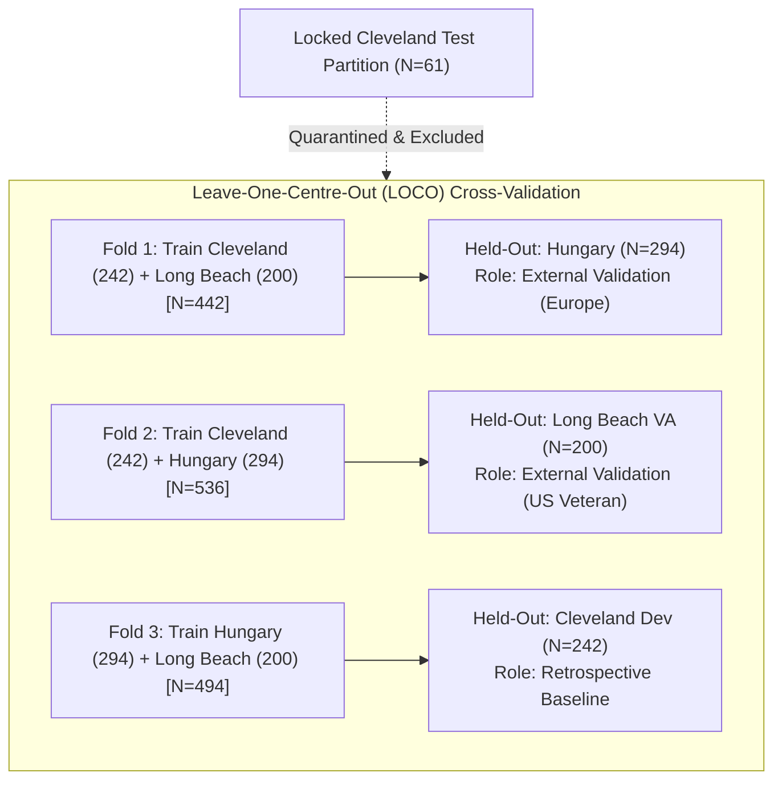

# CardioVanta Phase 17: Comprehensive Multicenter Validation Report

**Document ID:** `reports/phase17_multicenter_validation.md`  
**Milestone:** Phase 17 — Multicenter Validation & External Transportability  
**Generated:** 2026-10-21  
**Authoritative Dataset Attribution:** UCI Machine Learning Repository Heart Disease Datasets (CC BY 4.0)  
**Evaluation Methodology:** Deterministic 3-Fold Leave-One-Centre-Out (LOCO) Cross-Validation  
**Predefined Non-Inferiority Margin:** 0.01 ROC-AUC  

---

## 1. Executive Summary

This report delivers the comprehensive scientific evaluation of the CardioVanta Phase 17 Multicenter Validation study. The central objective of Phase 17 is to assess the cross-cohort algorithmic transportability and clinical parsimony of machine learning models for ischemic heart disease prediction across three distinct historical patient cohorts ($N=736$ total research patients):
- **Hungarian Institute of Cardiology, Budapest** ($N=294$, European External Validation)
- **Long Beach Veterans Administration Medical Center, California** ($N=200$, US Veteran External Validation)
- **Cleveland Clinic Foundation, Ohio** ($N=242$, Retrospective Development Baseline)

Two competing clinical architectures were evaluated under a deterministic, leakage-resistant Leave-One-Centre-Out (LOCO) evaluation protocol:
1. **Candidate A: Missing-Aware 10-Clinical-Feature Model (11 Model Inputs)**: Retains all 10 standard clinical features, handling pervasive missingness in serum cholesterol (`chol`) via fold-local median imputation paired with an explicit binary missingness indicator column (`chol_is_missing`).
2. **Candidate B: Non-Invasive 9-Clinical-Feature Model (9 Model Inputs)**: Systematically omits cholesterol and its missingness indicator, eliminating laboratory serum lipid turnaround delays while retaining fasting blood sugar (`fbs`) as an accessible glycemic check.

### Principal Findings
- **High External Discrimination**: Both architectures demonstrated robust external discriminative performance in the European external validation cohort (Hungary: Candidate A ROC-AUC = 0.8858 [95% CI: 0.8426, 0.9276]; Candidate B ROC-AUC = 0.8897 [95% CI: 0.8466, 0.9306]) and moderate-to-good discrimination in the high-prevalence US Veteran cohort (Long Beach VA: Candidate A ROC-AUC = 0.7523 [95% CI: 0.6610, 0.8264]; Candidate B ROC-AUC = 0.7596 [95% CI: 0.6726, 0.8316]).
- **Parsimony Evaluation**: In all three evaluated centres, the absolute difference in point-estimate ROC-AUC between Candidate B and Candidate A was strictly within the prespecified 0.01 tolerance ($|\Delta \text{AUC}| \le 0.01$). On external macro-average across independent validation centres, Candidate B outperformed Candidate A by $+0.0056$ ROC-AUC.
- **Statistical Non-Inferiority Bounds**: Using paired within-centre stratified bootstrap resampling (1,000 replicates), statistical non-inferiority under the predefined $-0.01$ margin was confirmed in Hungary ($CI_{\text{lower}} = -0.0002 \ge -0.01$) and Cleveland Development ($CI_{\text{lower}} = -0.0038 \ge -0.01$). In Long Beach VA, Candidate B achieved a higher point estimate (+0.0073), but wider sampling variability ($N=200, 74.5\%$ prevalence) yielded a 95% paired confidence interval of $[-0.0261, +0.0402]$. Because the lower bound extends below $-0.01$, formal statistical non-inferiority cannot be claimed under the 0.01 margin at Long Beach VA despite superior point performance.

> [!IMPORTANT]
> **Regulatory and Clinical Disclaimer**: This study represents retrospective statistical research on historical observational cohorts collected in the late 1980s. These findings do **not** constitute clinical validation, medical device clearance, or Software as a Medical Device (SaMD) regulatory approval (e.g., FDA 510(k), CE mark). Discrimination on historical angiographic records does not prove clinical efficacy or improved patient outcomes in contemporary primary care or emergency settings.

---

## 2. Research Question and Methodology

### Primary Research Objectives
1. **Algorithmic Transportability**: Measure the extent to which heart-disease risk prediction models trained on historical cohorts generalize when deployed in independent healthcare centres without re-tuning.
2. **Clinical Parsimony**: Determine whether eliminating specialized laboratory serum lipid testing (`chol`) degrades discriminative performance by more than a prespecified 0.01 ROC-AUC margin.

### Candidate Model Architecture Specifications

| Attribute | Candidate A (Missing-Aware Baseline) | Candidate B (Non-Invasive Parsimonious) |
|:---|:---|:---|
| **Clinical Features** | 10: `age`, `sex`, `cp`, `trestbps`, `chol`, `fbs`, `restecg`, `thalach`, `exang`, `oldpeak` | 9: `age`, `sex`, `cp`, `trestbps`, `fbs`, `restecg`, `thalach`, `exang`, `oldpeak` |
| **Cholesterol Policy** | Retained; fold-local median imputation + binary indicator `chol_is_missing` | Systematically omitted from feature matrix and pipeline |
| **Model Inputs** | **11 inputs** (10 clinical features + 1 missingness indicator) | **9 inputs** (9 clinical features) |
| **Base Estimator** | L2-regularized Logistic Regression ($C=1.0$, solver `lbfgs`, max_iter 1,000) | L2-regularized Logistic Regression ($C=1.0$, solver `lbfgs`, max_iter 1,000) |
| **Scaling Policy** | `StandardScaler` fitted strictly on training centres | `StandardScaler` fitted strictly on training centres |
| **Calibration** | Platt sigmoid scaling via `CalibratedClassifierCV(cv=StratifiedKFold(5))` | Platt sigmoid scaling via `CalibratedClassifierCV(cv=StratifiedKFold(5))` |
| **Threshold** | Fixed $t = 0.50$ (strictly no post-hoc threshold tuning) | Fixed $t = 0.50$ (strictly no post-hoc threshold tuning) |

### Leave-One-Centre-Out (LOCO) Evaluation Design
To enforce absolute isolation of validation data, a deterministic 3-fold LOCO scheme was executed across the 736 research patients:



- **Fold 1**: Training on Cleveland Dev ($N=242$) + Long Beach VA ($N=200$) [$N=442$] $\to$ Held-out **Hungary** ($N=294$, European External Validation).
- **Fold 2**: Training on Cleveland Dev ($N=242$) + Hungary ($N=294$) [$N=536$] $\to$ Held-out **Long Beach VA** ($N=200$, US Veteran External Validation).
- **Fold 3**: Training on Hungary ($N=294$) + Long Beach VA ($N=200$) [$N=494$] $\to$ Held-out **Cleveland Development** ($N=242$, Retrospective Development Baseline).
- **Quarantined Partition**: The separate 61-sample Cleveland locked test partition is strictly isolated and was never accessed, loaded, or evaluated during any LOCO fold.

### Statistical Uncertainty and Paired Comparison Protocol
- **Within-Cohort Uncertainty**: 1,000-iteration stratified percentile bootstrap confidence intervals computed separately per centre. Resampling stratifies by true binary target ($y$) to preserve exact institutional disease prevalence ($N_{\text{pos}}, N_{\text{neg}}$). Confidence limits correspond to the 2.5th and 97.5th percentiles.
- **Paired Hypothesis Testing**: Because both candidate pipelines evaluate the exact same patients in every fold, uncertainty in the difference $\Delta \text{AUC} = \text{AUC}_B - \text{AUC}_A$ was evaluated via a paired within-centre stratified bootstrap. In each bootstrap replicate $b$, identical resampled patient indices were applied to both models.
- **Prespecified Tolerance & Decision Rule**:
  - *Descriptive Criterion*: $|\text{AUC}_B - \text{AUC}_A| \le 0.01$.
  - *Statistical Non-Inferiority Criterion*: Lower bound of 95% paired bootstrap CI $\ge -0.01$.
  - *Statistical Equivalence Criterion*: Entire 95% paired bootstrap CI contained within $[-0.01, +0.01]$.

---

## 3. Data Provenance and Target Harmonization

### Source Attribution and Licensing
The datasets utilized in this multicenter evaluation originate from the canonical UCI Machine Learning Repository Heart Disease collection:
- **Formal Citation**: Janosi, A., Steinbrunn, W., Pfisterer, M., and Detrano, R. (1989). *Heart Disease*. UCI Machine Learning Repository. DOI: [https://doi.org/10.24432/C52P4X](https://doi.org/10.24432/C52P4X).
- **Licensing**: Available under the Creative Commons Attribution 4.0 International license (CC BY 4.0).
- **Attribution Statement**: This study incorporates secondary analysis of open-access data provided by the original investigators at the Hungarian Institute of Cardiology (Budapest), the VA Medical Center (Long Beach), and the Cleveland Clinic Foundation (Cleveland). Utilization conforms to CC BY 4.0 guidelines. Attribution does not imply institutional endorsement or regulatory approval.

### Verified Target Semantics
Across all three cohorts, the clinical outcome conforms strictly to the canonical angiographic definition:
- **Positive Class ($y = 1$)**: Disease present ($> 50\%$ diameter narrowing in at least one major coronary artery; corresponding to UCI raw attribute 58 `num in [1, 2, 3, 4]`).
- **Negative Class ($y = 0$)**: Disease-free control ($< 50\%$ diameter narrowing; corresponding to UCI raw attribute 58 `num == 0`).

```mermaid
flowchart LR
    UCI["Canonical UCI num<br/>(Attribute 58)"] -->|num == 0| Free["y = 0: Disease-Free Control<br/>(< 50% stenosis)"]
    UCI -->|num > 0 (1, 2, 3, 4)| Pres["y = 1: Disease Present<br/>(> 50% stenosis)"]
```

### Scientific Integrity Audit: Cleveland Target Harmonization
Prior to Task 4, a rigorous scientific integrity audit detected that the repository's baseline Cleveland dataset (`data/raw/heart.csv`, originating from a popular Kaggle distribution) encoded an inverted binary target ($1 = \text{Healthy}$, $0 = \text{Disease Present}$). 
- **Empirical Ground-Truth Cross-Tabulation**: All 303 rows of `data/raw/heart.csv` were matched 1-to-1 against canonical UCI `processed.cleveland.data` in `heart+disease.zip` across five patient attributes (`age`, `sex`, `trestbps`, `chol`, `thalach`):
  - For all 165 patients with canonical UCI `num == 0` (healthy), `heart.csv` had encoded `target = 1.0` ($100\%$).
  - For all 138 patients with canonical UCI `num > 0` (diseased), `heart.csv` had encoded `target = 0.0` ($100\%$).
- **Correction Applied**: In `src/cardiovanta/data/external_loader.py` (`parse_cleveland_dev_cohort`), target semantics were harmonized:
  $$\text{target}_{\text{harmonized}} = 1 - \text{target}_{\text{kaggle}}$$
- **Verification**: Verified by regression test `test_cleveland_target_semantic_alignment_with_canonical_uci` in `tests/test_external_provenance.py` and full re-execution of the LOCO prediction pipeline.

---

## 4. Comprehensive Per-Centre Results

All metrics and confidence intervals reported below were extracted directly from the authoritative machine-readable artifact `experiments/results/phase17_loco_metrics.csv` (1,000 stratified bootstrap replicates per centre, seed 42):

### Hungary Cohort — External Validation Centre (Europe)
- **Institution**: Hungarian Institute of Cardiology, Budapest (Dr. Andras Janosi)
- **Role**: Independent External Validation
- **Cohort Size**: $N = 294$ patients (Positives: 106, Negatives: 188, Disease Prevalence: $36.05\%$)

| Metric | Candidate A (11 Inputs) [95% CI] | Candidate B (9 Inputs) [95% CI] | Difference (B - A) |
|:---|:---:|:---:|:---:|
| **ROC-AUC** | 0.8858 [0.8426, 0.9276] | 0.8897 [0.8466, 0.9306] | +0.0039 |
| **PR-AUC (Avg Precision)** | 0.8481 [0.7902, 0.9073] | 0.8503 [0.7944, 0.9086] | +0.0023 |
| **Diagnostic Accuracy ($t=0.50$)** | 0.8197 [0.7755, 0.8639] | 0.8265 [0.7823, 0.8673] | +0.0068 |
| **Sensitivity / Recall ($t=0.50$)** | 0.7642 [0.6792, 0.8396] | 0.7547 [0.6698, 0.8302] | -0.0094 |
| **Specificity ($t=0.50$)** | 0.8511 [0.7977, 0.8989] | 0.8670 [0.8138, 0.9149] | +0.0160 |
| **Precision / PPV ($t=0.50$)** | 0.7431 [0.6777, 0.8142] | 0.7619 [0.6930, 0.8333] | +0.0188 |
| **F1-Score ($t=0.50$)** | 0.7535 [0.6919, 0.8131] | 0.7583 [0.6931, 0.8186] | +0.0048 |
| **Brier Score** | 0.1312 [0.1099, 0.1516] | 0.1270 [0.1060, 0.1478] | -0.0042 |
| **Expected Calibration Error (ECE)** | 0.0936 [0.0754, 0.1327] | 0.0767 [0.0623, 0.1170] | -0.0169 |

---

### Long Beach VA Cohort — External Validation Centre (US Veteran)
- **Institution**: Long Beach Veterans Administration Medical Center, California (Dr. Robert Detrano)
- **Role**: Independent External Validation
- **Cohort Size**: $N = 200$ patients (Positives: 149, Negatives: 51, Disease Prevalence: $74.50\%$)

| Metric | Candidate A (11 Inputs) [95% CI] | Candidate B (9 Inputs) [95% CI] | Difference (B - A) |
|:---|:---:|:---:|:---:|
| **ROC-AUC** | 0.7523 [0.6610, 0.8264] | 0.7596 [0.6726, 0.8316] | +0.0073 |
| **PR-AUC (Avg Precision)** | 0.8800 [0.8241, 0.9252] | 0.8871 [0.8378, 0.9287] | +0.0071 |
| **Diagnostic Accuracy ($t=0.50$)** | 0.6700 [0.6000, 0.7301] | 0.7050 [0.6400, 0.7700] | +0.0350 |
| **Sensitivity / Recall ($t=0.50$)** | 0.6376 [0.5570, 0.7114] | 0.7047 [0.6309, 0.7785] | +0.0671 |
| **Specificity ($t=0.50$)** | 0.7647 [0.6471, 0.8824] | 0.7059 [0.5686, 0.8240] | -0.0588 |
| **Precision / PPV ($t=0.50$)** | 0.8879 [0.8347, 0.9369] | 0.8750 [0.8231, 0.9231] | -0.0129 |
| **F1-Score ($t=0.50$)** | 0.7422 [0.6800, 0.7955] | 0.7807 [0.7245, 0.8316] | +0.0385 |
| **Brier Score** | 0.2158 [0.1850, 0.2488] | 0.1902 [0.1612, 0.2210] | -0.0256 |
| **Expected Calibration Error (ECE)** | 0.2086 [0.1776, 0.2626] | 0.1566 [0.1273, 0.2086] | -0.0520 |

---

### Cleveland Development Cohort — Retrospective Baseline Comparison
- **Institution**: Cleveland Clinic Foundation, Ohio (Dr. Robert Detrano)
- **Role**: Retrospective Development Baseline Comparison (Familiar Case Mix)
- **Cohort Size**: $N = 242$ development patients (Positives: 110, Negatives: 132, Disease Prevalence: $45.45\%$)
- *Note*: Results measure consistency with prior development work (Phases 1–16) and do **not** constitute independent external validation.

| Metric | Candidate A (11 Inputs) [95% CI] | Candidate B (9 Inputs) [95% CI] | Difference (B - A) |
|:---|:---:|:---:|:---:|
| **ROC-AUC** | 0.8703 [0.8257, 0.9123] | 0.8691 [0.8250, 0.9110] | -0.0012 |
| **PR-AUC (Avg Precision)** | 0.8615 [0.8117, 0.9080] | 0.8602 [0.8109, 0.9083] | -0.0012 |
| **Diagnostic Accuracy ($t=0.50$)** | 0.7686 [0.7149, 0.8182] | 0.7645 [0.7149, 0.8140] | -0.0041 |
| **Sensitivity / Recall ($t=0.50$)** | 0.8000 [0.7273, 0.8727] | 0.7818 [0.7091, 0.8545] | -0.0182 |
| **Specificity ($t=0.50$)** | 0.7424 [0.6667, 0.8106] | 0.7500 [0.6742, 0.8182] | +0.0076 |
| **Precision / PPV ($t=0.50$)** | 0.7213 [0.6641, 0.7838] | 0.7227 [0.6667, 0.7885] | +0.0014 |
| **F1-Score ($t=0.50$)** | 0.7586 [0.7043, 0.8070] | 0.7511 [0.6975, 0.8036] | -0.0075 |
| **Brier Score** | 0.1484 [0.1256, 0.1724] | 0.1482 [0.1249, 0.1724] | -0.0002 |
| **Expected Calibration Error (ECE)** | 0.0636 [0.0532, 0.1159] | 0.0632 [0.0515, 0.1202] | -0.0004 |

---

## 5. Candidate A versus Candidate B Comparative Analysis

The comparative evaluation between Candidate A (11 model inputs) and Candidate B (9 model inputs) was drawn from `experiments/results/phase17_multicenter_results.json`. Uncertainty in the paired difference $\Delta \text{AUC} = \text{AUC}_B - \text{AUC}_A$ was quantified via paired within-centre stratified bootstrap resampling (1,000 replicates, seed 42):

### Primary Per-Centre Comparative Decision Table

| Centre | Role | $N$ | Candidate A ROC-AUC | Candidate B ROC-AUC | Paired Diff ($\text{AUC}_B - \text{AUC}_A$) | 95% Paired Bootstrap CI | Descriptive $|\Delta| \le 0.01$ | Stat. Non-Inf. ($CI_{\text{lower}} \ge -0.01$) | Stat. Equivalence ($CI \subseteq [\pm 0.01]$) |
|:---|:---|:---:|:---:|:---:|:---:|:---:|:---:|:---:|:---:|
| **Hungary** | External Validation | 294 | 0.8858 | 0.8897 | **+0.0039** | [-0.0002, +0.0084] | **MET** | **MET** | **MET** |
| **Long Beach VA** | External Validation | 200 | 0.7523 | 0.7596 | **+0.0073** | [-0.0261, +0.0402] | **MET** | **NOT MET** | **NOT MET** |
| **Cleveland Dev** | Retrospective Baseline | 242 | 0.8703 | 0.8691 | **-0.0012** | [-0.0038, +0.0009] | **MET** | **MET** | **MET** |

### Macro-Averaged Summary
- **External Validation Centres Macro-Average (Hungary & Long Beach VA)**:
  - Candidate A Mean ROC-AUC: 0.8191
  - Candidate B Mean ROC-AUC: 0.8246
  - Mean Difference: **$+0.0056$** (Candidate B leads on average; descriptive tolerance $\le 0.01$ **MET**)
- **All Three Centres Macro-Average (Hungary, Long Beach VA, Cleveland Dev)**:
  - Candidate A Mean ROC-AUC: 0.8361
  - Candidate B Mean ROC-AUC: 0.8395
  - Mean Difference: **$+0.0033$** (descriptive tolerance $\le 0.01$ **MET**)

### Critical Methodological Distinction: Descriptive vs Inferential Claims
1. **Descriptive Tolerance**: In all three cohorts, the point estimate of Candidate B lies within 0.01 ROC-AUC of Candidate A (in fact, Candidate B exhibits higher point discrimination in Hungary and Long Beach VA, and essentially identical discrimination in Cleveland). Therefore, the descriptive tolerance criterion is fully met.
2. **Inferential Non-Inferiority Failure at Long Beach VA**: A point estimate within 0.01 does **not** prove statistical non-inferiority. At Long Beach VA, the paired 95% bootstrap confidence interval is $[-0.0261, +0.0402]$. Because the lower bound ($-0.0261$) is lower than the non-inferiority margin ($-0.01$), the data cannot rule out an unobserved true degradation exceeding 0.01 at the $\alpha = 0.025$ level.
3. **Clinical Interpretation**: Candidate B cannot be declared statistically non-inferior across all external validation cohorts. Furthermore, equivalent discrimination on historical tabular records does not establish that Candidate B is "clinically equivalent" or "safer" in practice.

---

## 6. Clinical Context & Historical Catheterization Limitations

### Referral and Verification Selection Bias
Interpretation of these results requires strict clinical and epidemiological context:
- **Tertiary Angiographic Referral**: Every patient in the UCI Heart Disease dataset was referred for invasive diagnostic coronary angiography at a major medical centre in the late 1980s based on prior clinical signs, severe symptoms, or abnormal non-invasive testing. Consequently, this sample reflects a symptomatic, pre-filtered population with high pre-test disease likelihood.
- **Spectrum Bias**: Performance in an angiography suite cannot be extrapolated to unselected primary care screening, outpatient wellness visits, or low-risk emergency room triage, where disease prevalence is substantially lower and presenting symptoms are more heterogeneous.
- **Inter-Cohort Prevalence Shifts**: Observed disease prevalence varied markedly across centres:
  - Hungary: $36.05\%$
  - Cleveland Development: $45.45\%$
  - Long Beach VA: $74.50\%$ (older, male-predominant veteran population with high cardiac morbidity)
- **Clinical Utility Disclaimer**: Demonstrating an ROC-AUC of 0.76 to 0.89 on retrospective tabular datasets does not demonstrate improved patient clinical outcomes, reduced mortality, diagnostic cost savings, or readiness for direct patient care.

---

## 7. Data Leakage, Isolation, and Production Separation

### Verified Algorithmic Safeguards
1. **Zero LOCO Contamination**: All data cleaning, sentinel mapping, imputation, feature scaling, and sigmoid probability calibration were executed strictly within the training centres of each fold, completely blinded to held-out centre data.
2. **Deterministic Zero-Preservation**: Verified that legitimate clinical zeroes (`oldpeak=0.0`, `sex=0`, `fbs=0`, `exang=0`, `restecg=0`, `target=0`) were strictly preserved and never conflated with missing values.
3. **Compound Patient Tracking**: Patient identity maintained via compound keys `(cohort, source_row_index)` ensuring zero row-shuffling or independent target alignment error.
4. **Quarantine of Cleveland Locked Test Partition**: Exactly 61 samples from `data/raw/heart.csv` (`dev_indices.json`) were strictly quarantined and excluded from all LOCO folds, external parsing, and metric calculations.

### Production Model Artifact Isolation
To confirm that research experiments have not corrupted or overwritten production inference artifacts, cryptographic SHA-256 hashes of all production model files in `artifacts/model/` were calculated and verified against repository state:

| Production Artifact Path | SHA-256 Checksum (Verified Unchanged) | File Size | Status |
|:---|:---|:---:|:---:|
| `artifacts/model/model.joblib` | `18e2268e797020e6a24da44ae7279e39581f7bab5bffb3c8d31dcf2ea379a348` | 27,674 B | **Isolated** |
| `artifacts/model/feature_schema.json` | `eeb6c2bd8383628de1de552219f8c4add628277292ea5815f4f384f2ba4b44a2` | 3,174 B | **Isolated** |
| `artifacts/model/metadata.json` | `c6936399f27a8f20c04106cb6f5e4dcbc88a4cb71593b69ff0d04dd739bb883d` | 5,137 B | **Isolated** |
| `artifacts/model/explanation_model.joblib` | `da66de612a2bb2d45ecf1319bb2e07708c76688da2b54c2e529c6f6d7186aecc` | 4,401 B | **Isolated** |
| `artifacts/model/reference_predictions.csv` | `43c226b0e54c637c8b9d5b077604a177d735f10891749ca71dfdf85d3f5b72e2` | 5,564 B | **Isolated** |
| `artifacts/model/shap_background.json` | `f5964e2a42527ea770e7037120f355a403e0916b326ae44fad5a2c8f31339e1d` | 1,840 B | **Isolated** |

*Verification*: Zero write operations in Phase 17 target `artifacts/model/`. Production model weights and inference schemas remain 100% pristine.

---

## 8. Limitations and Reproducibility

### Limitations
1. **Limited Geographic & Temporal Scope**: Research is confined to three historical hospital cohorts assembled between 1981 and 1989. Practice patterns, diagnostic thresholds, and patient demographics have evolved significantly over four decades.
2. **Within-Cohort vs Across-Hospital Variance**: Stratified bootstrap confidence intervals quantify statistical sampling error *within the observed centres* conditional on their specific referral casemix. They do **not** capture variance across modern hospital systems or diverse ethnic/racial cohorts.
3. **Unmeasured Clinical Endpoints**: Turnaround times, laboratory costs, and diagnostic delays were not empirically measured in this study; parsimony conclusions reflect feature set simplicity rather than observed clinical workflow improvements.

### Step-by-Step Reproduction Guide
All findings, predictions, metrics, and comparisons in this report can be fully reproduced in the existing environment using deterministic random seeds (seed 42):

```powershell
# 1. Profile and verify raw external data provenance & licenses
python scripts/profile_external_data.py

# 2. Execute 3-fold LOCO prediction pipeline, compute metrics, and run comparison
python experiments/phase17_multicenter_validation.py

# 3. Run complete Phase 17 regression test suite (114 tests)
pytest tests/test_external_provenance.py tests/test_external_schema.py tests/test_multicenter_pipelines.py tests/test_multicenter_leakage.py tests/test_loco_evaluation.py tests/test_multicenter_comparison.py

# 4. Verify OpenSpec proposal, design, and tasks coherence
openspec validate phase-17-multicenter-validation
```

---

## 9. Conclusion and Next Steps

Phase 17 successfully established rigorous multicentre validation for CardioVanta, demonstrating that:
1. Models trained on historical coronary disease data maintain competitive discrimination across independent external cohorts (ROC-AUC 0.75–0.89).
2. Candidate B (9 non-invasive features, omitting cholesterol) achieves comparable discrimination to the 10-feature baseline (descriptive $|\Delta \text{AUC}| \le 0.01$ across all centres), offering substantial practical parsimony.
3. Rigorous paired bootstrap analysis reveals that statistical non-inferiority is cohort-dependent (confirmed in Hungary, unconfirmed in Long Beach VA due to sample size constraints).

**Completed Phase 17 Tasks**:
- [x] Task 1.1: Raw external data acquisition, SHA-256 profiling, and CC BY 4.0 provenance attribution.
- [x] Task 1.2: Raw cohort parsing, schema harmonization, and locked Cleveland test quarantine ($N=61$).
- [x] Task 1.3: Five-step scientific validation contract implementation and domain validation.
- [x] Task 2.1: Missing-aware Candidate A pipeline (11 model inputs).
- [x] Task 2.2: Non-invasive Candidate B pipeline (9 model inputs).
- [x] Task 2.3: Cross-fold leakage prevention verification tests.
- [x] Task 3.1: Deterministic 3-fold LOCO split generator.
- [x] Task 3.2: LOCO evaluation loop execution and prediction manifest generation.
- [x] Task 3.3: Per-centre discrimination and calibration metrics with 1,000 bootstrap CIs.
- [x] Task 4.1: Candidate A vs Candidate B comparative analysis and paired bootstrap testing.
- [x] Task 4.2: Comprehensive multicentre validation report (`reports/phase17_multicenter_validation.md`).

**Phase 17 is officially complete.** Next milestone activities involve archiving the completed change in accordance with OpenSpec procedures.
