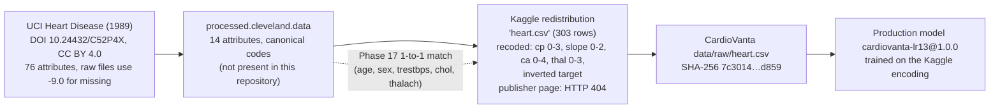

# R6 Report: Clinical Feature Codebook Resolution — `slope`, `thal`, `ca = 4`, `thal = 0`

| Field | Value |
|---|---|
| Status | Provenance research only. Contract, production artifacts, registry, API and frontend unchanged |
| Date | 2026-10-31 |
| Change | `openspec/changes/r6-feature-codebook-resolution/` |
| Evidence builder | `experiments/r6_codebook_evidence.py` (deterministic; reads documentation and project records only) |
| Evidence record | `experiments/results/r6_codebook_evidence.json` (SHA-256 `ed4c17b1…`) |
| Tests | `tests/test_r6_codebook_resolution.py` (22 tests) |
| **Outcome** | **No mapping could be verified. All four items keep their unresolved status. No clinical meaning is assigned** |

> CardioVanta is a research application and is not clinically validated.

## Contents
1. [Summary](#1-summary)
2. [Evidence standard](#2-evidence-standard)
3. [Provenance chain](#3-provenance-chain)
4. [Source codes versus production codes](#4-source-codes-versus-production-codes)
5. [Per-code evidence and status](#5-per-code-evidence-and-status)
6. [Why verification is not possible within the constraints](#6-why-verification-is-not-possible-within-the-constraints)
7. [Discrepancies and hygiene findings](#7-discrepancies-and-hygiene-findings)
8. [Recommended resolution paths](#8-recommended-resolution-paths)
9. [Verification of this work](#9-verification-of-this-work)

## 1. Summary

| Item | Production codes | Canonical UCI codes | Status (unchanged) | Confidence |
|---|---|---|---|---|
| `slope` | 0, 1, 2 | 1 upsloping · 2 flat · 3 downsloping | `unverified` | Unresolved: correspondence unknown |
| `thal` | 1, 2, 3 | 3 normal · 6 fixed defect · 7 reversable defect | `unverified` | Unresolved: correspondence unknown |
| `thal = 0` | 0 | no canonical code 0 | `undefined_in_codebook` | Unresolved: valid category, missing-value sentinel or undocumented encoding cannot be determined |
| `ca = 4` | 4 | `ca` is defined as 0–3 | `undefined_in_codebook` | Unresolved: as for `thal = 0` |
| `ca` 0–3 (context) | 0–3 | vessel count 0–3 | `codebook_and_project_contract` | Supported by the codebook. Not patient-matched |

The R1 contract's statuses were already correct. R6 adds:
- an evidence record for every code;
- a clear separation of canonical source codes from transformed production codes;
- a documented explanation of why the unresolved items cannot currently be resolved;
- concrete paths to resolution.

## 2. Evidence standard

| Level | Evidence | Verifies a mapping? |
|---|---|---|
| **E1** | Patient-level 1-to-1 matching between the training encoding and canonical UCI records | **Yes** |
| **E2** | A primary-source statement of the transformation (UCI, or the dataset publisher) | **Yes** |
| E3 | A canonical codebook definition only | No: it defines the source codes, not the mapping |
| E4 | Secondary claims, frequency similarity, model coefficients or feature importance | No: recorded as labelled hypotheses only |

As required, no meaning was inferred from coefficients, feature importance or distributions.

## 3. Provenance chain

| Link | Evidence | Status |
|---|---|---|
| UCI → canonical codes | `data/external/raw/heart-disease.names`; UCI dataset page (loaded 2026-10-31), which states the same codes word for word | Documented (E3) |
| Canonical → Kaggle, `cp` | Phase 17 patient match, recorded in `src/cardiovanta/data/validation.py` (`KAGGLE_CP_TO_CANONICAL = {0:4, 1:2, 2:3, 3:1}`) | **Verified (E1)** |
| Canonical → Kaggle, `target` | Phase 17 patient match (`reports/phase17_multicenter_validation.md` §3): Kaggle `target = 1 − [num > 0]` | **Verified (E1)** |
| Canonical → Kaggle, `slope`, `thal`, `ca` | Phase 17 matched the same rows but **recorded no cross-tabulation** for these features | **Not documented** |
| Kaggle publisher documentation | `kaggle.com/datasets/ronitf/heart-disease-uci` returned **HTTP 404** (2026-10-31). Project records give no URL, version or recoding notes | **Unavailable** |
| Missing-value encoding in the processed file | The codebook gives −9.0 for the raw files. The UCI page says the dataset "has missing values" but not which variables or how they are encoded | Not documented for the processed file |

## 4. Source codes versus production codes

The production model (`cardiovanta-lr13@1.0.0`) consumes the **Kaggle (training) encoding**, never canonical UCI codes.

| Feature | Canonical UCI source codes | Production / training codes | Mapping |
|---|---|---|---|
| `cp` | 1, 2, 3, 4 | 0, 1, 2, 3 | Verified (E1): 0→4, 1→2, 2→3, 3→1. A naive "+1" would invert typical and asymptomatic |
| `slope` | 1, 2, 3 | 0, 1, 2 | **Unknown.** The `cp` precedent shows a shift cannot be assumed |
| `thal` | 3, 6, 7 | 0, 1, 2, 3 | **Unknown.** Four production codes versus three canonical codes |
| `ca` | 0, 1, 2, 3 | 0, 1, 2, 3, 4 | Codes 0–3 are counts (codebook-supported). **Code 4 has no canonical counterpart** |
| `restecg` | 0, 1, 2 | 0, 1, 2 | Codebook and project contract (same codes) |

## 5. Per-code evidence and status

| Code | Evidence considered (levels) | Labelled hypothesis (not evidence) | Resolved status |
|---|---|---|---|
| `slope` 0, 1, 2 | Codebook (E3); UCI page (E3); Phase 17 match exists but no slope mapping recorded; Kaggle page 404 | 0–2 may be a shift or a reordering of 1–3 | `unverified` (unchanged) |
| `thal` 1, 2, 3 | As above | 0–3 is a recoding of {3, 6, 7}; the order is undocumented | `unverified` (unchanged) |
| `thal = 0` | As above; the codebook has no `thal` code 0 | Secondary sources often describe Kaggle `thal = 0` as a recoded missing value. Not documented in any project record or in the UCI text retrieved | `undefined_in_codebook` (unchanged) |
| `ca = 4` | As above; the codebook defines `ca` as 0–3 | Secondary sources often describe Kaggle `ca = 4` as a recoded missing value. Not documented | `undefined_in_codebook` (unchanged) |

Whether `ca = 4` and `thal = 0` are valid categories, missing-value sentinels or undocumented encodings **cannot be established** from the available evidence. The missing-sentinel interpretation is plausible but rests only on E4 sources, so it is recorded as a hypothesis and does not change the status.

## 6. Why verification is not possible within the constraints

1. **No primary-source transformation statement exists** (E2). UCI documents only canonical codes, and the Kaggle publisher page is unavailable.
2. **Patient-level matching (E1) needs the canonical Cleveland file.** That file (`processed.cleveland.data`) is not in the repository. The Phase 17 loader downloads it at runtime.
3. **The canonical file includes the locked patients.** It holds canonical records for **all 303** Cleveland patients, including the 61 locked observations. Matching even only the 242 development rows requires parsing the whole file, which would expose the locked patients' records. R6 forbids that.
4. **Phase 17 recorded only `cp` and `target`.** It performed a full match, but recorded no `slope`, `thal` or `ca` results. Reconstructing them would repeat the forbidden access.

## 7. Discrepancies and hygiene findings

| Finding | Detail | Action |
|---|---|---|
| Cleveland healthy count | The codebook class distribution gives `Cleveland: 164 55 36 35 13 303`, so num = 0 for **164** patients. Phase 17 reports **165** with num = 0 and 138 with num > 0 | Recorded as unresolved. Not investigated, because that would need Cleveland patient rows. The total of 303 agrees |
| Raw row in a report | `reports/cardio_vanta_master_audit.md` reproduces a raw `heart.csv` row (including `ca = 4`) | Not used as evidence; its partition was not checked. Recommend redacting raw rows from reports |
| Kaggle provenance | No URL, version or download date of `heart.csv` is recorded in the project, and the commonly cited source page is gone | Recommend recording dataset provenance at acquisition |

## 8. Recommended resolution paths

Each needs a decision from you.

| Option | What it resolves | Requirement |
|---|---|---|
| **A. Development-only patient match** (recommended if authorised) | `slope`, `thal`, `ca = 4`, `thal = 0` at E1, including whether codes 4 and 0 align with canonical missing values | Explicit authorisation, because the canonical file contains the locked patients' records. A pre-registered protocol restricted to the 242 development rows, reporting only aggregate cross-tabulations |
| B. Archived publisher documentation | Possibly E2 | A web-archive copy of the original Kaggle dataset card, if one exists and states the recoding |
| C. Accept as unresolved | Nothing | Keep the current statuses. Any model v2 should avoid depending on `slope` and `thal` codes, or treat `ca = 4` and `thal = 0` as explicit unknown categories, until resolved |

R5 showed that the production model relies materially on `thal`: perturbations move P(disease) by up to 0.30. So option A or B should precede any model v2 that keeps these inputs.

## 9. Verification of this work

| Check | Result |
|---|---|
| Builder determinism | Two runs byte-identical (`ed4c17b1…`) |
| Data access | 0 dataset rows read. The builder opens only the codebook text, the contract, a source module, two reports and the profiling summary. Enforced by test |
| Contract | Unchanged (SHA-256 `50249533…`). Bundled hash = generated hash = registry metadata hash |
| Evidence/contract consistency | Every code's resolved status equals its contract status. No status upgraded without E1/E2 evidence |
| Artifact integrity | `scripts/verify_artifact_integrity.py` passes. No changes under `artifacts/`, `cardiovanta_ml/`, `backend/`, `src/`, `api/`, `data/` or `vercel.json` |
| Tests | 22/22 pass |
